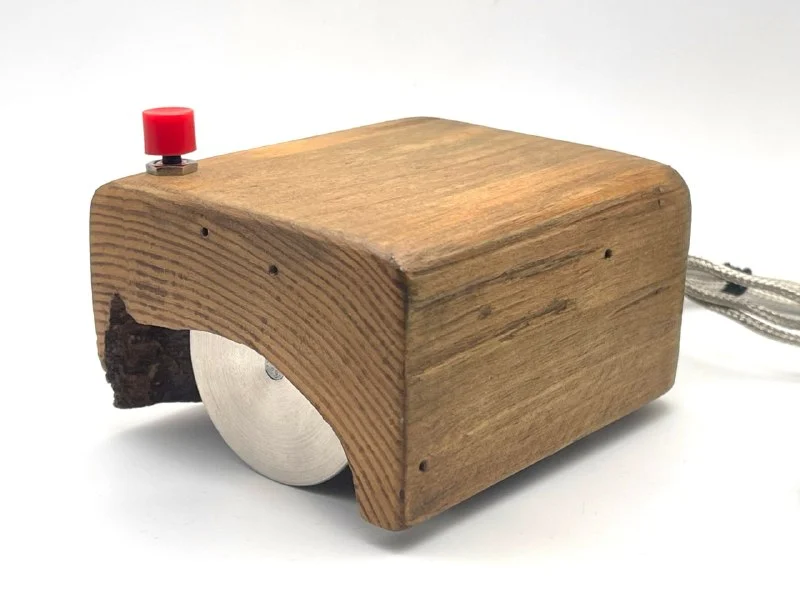
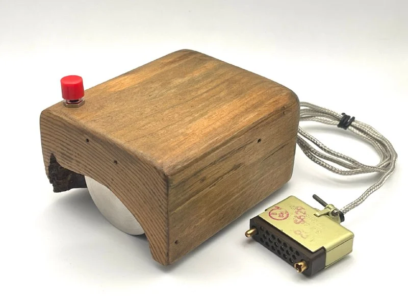
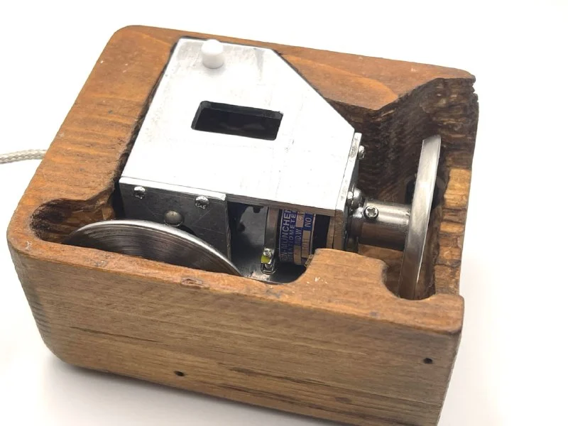
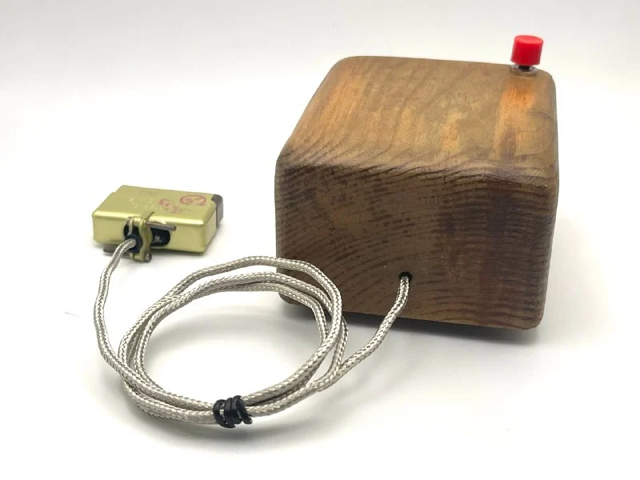

Обычно историю появления компьютерной мыши рассказывают примерно так: Дуглас Энгельбарт придумал мышь, в 1968 году показал её на [Mother of All Demos](https://en.wikipedia.org/wiki/The_Mother_of_All_Demos), а потом весь мир стал пользоваться мышками.

В реальности все было чуть сложнее и интереснее.   
В начале 1960-х компьютер ещё не был персональным устройством на столе. Для большинства людей работа с вычислительной машиной означала перфокарты, пакетную обработку, операторов, машинное время и очень длинную обратную связь: ты готовишь задание, отдаёшь его машине, ждёшь результата и потом ищешь ошибку. Энгельбарт в Stanford Research Institute занимался почти противоположной идеей: компьютер должен быть не калькулятором за стеной, а интерактивной средой для усиления человеческого мышления.

Эта среда называлась NLS, oN-Line System. Слово online тогда означало не интернет в современном смысле, а работу человека с компьютером в реальном времени, через экран, команды и мгновенную обратную связь. NLS была целой рабочей системой для текстов, ссылок, структурированных документов, совместной работы, команд, экранного редактирования, видеосвязи и навигации по информации - прообразом современных операционных систем, где человеку нужно быстро указывать на объекты на экране, выбирать фрагменты текста, перемещаться по структурам и управлять сложными объектами.

Когда такая задача появилась, никто заранее не знал, какое устройство окажется лучшим. В лаборатории пробовали разные способы взаимодействия человека с экраном: световое перо, джойстик, Grafacon(дед планшетов), устройства для управления коленом, варианты с движением головы или носа и другие экспериментальные манипуляторы.

Саму первую мышь физически сделал не Энгельбарт, а инженер Билл Инглиш. Энгельбарт придумал принцип и поставил задачу, а Инглиш построил устройство, участвовал в инженерной проработке и стал одним из первых людей, кто реально пользовался мышью. В музейных записях Computer History Museum оригинальный деревянный прототип прямо атрибутирован так: Douglas Engelbart как создатель, Bill English как человек, который его построил.

Первая мышь работала на двух колёсах, установленных под прямым углом друг к другу. Одно колесо отвечало за движение по оси X, другое - за движение по оси Y. Каждое колесо было посажено на вал потенциометра, а весь механизм был закрыт в деревянный корпус размером примерно 2 × 3 × 4 дюйма, то есть около 5 × 7,6 × 10 сантиметров. В Computer History Museum эти колёса описывают как knife-edge wheels, то есть колёса с тонкой кромкой: одно катилось при движении в своём направлении и скользило при движении поперёк, второе делало то же самое для другой оси.

В патенте Энгельбарта слово mouse вообще не используется: юридически устройство называлось X-Y Position Indicator for a Display System.

К 1968 году мышь уже эволюционировала. На Mother of All Demos Энгельбарт показывал не этот самый ранний однокнопочный деревянный прототип, а более зрелую рабочую версию для NLS: трёхкнопочную мышь вместе с обычной клавиатурой, пятиклавишным аккордным кейсетом и экранной системой.

Помимо оригинала и "почти оригинальной" реплики, тоже созданной Инглишем, мне удалось найти информацию еще о трех репликах в США и Европе.

Самое сложное в реплике - найти оригинальные компоненты, или хотя бы приближенные к оригинальным. В нашем случае это потенциометры, кнопка, разъем и кабель. На поиск этого всего по всему миру у меня ушло около полугода. Поэтому реплика собирается как расследование: патентные схемы, фотографии нижней стороны, музейные размеры, технические статьи, сравнение ранних и поздних версий, поиск компонентов той же эпохи и постоянная проверка, где заканчивается факт и начинается реконструкция.

Ну и конечно получилось найти человека, который скрупулезно воссоздал точную копию конструкции и внешнего вида.   
Спасибо, [Дима](https://t.me/DV_Workrshop)!

Эту и другие мыши скоро можно будет посмотреть живьем в Москве, детали чуть позже. Stay tuned!

