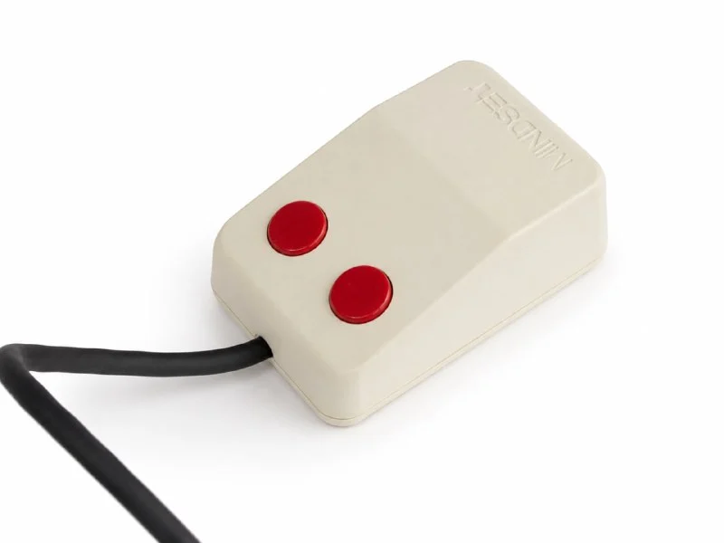
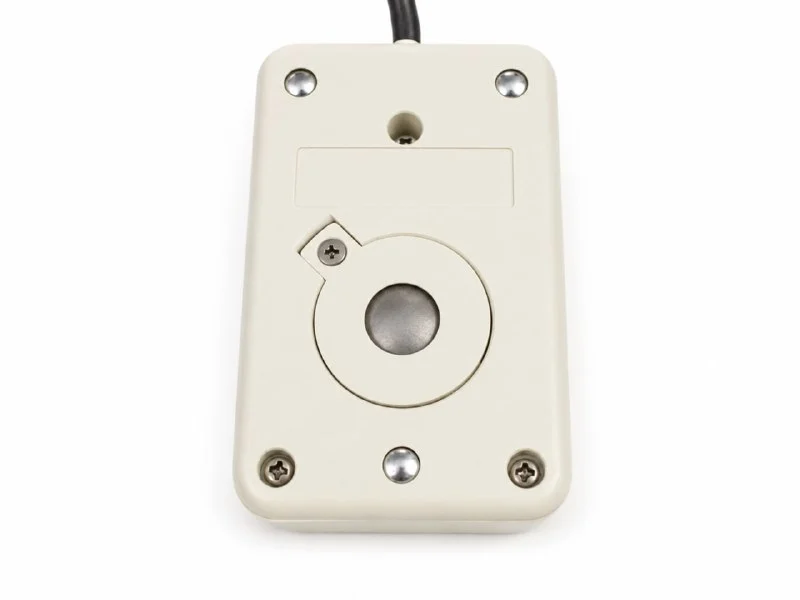
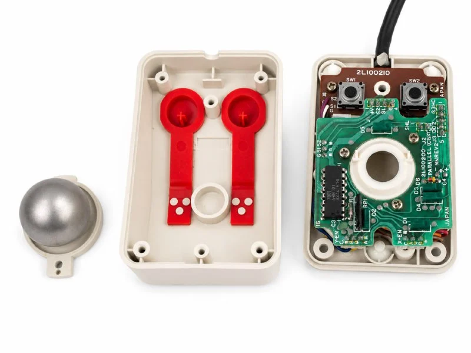
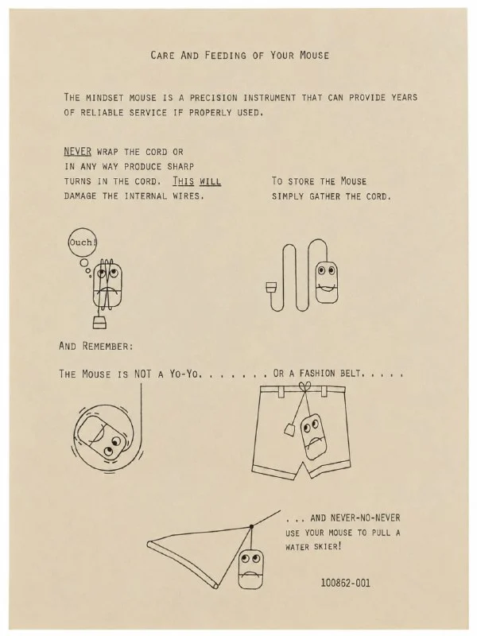

В 1984 году на рынке появился Mindset Personal Computer — компьютер, который очень не хотел быть ещё одним скучным клоном IBM PC.

Формально это была DOS-машина на Intel 80186, частично совместимая с IBM PC. Но её главной особенностью стала собственная графическая подсистема: отдельный графический сопроцессор мог аппаратно выполнять типичные операции вроде рисования линий, заливки областей и переноса блоков изображения. Mindset задумывался как компьютер для насыщенной деловой графики, работы с изображениями, анимации и наступавшей эпохи оконных интерфейсов. Компания даже была среди производителей, заранее заявивших поддержку Microsoft Windows — правда, сама Windows 1.0 добралась до покупателей только в конце 1985 года, когда история Mindset уже практически закончилась.

Амбициям соответствовал и внешний вид. Дизайн системы создал молодой Роберт Бруннер, впоследствии возглавивший промышленный дизайн Apple. Корпуса Mindset выглядели скорее как предметы из дизайнерского бюро, чем как обычная компьютерная техника начала восьмидесятых: строгие геометрические формы, светлый пластик, чёрные поверхности и ярко-красные акценты. Компьютер даже попал в коллекцию нью-йоркского [Museum of Modern Art](https://www.moma.org/collection/works/2209).

Мышь была выполнена в том же стиле: небольшой клиновидный корпус и две круглые красные кнопки. Однако внутри никакой специальной американской магии не обнаружилось. Настоящим производителем мыши была японская ALPS, которая использовала свою платформу первого поколения — стальной шар, массивные ролики и два закрытых контактных механических энкодера.

По строению Mindset Mouse очень близка к [Sharp MZ-1X10](https://collectionerus.ru/collections/old-mice/204/), первой мыши Microsoft, знаменитой [Green-eyed Mouse](https://collectionerus.ru/collections/old-mice/3/) и других мышей этой же серии. Alps поступила вполне рационально: взяла уже отработанный механизм, изменила печатную плату и интерфейс, а всё это разместила в совершенно новом корпусе, подходящем к дизайну Mindset. На плате можно увидеть фирменную фишку Alps — подписанные иероглифами цвета проводов.

Подключалась мышь не к системному блоку, а к одному из двух разъёмов по бокам клавиатуры. Это не обычная серийная PC-мышь: она передавала непосредственно сигналы двух квадратурных энкодеров и кнопок, которые считывал контроллер клавиатуры Mindset. Поэтому стандартную последовательную мышь туда просто не воткнуть, а Mindset Mouse нельзя напрямую подключить к обычному PC.

Но самое прекрасное здесь — инструкция под названием Care and Feeding of Your Mouse, то есть буквально «Уход и кормление вашей мыши».  
Иллюстратор превратил реальную Mindset Mouse в маленького персонажа. Клиновидный корпус стал мордочкой, две красные кнопки — глазами, а нижний шов корпуса — ртом. В результате на картинках мышь пугается, грустит и явно страдает от человеческой изобретательности.

