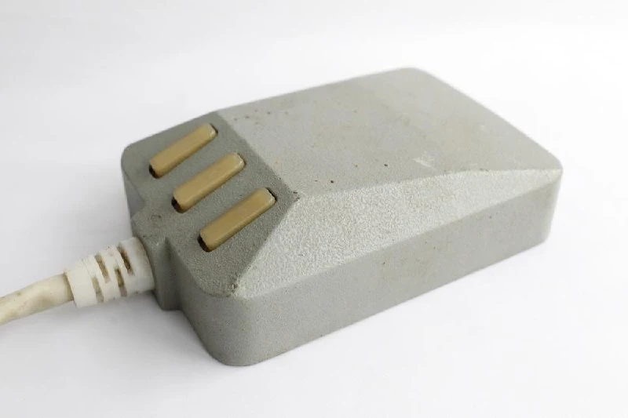
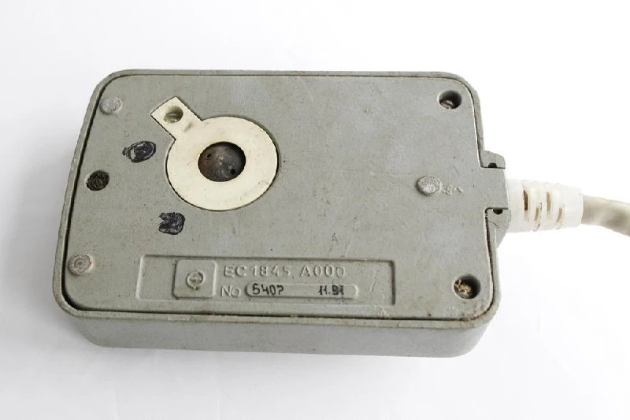
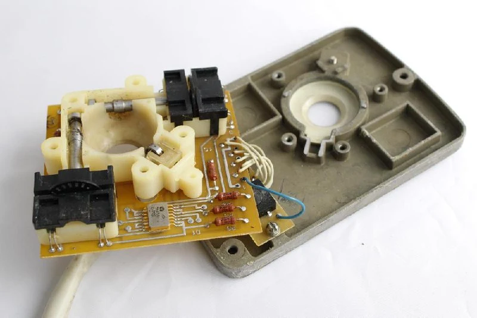
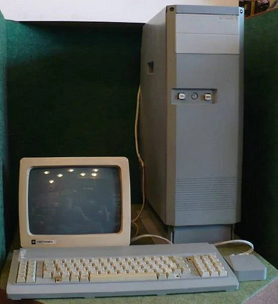

The toughest Soviet mouse, made entirely of metal, for the [ES 1845 workstation](https://collectionerus.ru/collections/old-mice/103/). The computer was designed to prevent information leakage through various kinds of emissions.

#mouse

