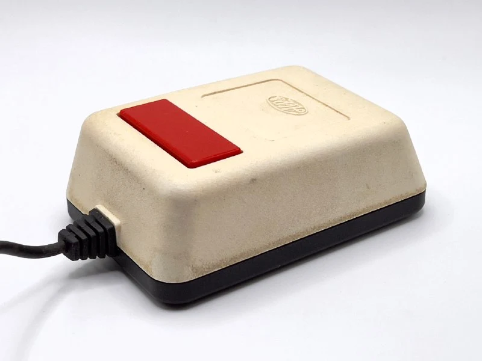
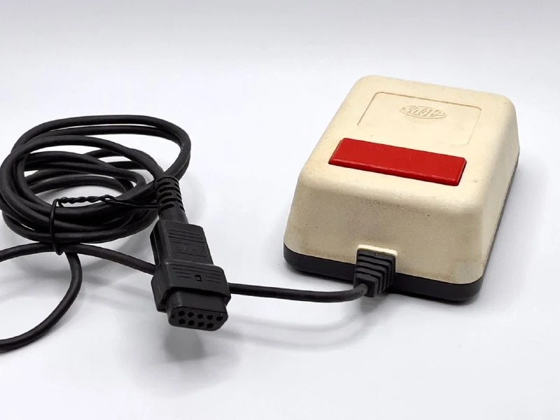
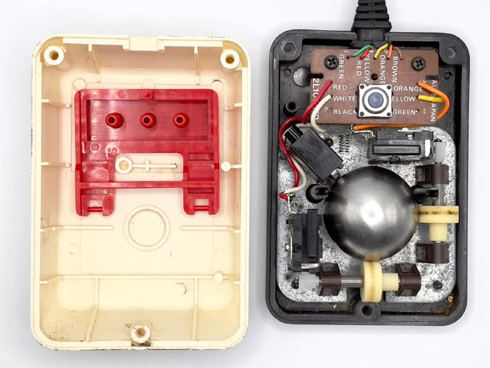
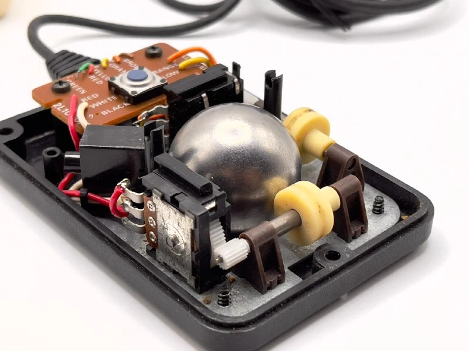
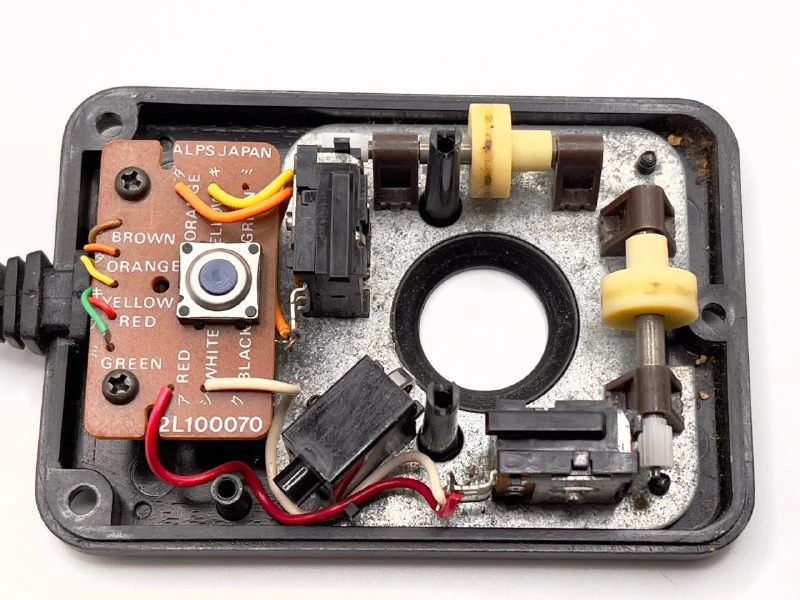
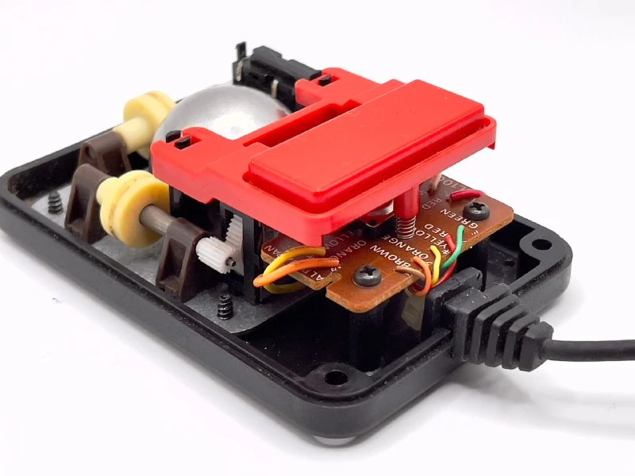

Alps Electric Co. Ltd. is a legendary Japanese name in mouse circles, specialising in electronic components such as sensors, switches and potentiometers.

Many early, and later, mice from famous brands released in 1983–1986 used Alps electromechanical encoders and electronics: [Microsoft Green Eye](https://collectionerus.ru/collections/old-mice/3/), [Sharp MZ-1X10](https://collectionerus.ru/collections/old-mice/204/), [Mindset](https://collectionerus.ru/collections/old-mice/140/), [Tandy Color](https://collectionerus.ru/collections/old-mice/4/) and [IBM](https://collectionerus.ru/collections/old-mice/30/).

Alps itself released only a few own-brand mice, for the mass market, in the early 1990s.

The mouse pictured is probably a prototype Alps sent to companies to test mouse interaction with emerging graphical operating systems. Its previous owner says this particular mouse went to Commodore Electronics for testing the GEOS graphical user interface on the Commodore 64 and C128.

We never saw Commodore mice with Alps internals, though, which suggests the testing didn't go too well =)

The mouse is almost an exact copy of the [Tandy Color Mouse](https://collectionerus.ru/collections/old-mice/4/), first listed in Tandy catalogues in 1983. The exception is that the potentiometers use two wires rather than three, fundamentally reducing positioning accuracy.

I haven't seen other devices with wire colours written right on the board. I wonder how much that reduced assembly errors.
