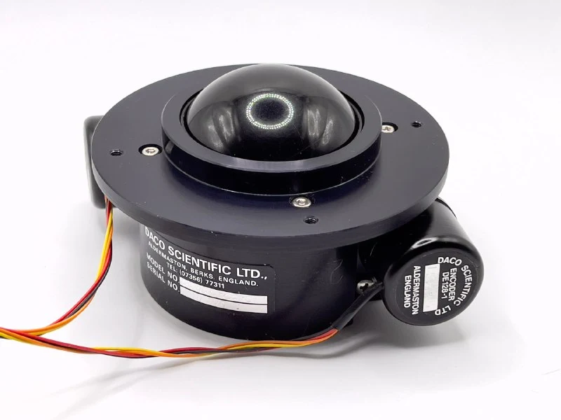
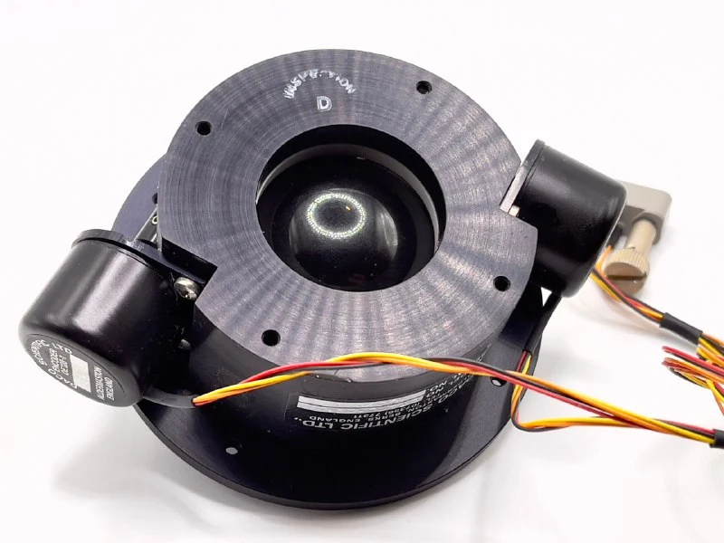
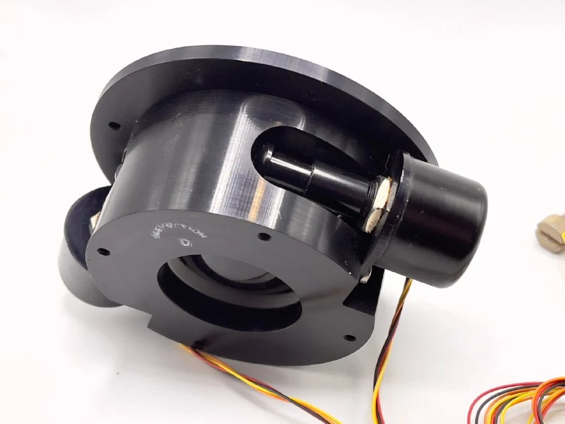
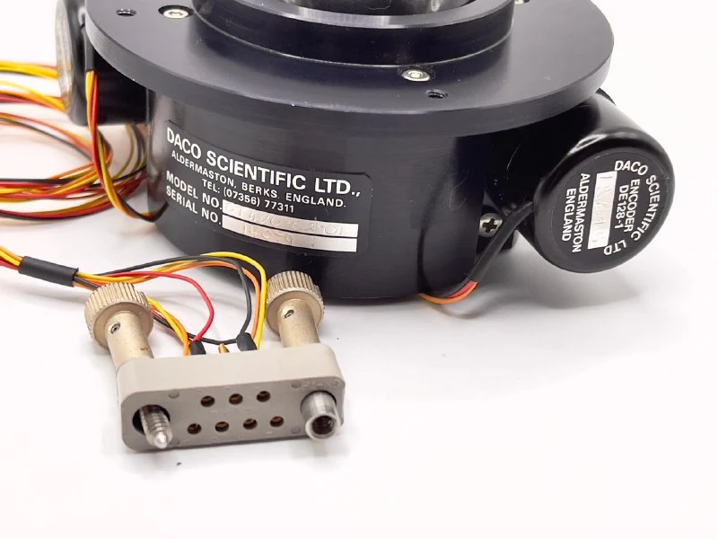

A modern [Daco DT420-02-01 trackball](https://collectionerus.ru/collections/old-mice/219/).

Marketed for demanding vibration conditions and an extended temperature range, suggesting industrial or military use.

The idea is this: in conventional optomechanical trackballs, the ball rests directly on the shafts carrying the encoder discs. Under vibration or shock it jumps on those shafts, impairing operation. So why not separate the encoder shafts from the mechanism supporting the ball?

Here, the ball sits in a cup. The encoders attach to the assembly and pick up the ball's rotation through a soft roller.

Mine had a roller on only one encoder, and it resembled Soviet foam rubber after ten years in storage. The rollers are definitely a weak point. The encoders themselves are lovely; I'm still studying them.

There are no brains inside: it simply outputs raw encoder signals for you to do whatever you want with. The connector also has extra protection against determined attempts to plug it in the wrong way.
