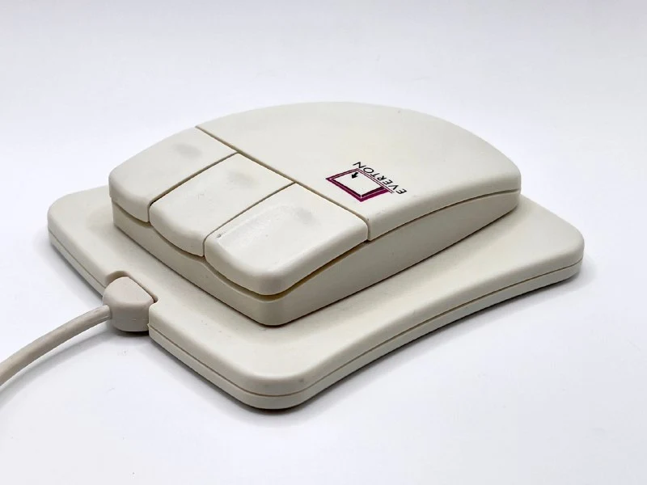
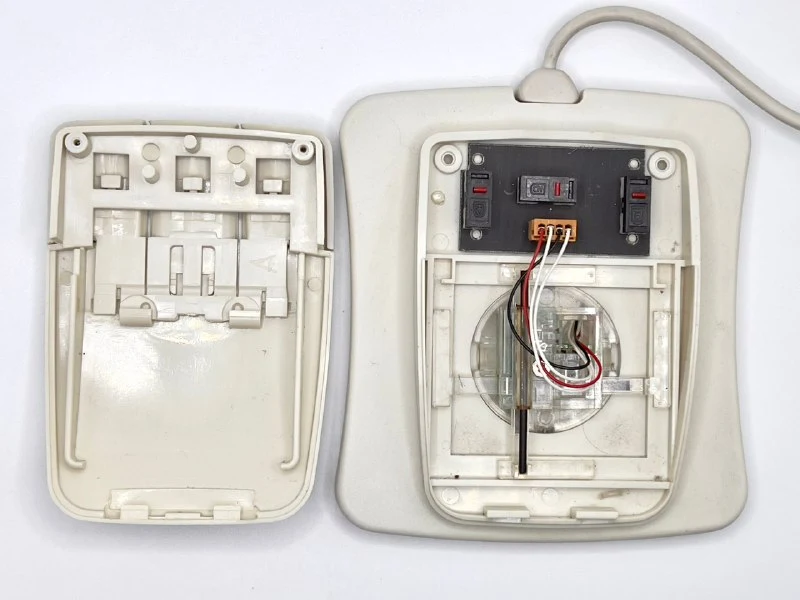
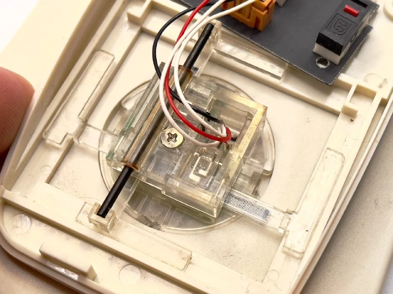

A mouse with its own built-in pad: a little tracked bulldozer.

Unlike ordinary mice, the WinPoint has neither a ball nor optics. The secret is its 10 × 10 cm pad, which detects the mouse's position at up to 1,600 dpi.

Part of the mouse is rigidly attached to the pad. Any movement is detected by special linear encoders: marked strips illuminated by an LED.

Positioning therefore uses absolute rather than relative coordinates. Presumably the driver adapts to the monitor's resolution, but it looks unlikely to work with two monitors.

The mouse's working movement range on the pad fits within a rectangle of 1.8 × 1.6 cm.

I've recorded a video for you.
