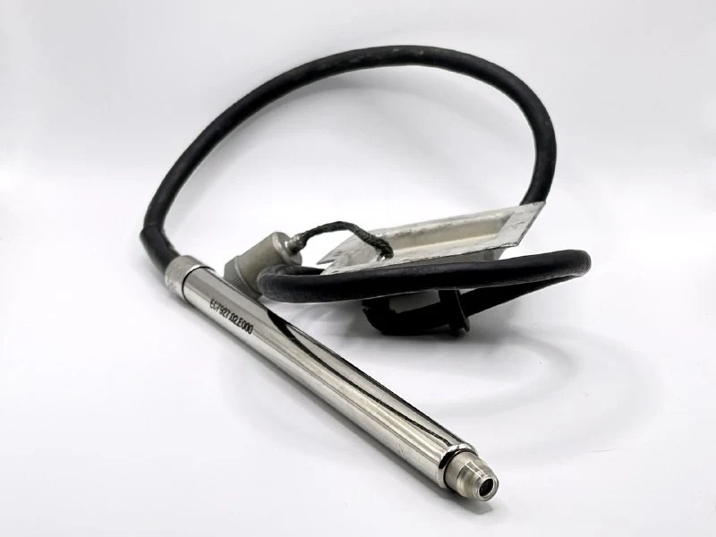
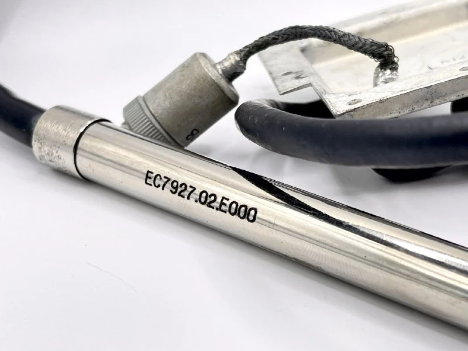
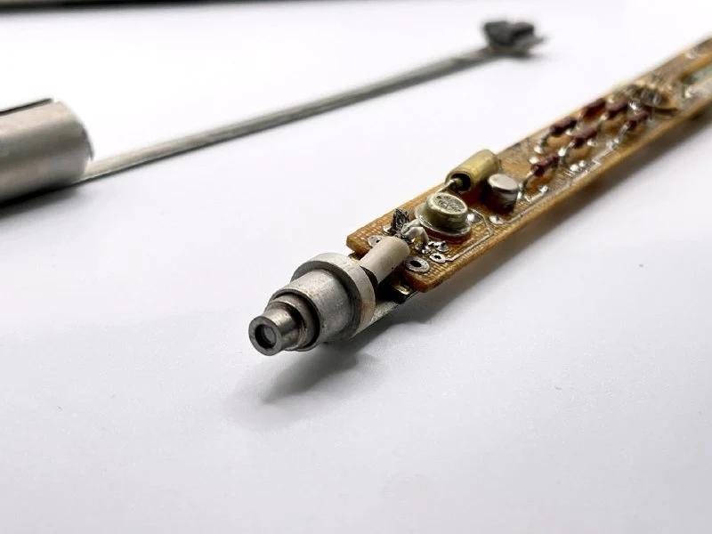
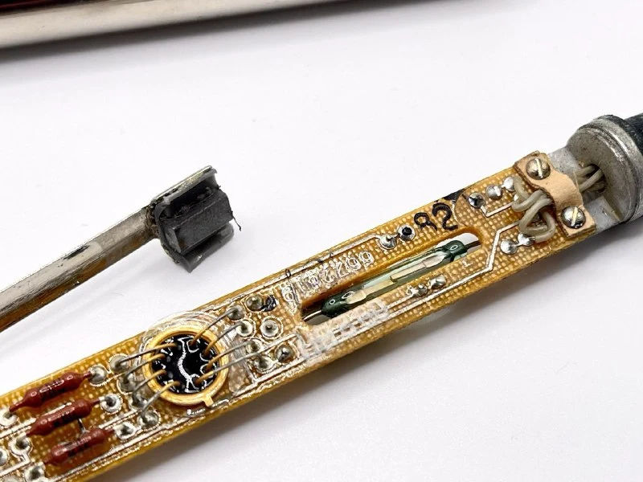
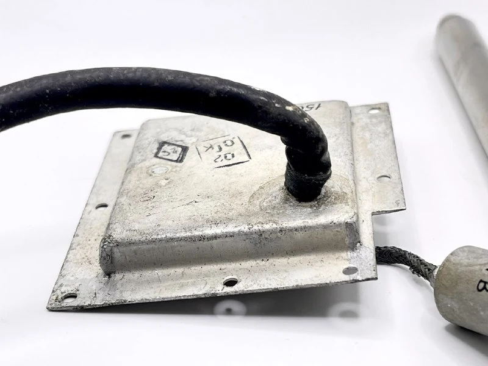
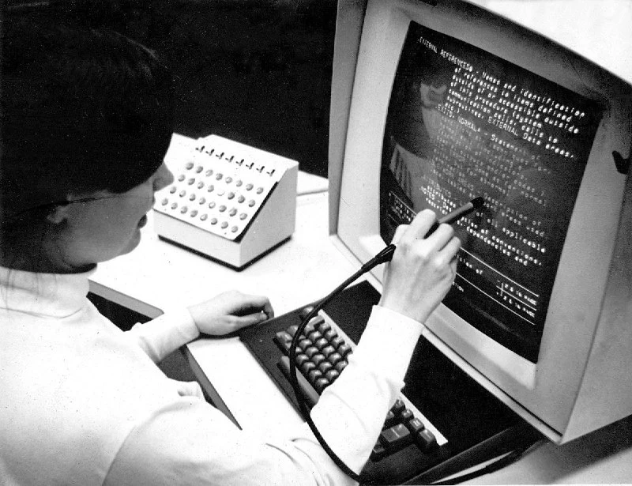
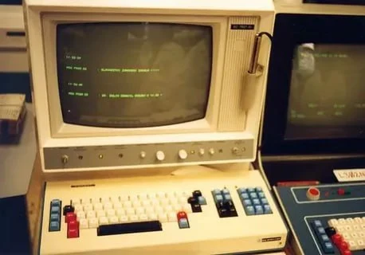

Если вдруг хотели узнать как работает световое перо и не спрашиваете =)

Наш экземпляр ЕС7927.02.Е000 к терминалу, внезапно, ЕС7927. Примерно 80-е года.  
Схема работы примерно такая: 
- Внутри ЭЛТ-дисплея электронный луч последовательно сканирует экран построчно (развертка).
- Когда оператор касается экрана и нажимает кнопку пера, фотоэлемент внутри пера считывает изменение яркости в момент нажатия.
- Контроллер пера фиксирует время вспышки и вычисляет положение точки на экране, используя синхронизацию с разверткой монитора.

В основном перо использовалось для навигации и перемещению курсора по отображаемому на экране тексту - задач рисования еще не появилось, а удобные комбинации перемещения по строкам редактора, как в vim, еще не изобретены.

Наше перо не имеет кнопки, но имеет подпружиненый кончик. При физическом нажатии пером на экран, кончик толкает магнитик, который замыкает геркон и дает сигнал на считывание.

Из интересного, разъем со стороны терминала скрыт за металлической крышкой. Здорово что инженеры подумали про износ крепления кабеля, ну и/или усложнили съем и неконтролируемое отделение пера: 7 винтов всяко сложнее открутить, чем одну гайку, ну и пломбируется легко

