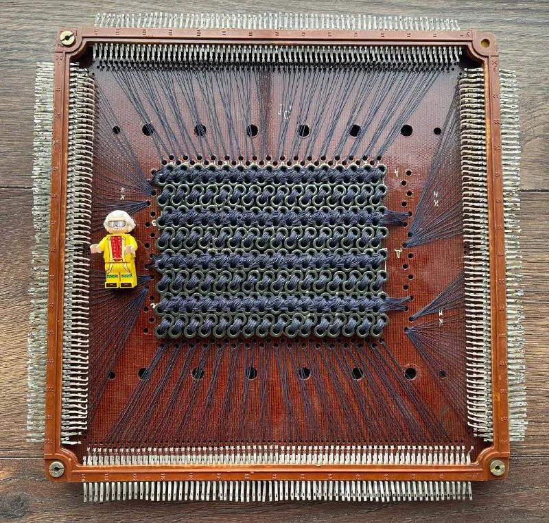
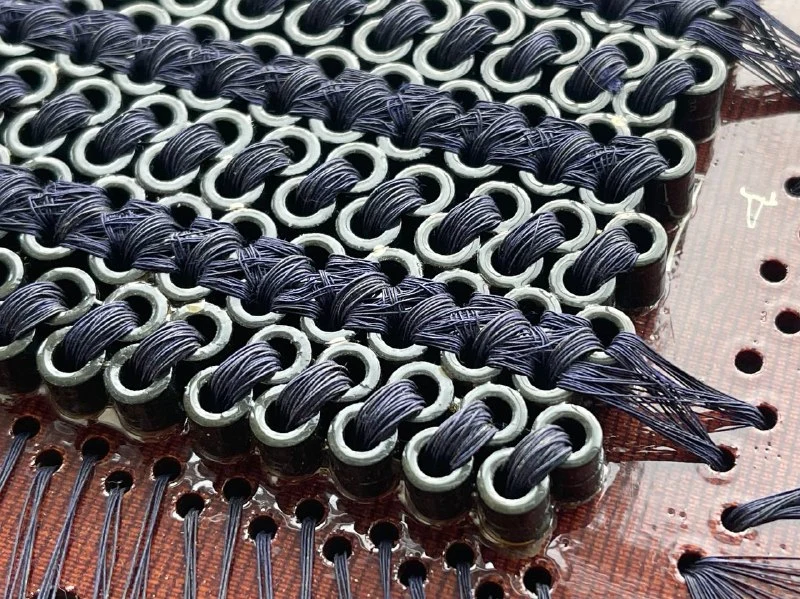

В 1949 году в Гарварде [Ван Ань](https://ru.wikipedia.org/wiki/%D0%92%D0%B0%D0%BD_%D0%90%D0%BD%D1%8C) и Во Вайдун изобрели новый тип памяти на основе магнитных колец из феррита. Этот материал мог «запоминать» данные без постоянного питания, так как сохранял намагниченность даже после выключения устройства.

К 1950-м годам такая память стала главным типом оперативки в компьютерах. Она оказалась надёжнее аналогов: не боялась помех, долго служила и не требовала энергии для хранения информации.

Внешне ферритовая память представляет собой набор колечек, пронизанных тонкими медными проволочками. Проволочки образуют прямоугольную сетку, или матрицу. Чтобы обратиться к конкретной ячейке, нужно подать ток на «вертикальную» и «горизонтальную» проволочки. В результате перемагнитится только тот сердечник, который находится на их пересечении, а остальные сохранят своё состояние.

Одну двухмерную матрицу ферритовых сердечников называют рамкой. Если же сложить стопкой несколько таких рамок, получится трёхмерный массив — куб памяти.

Со временем кольца уменьшили с 2 мм до 0,3 мм, а скорость их перемагничивания выросла в 13 раз. К 1980-м ферритовую память вытеснили полупроводники. Однако в авиации и космической технике её применяли до конца 1990-х из-за исключительной надёжности. В некоторых бортовых ЭВМ ее используют до сих пор.

На фото рамка от куба ЭВМ «[Минск-32](https://ru.wikipedia.org/wiki/%D0%9C%D0%B8%D0%BD%D1%81%D0%BA-32)», к котором было 38 таких рамок. Каждая вертикальная линия куба хранила одно машинное слово. Весь блок вмещал 16 384 слова (примерно 76 КБ), а при объединении 4–8 таких кубов память достигала более 0,5 МБ — огромный объём для начала 1970-х.

Первые матрицы собирали вручную, как бусины на проволоке. Даже когда процесс автоматизировали, термин «прошивка» (как в ПЗУ) остался от тех времён — его связывали с «прошиванием» проводов через кольца.
Ну и [сore dump](https://en.wikipedia.org/wiki/Core_dump), конечно тоже оттуда
