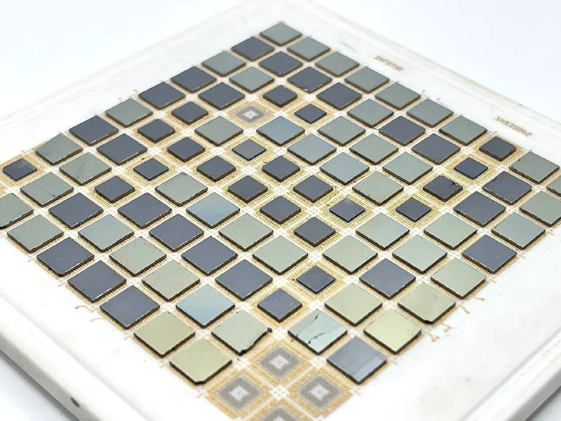
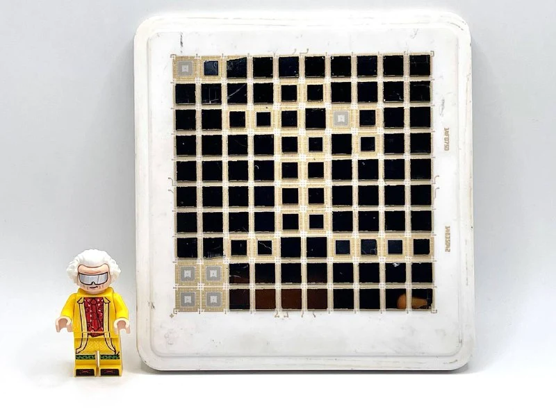
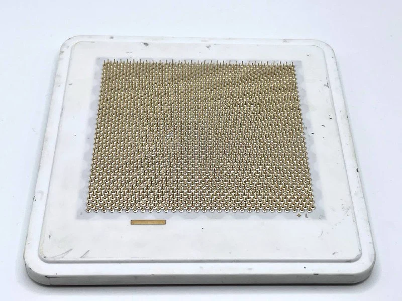

1985.

One key technology in this processor was the [multi-chip module](https://en.wikipedia.org/wiki/Multi-chip_module), or MCM: several chips or dies integrated on one substrate.

This allows:

- Shorter interconnections, reducing signal delays between components.
- Improved thermal characteristics.
- Higher integration density: compact functional blocks increase clock speed and overall system performance.

The problem at the time was that defect rates rose exponentially as chip area grew. Making small chips and placing them on a shared substrate was therefore much cheaper than manufacturing one large die.

As production improved, larger chips became feasible: what we now call [systems on a chip](https://en.wikipedia.org/wiki/System_on_a_chip), or SoCs.
