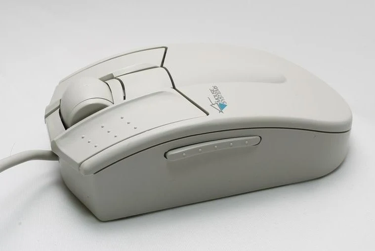
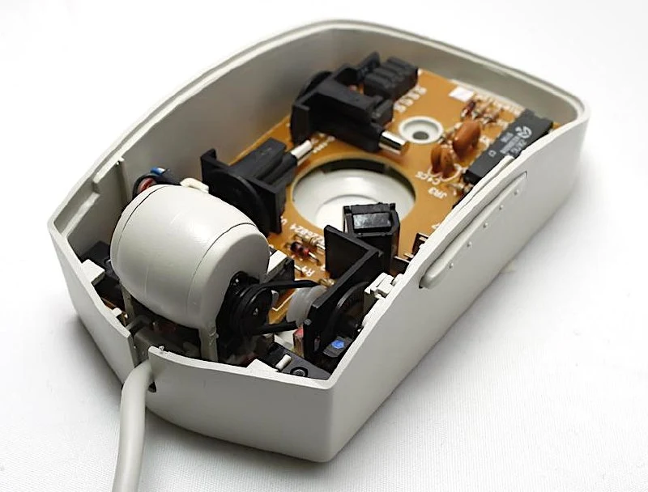
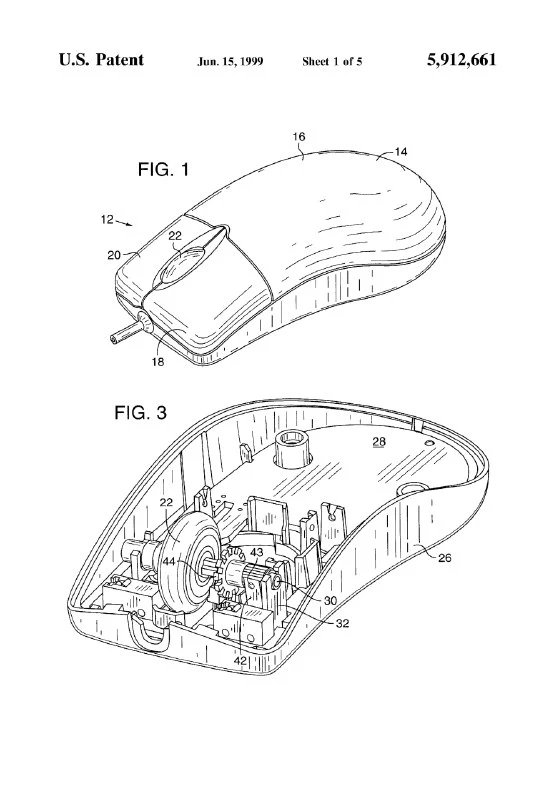

The first production mouse with a scroll wheel, introduced in 1995. It existed under two brands because Taiwan's KYE Systems, owner of Genius, bought America's Mouse Systems back in 1990. In the United States it was the MSC ProAgio; elsewhere, EasyScroll.

The idea was to speed up work in browsers and text editors, allowing users to scroll long documents without reaching for the scrollbar at the side of the screen.

Since both MSC and Genius mice then had three buttons, the third button was integrated into the wheel.

Early prototypes used a direct drive from the scroll wheel to a tiny encoder shaft. But the connection made scrolling too harsh and jittery: every touch went straight to the sensor. A rubber belt softened the jitter through the connection's inertia, though it deteriorated with age.

A year later Microsoft [released](https://patents.google.com/patent/US5912661A/en) its IntelliMouse, including the familiar stepped scrolling provided by a ridged wheel shaft.

Amusingly, Microsoft's [inspiration behind the mouse](https://en.wikipedia.org/wiki/Eric_Michelman) wasn't thinking about long texts or the internet at all. He wanted to solve Excel users' zooming problems and even proposed zoom as the wheel's default function. Under pressure from [Walt Mossberg](https://en.wikipedia.org/wiki/Walt_Mossberg), he eventually gave in, and now we enjoy scrolling across Microsoft's applications and beyond.

The first known scroll-wheel mouse prototype appeared back in 1985. That deserves a separate post.
