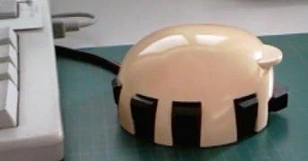
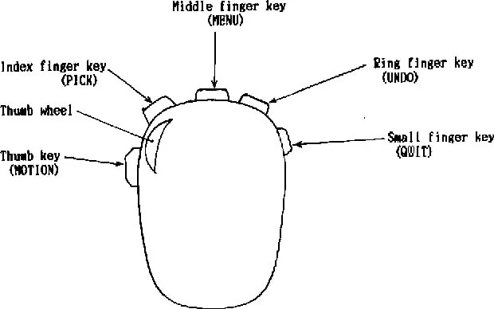

Совместная разработка ребят из Японии и Швейцарии в 1985 году (за 10 лет до [появления серийного скролла](https://t.me/old_mice_and_hw/131))
По этой мыши удалось найти довольно детальную "продуктовую" документацию, поэтому у нас есть возможность подглядеть в мысли того времени. 
Мышка, похоже, так и не вышла из прототипа, есть несколько фотографий с живыми экземплярами

5 кнопок и колесо отдельно для "максимально эффективного использования ловкости человеческой руки". 
Две из пяти кнопок были сложными - с возможностью различать клик и клик с нажатием (медленное нажатие).

Мышка по форме близка к [Depraz](https://collectionerus.ru/collections/old-mice/173/), оно и понятно, круглая форма корпуса - единственный вариант впихнуть по кнопке на каждый палец.

Вообще авторы претендовали на стандартизацию мышей с точки зрения кнопок-команд (и до, и после 1985 года количество кнопок у разных производителей варировалось от 1 ([apple Lisa](https://collectionerus.ru/collections/old-mice/207/)) до 3х, а иногда до десятков у совсем экзотических моделей)
Собственно идея была в том, чтобы на всех компьютерах одни и те же кнопки означали одинаковые действия. 
Сейчас такое получилось, но только для двух кнопок и колеса, а все остальное идет в нагрузку и кастомизируется.

Детально по кнопкам: 
**Кнопка большого пальца** (motion|scroll) - управление просмотром содержимого файлов. Включает в себя движение вперед и назад в пределах "линейно упорядоченного набора данных", например прокрутку текстового файла. Быстрое нажатие означает переход на следующую страницу. Медленное нажатие приводит к непрерывной прокрутке со скоростью, пропорциональной силе нажатия.

**Кнопка указательного пальца** (pick) - выбор объекта. Быстрое нажатие выбирает объект, на который указывает курсор на экране. Медленное нажатие используется для получения всё более подробной информации об объекте, например, при увеличении. Коэффициент увеличения пропорционален силе нажатия клавиши.

**Кнопка среднего пальца** (menu) - показ вслывающего (контекстного) меню.

**Кнопка безымянного пальца** (undo) - приводит к отмене последней введенной пользователем операции и возвращению системы в состояние, предшествующее этой операции.

**Кнопка мизинца**(quit) - выход или завершение операции.

**Колесо прокрутки большого пальца**(angle) - изменение угловой ориентации курсора на экране.

В комменты положу весь документ
