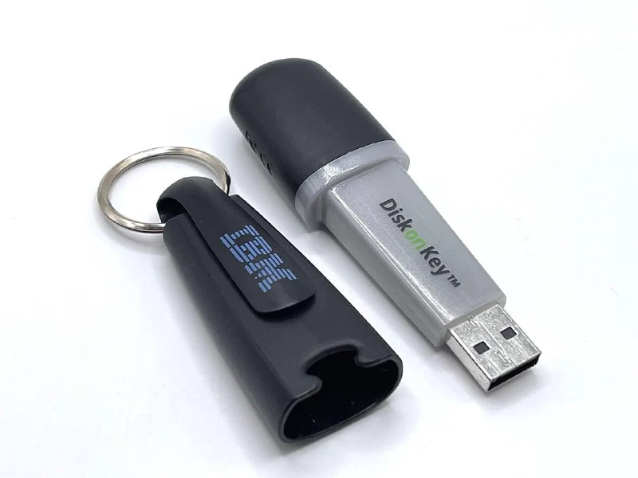
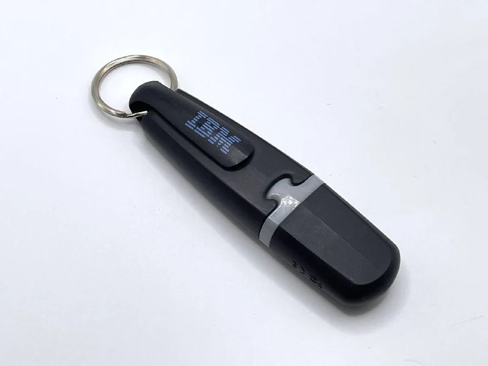
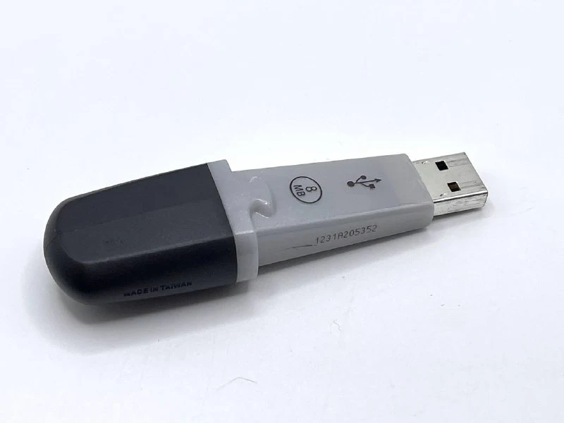

On 5 April 1999, M-Systems engineers Amir Ban, Dov Moran and Oron Ogdan filed a patent application for a device called “Architecture for a Universal Serial Bus-Based PC Flash Disk”.

Meanwhile, IBM engineer Shimon Shmueli also proposed a USB storage device. In September 1999 he registered an internal invention disclosure, IBM Disclosure RPS8-1999-0201, describing a similar device.

In September 2000, M-Systems announced its first USB flash drive, **DiskOnKey**. On 15 December 2000, IBM began selling it under its own brand in North America.

The first version held 8 MB, five times the capacity of a standard 3.5-inch floppy, and cost $50. It was immediately positioned as a hard drive on a key ring, emphasising portability and enough capacity for office documents.

The developers faced several challenges. First, the flash memory, controller and USB interface had to fit in a tiny key-ring-friendly case. The original M-Systems patent described a cable between the flash unit and USB connector to simplify packaging. In the final product, the engineers managed to integrate everything into one cable-free enclosure.

Second, it needed to work with existing computers and operating systems. USB was only becoming widespread, and not every OS supported USB storage. M-Systems implemented the device as USB Mass Storage, so DiskOnKey appeared as an ordinary disk drive. Windows 2000 and Windows ME required no drivers, offering Plug and Play; a Windows 98 driver came on CD.

How big was your first flash drive?
