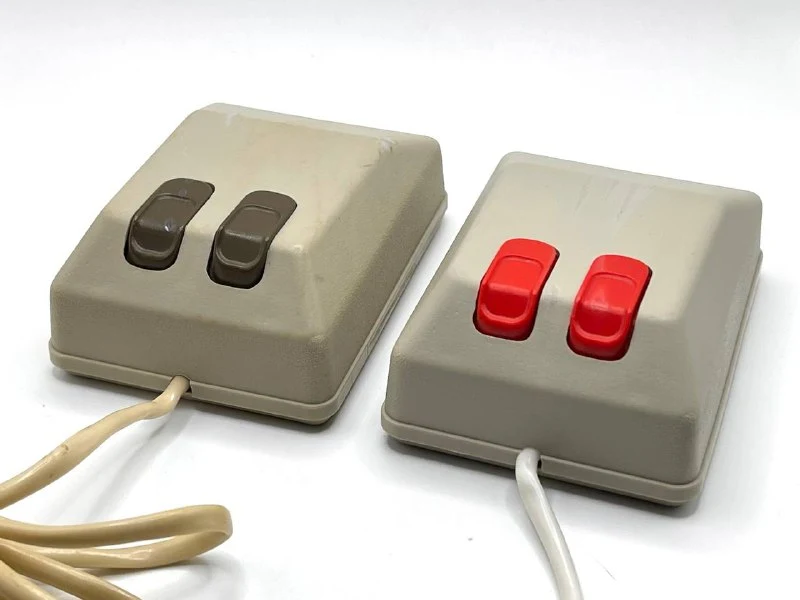
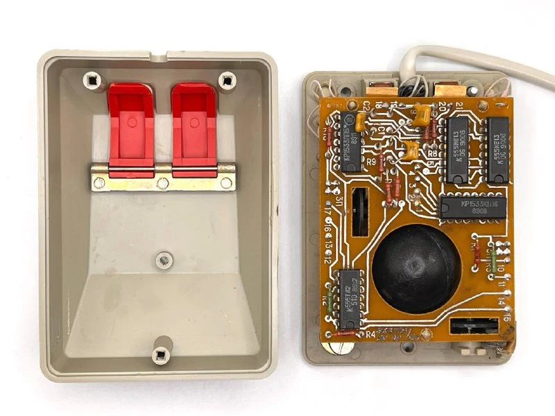
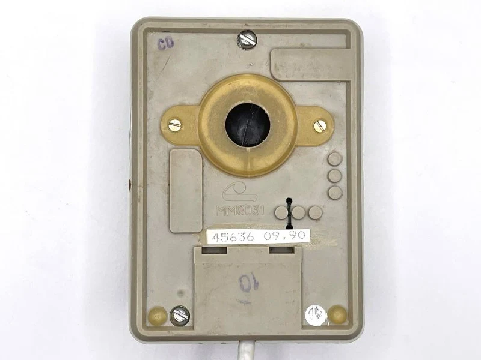
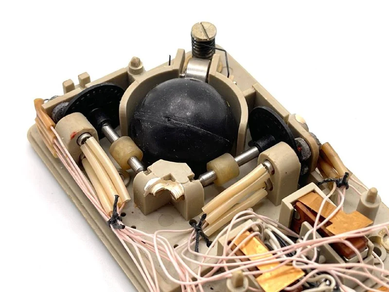
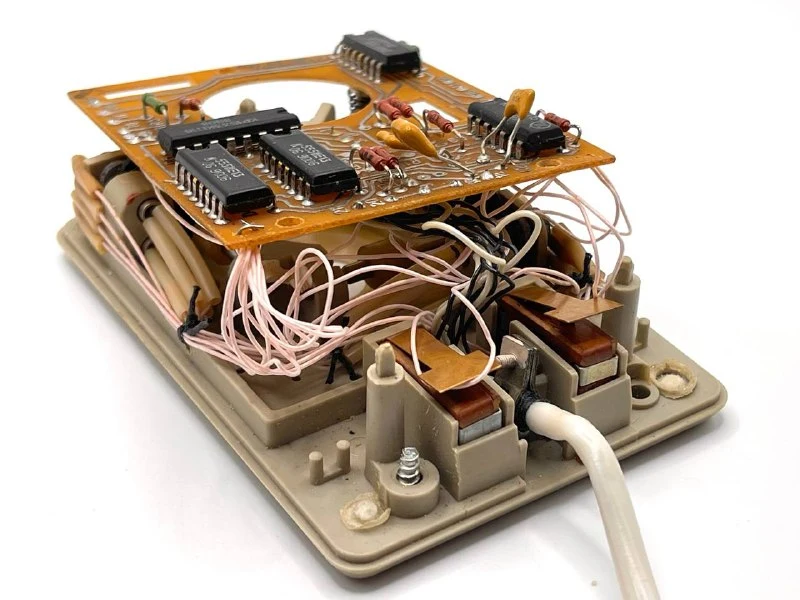
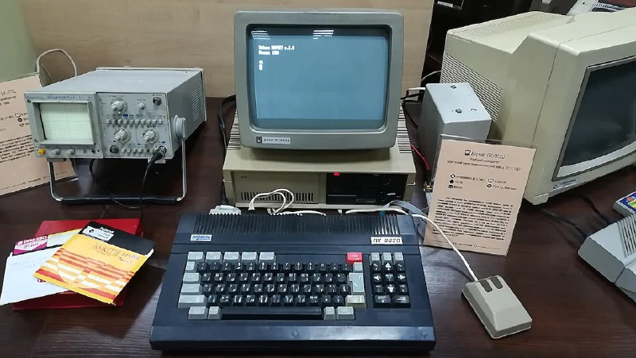

ММ означает "Манипулятор мышь" =)

«Корвет» создавался группой сотрудников Института ядерной физики МГУ ещё в 1985 году для автоматизации физических экспериментов​. Проект быстро привлёк внимание руководства: уже в 1987 г. было начато серийное производство «Корвета» для школ СССР - комплекса учебной вычислительной техники (КУВТ).

Комплекс включал учительский компьютер ПК 8020 и до 15 ученических терминалов ПК 8010, объединённых в локальную сеть​. Мышь должна была расширить возможности работы с графической информацией на «Корвете», например, в графических редакторах. 
Первоначально планировалось подключение стандартной серийной (RS-232) мыши «Microsoft» через последовательный порт. Однако практическая реализация пошла по другому пути: была спроектирована собственная мышь, которая подключалась напрямую или через переходник к портам расширения.

Основная гипотеза почему так произошло - дефицит микросхем UART, которые нужно было поставить в каждую мышь. При этом это не уникальное решение, та же логика применялась в мышках для Commodore Amiga/Atari - мышь была с ними совместима.

ММ 8031 передает почти сырые сигналы датчиков - на выходе формируются прямые квадратурные импульсы на 4 линиях. Такое решение упростило разработку, но потребовало больше проводов в кабеле и специальных схем в компьютере для считывания импульсов. С учетом двух кнопок провод состоял из 9-ти жил.

Мышку отличала упоротая компоновка в части кабель-менеджемента. Кабели привяывали ниточкой к корпусу через специальные технологические отверстия.

Планировалось выпустить больше 500к компьютеров (и, веротяно, стать русским BBC Micro ), но из-за общей ситуации в 90х - не получилось.
