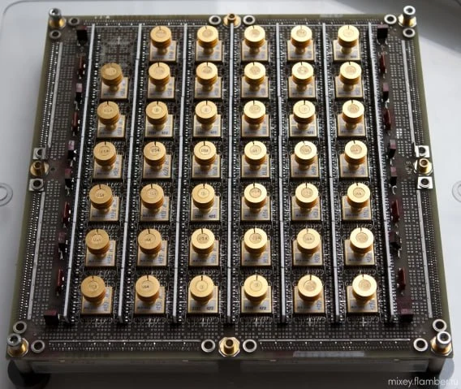
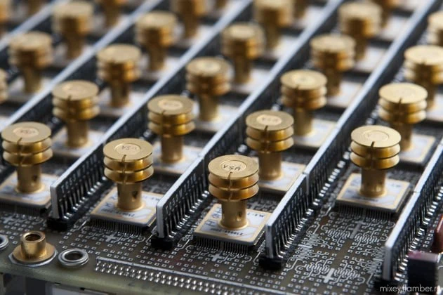
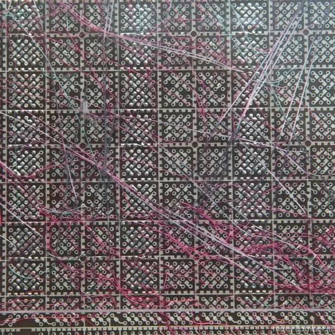

Процессорный модуль от мейнфрейма 1975 года [Amdahl 470V/6](https://www.fujitsu.com/global/about/corporate/history/products/computer/mainframe/facom470v6.html). Сначала [Джин Амдал](https://ru.wikipedia.org/wiki/%D0%90%D0%BC%D0%B4%D0%B0%D0%BB,_%D0%94%D0%B6%D0%B8%D0%BD) спроектировал System/360, а потом ушел из IBM и запустил свою линейку совместимых машин, которые были дешевле и шустрее. 
Как они дебажили ошибки с такой разводкой, страшный сон инженера.

Модули иногда встречаются на ebay примерно за $1к
[#cpu](https://t.me/s/old_mice_and_hw?q=%23cpu)

