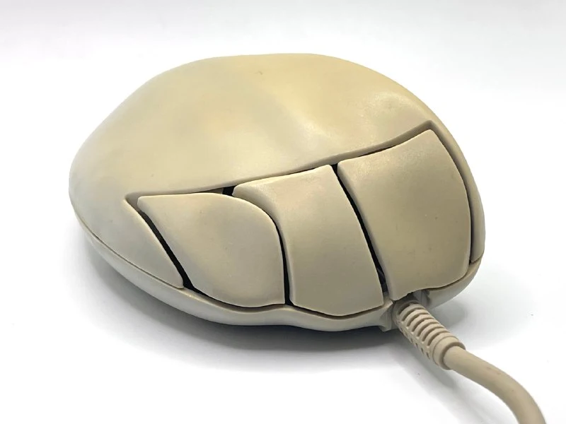
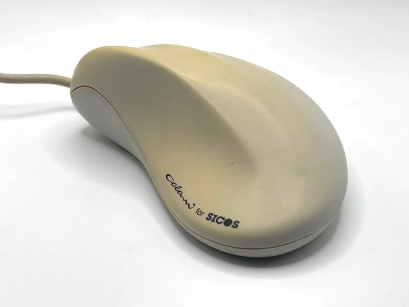
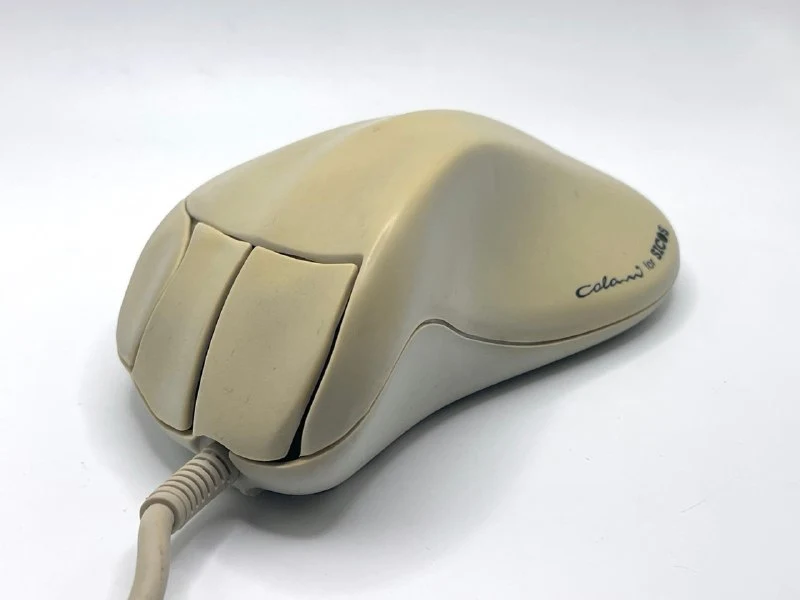
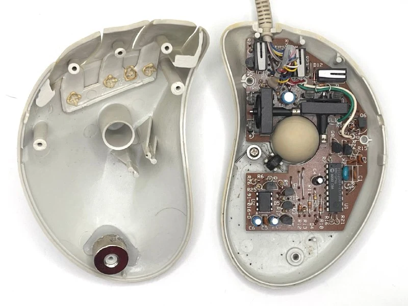
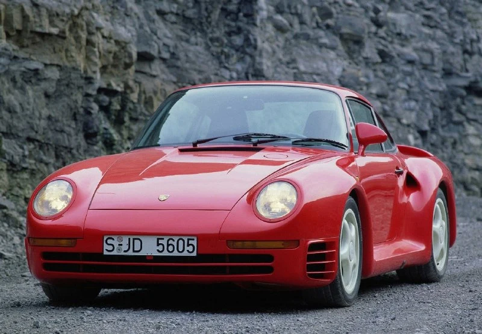

Мышь была создана немецким дизайнером [Луиджи Колани](https://en.wikipedia.org/wiki/Luigi_Colani) в 1993 году. Она моментально привлекла внимание благодаря плавным биоморфным формам и особой системе баланса: внутри корпуса располагался небольшой грузик, позволяющий уменьшить нагрузку на кисть и повысить точность движений. Колани считал, что техника должна гармонировать с телом, поэтому убрал все прямые линии, сделав корпус обтекаемым и максимально удобным.

Помимо работы над компьютерными устройствами, Колани участвовал в создании облика суперкара Porsche 959, считающегося одним из самых передовых автомобилей 80-х. Во всём, за что брался Колани, сочетались футуристические идеи и внимание к практичности: элементы будто «перетекают» друг в друга, образуя цельный контур.
Очень рекомендую посмотреть другие "экспонаты", там огромный список от самолетов до роялей.

Для этой компьютерной мыши Колани спроектировал приподнятую «спинку», снимающую часть нагрузки с ладони, и крупные кнопки, подстроенные под естественное положение пальцев. В итоге улучшалась эргономика, а вместе с ней и точность перемещения курсора по сравнению со стандартными моделями начала девяностых. Такое сочетание плавного дизайна и заботы о комфорте впечатлило производителей, которые позже стали активнее внедрять биоморфные элементы в свои устройства.

Но я не могу отделаться от мысли, что это чья-то нога

