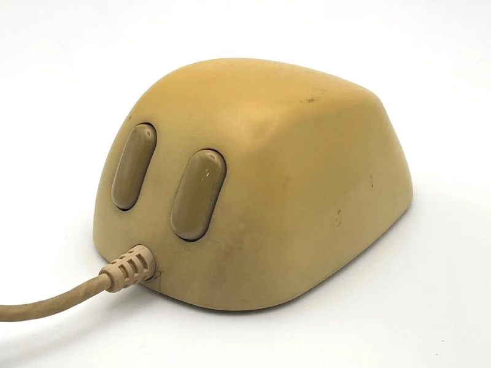
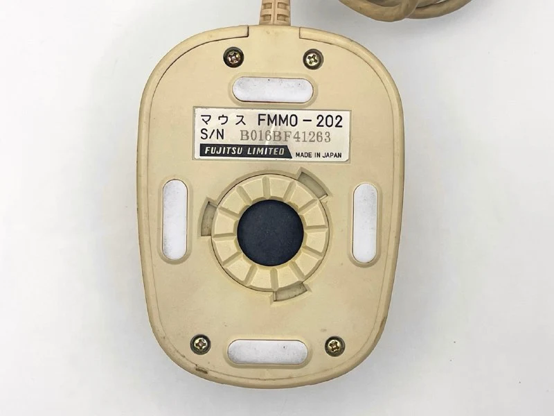
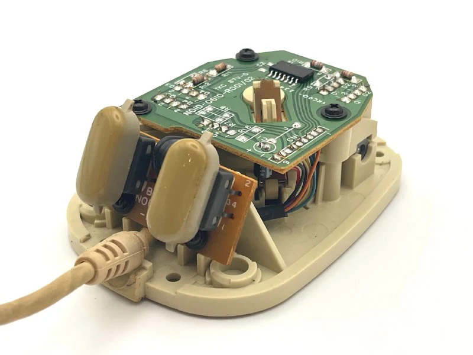
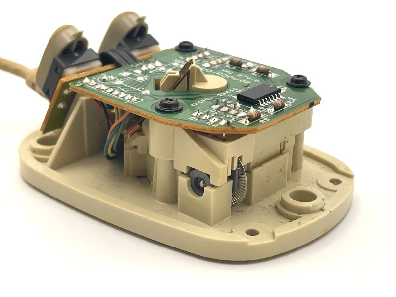
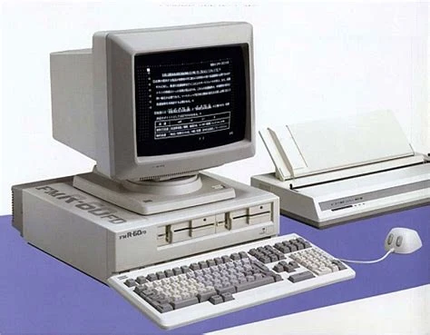

В 1987 году вместе с офисными ПК FMR‑50 и FMR‑60 на рынок вышла двухкнопочная мышь Fujitsu FMMO‑202. Японские пользователи прозвали её «象亀マウス» — «черепаха‑слон»: высокая выпуклая «спинка» действительно напоминает панцирь. Такая форма позволила разместить в небольшом корпусе стандартный шар диаметром ~24 мм и опто‑механический узел Alps Electric, а заодно дала ладони опору, снижая нагрузку при длительной работе.

Главная особенность модели — собственный интерфейс. Кабель c мини‑DIN‑8 подключался не к системному блоку, а к разъёму на клавиатуре, контроллер мыши был встроен именно туда. Решение освобождало ISA‑слот, но превращало мышь в аксессуар, пригодный только для экосистемы Fujitsu (привет, apple ADB). 
Для MS‑DOS поставлялся драйвер, обеспечивавший разрешение порядка 200 DPI — вполне комфортный показатель для графических оболочек и текстового процессора OASYS.

Цена мыши была корпоративной: около ¥20 000 (≈ 150 USD по курсу 1987 года), то есть почти вдвое дороже массовых «bus mouse» NEC. Поэтому в свободной продаже она встречалась редко, чаще поставлялась в комплекте с офисными рабочими станциями.

Еще у мыши был салатовый кабель, как у всей переферии экосистемы Fujitsu FMR, но мой экземпляр сильно пожелтел и выгорел.

За пределы Японии FMMO‑202 практически не экспортировали, и сегодня она известна главным образом коллекционерам.

В начале 1990‑х Fujitsu перешла на стандартный PS/2, и «черепашья» мышь ушла в историю. Но именно FMMO‑202 напоминает, каким разнообразным был рынок периферии до унификации.
