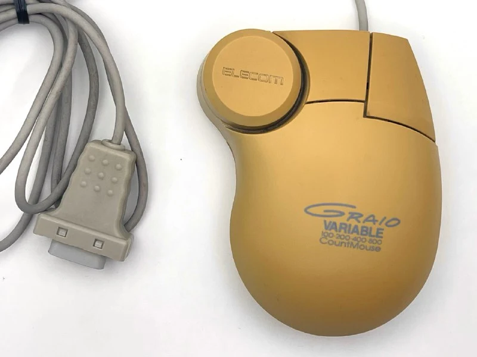
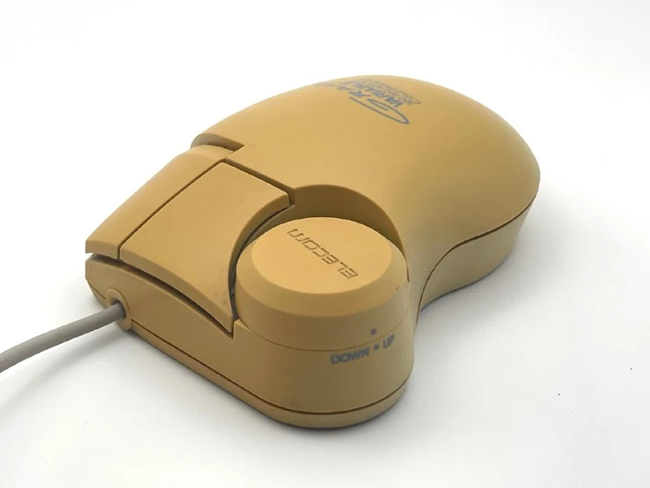
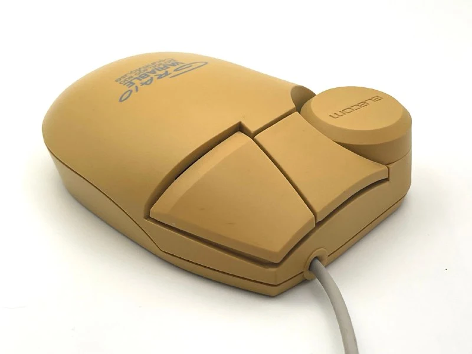
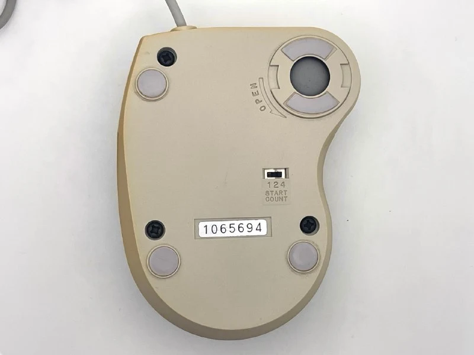
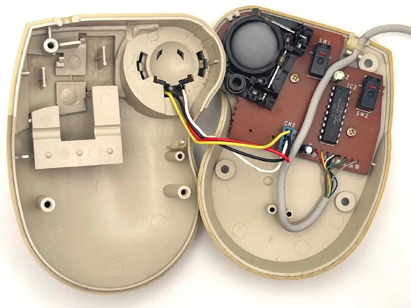

Как намекает название, мышка с переменной чувствительностью, но это не единственно, что тут можно посмотреть.

Мыши GRAIO позиционировались как продукт нового поколения, призванный улучшить точность и комфорт за счёт смелых конструктивных решений. 
Если у обычных мышей шарик находится примерно в центре, то в этой мышке он располагался впереди, прямо под указательным пальцем. Это решение, по задумке дизайнеров, должно было сделать движения мыши более интуитивными, похожими на движение ручкой по бумаге.

Это привело к специфическому эффекту: оси движения курсора у GRAIO оказались развернуты под углом относительно геометрии корпуса, вероятно для для учета естественного наклона руки, и, если двигать мышь строго вперёд, курсор смещался чуть по диагонали. Это требовало некоторого привыкания и считалось «платой» за нестандартную эргономику.

Переменная чувствительность, которая с появлением Win95 переехала в настройки драйвера мыши, пока существует на аппаратном уровне в самой мышке. Реализовано каскадом из нескольких делителей, которые могут либо отдавать каждый импульс, либо каждый 2й, 4й или 8й. Чем больше деление, тем меньше величина сдвига курсора мышки при одинаковом пути мышки по столу. 
Переключение между режимами выполняется через колесо больше/меньше, также на пузе есть переключатель, который ставит начальное значение. 
 
Мышка предназначалась для компьютеров [NEC PC-9800](https://ru.wikipedia.org/wiki/NEC_PC-9800) и совместимых (например, Epson PC), поэтому имели специальный 9-контактный разъём (D-Sub9) для подключения к порту BUS Mouse на этих системах.

Все это суммарно привело к получению Good Design Award в 1993 году.

По мне, эта штука вообще не удобная. Кругляш не нажимается, хотя очень хочется его нажать. Если сдвигать кисть в вперед, чтобы кругляш было удобно двигать двумя пальцами, то кнопки окаызваются под вторыми фалангами - опять конструкция для маленьких японских ручек.

Японские пользователи сдержанно оценили мышь как "идея огонь, исполнение - так себе", поэтому мышка не получила широкого распространения, но Elecom продолжат делать интересное.
