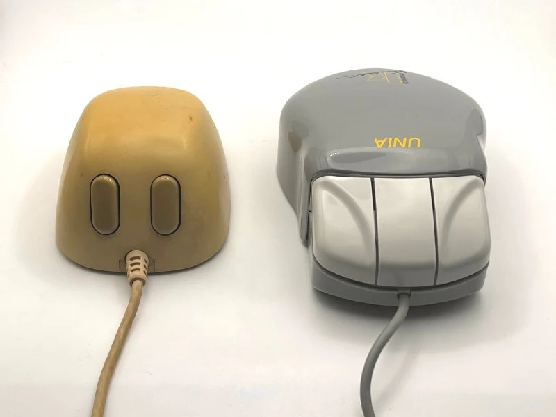
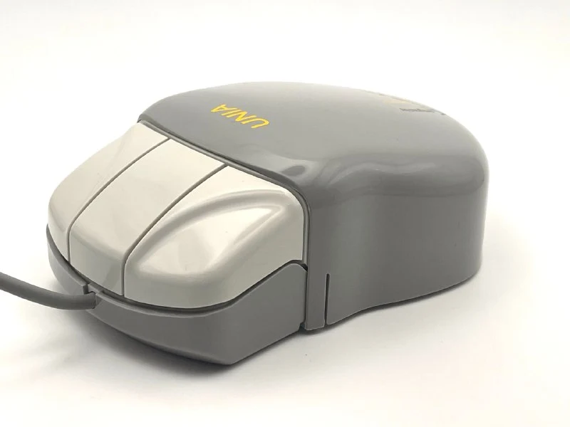
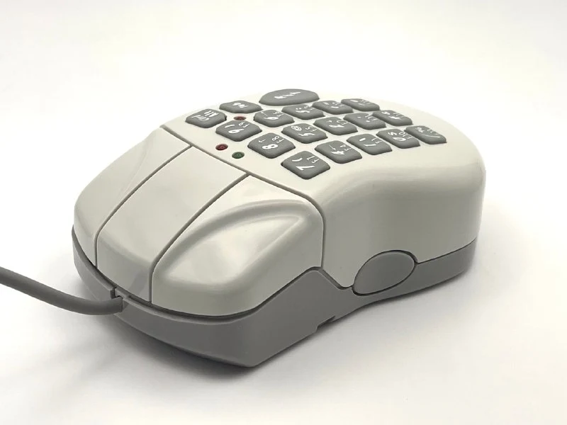
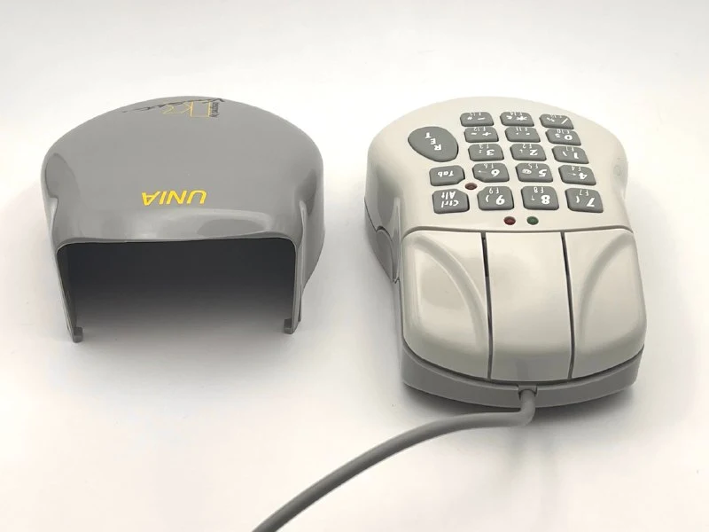
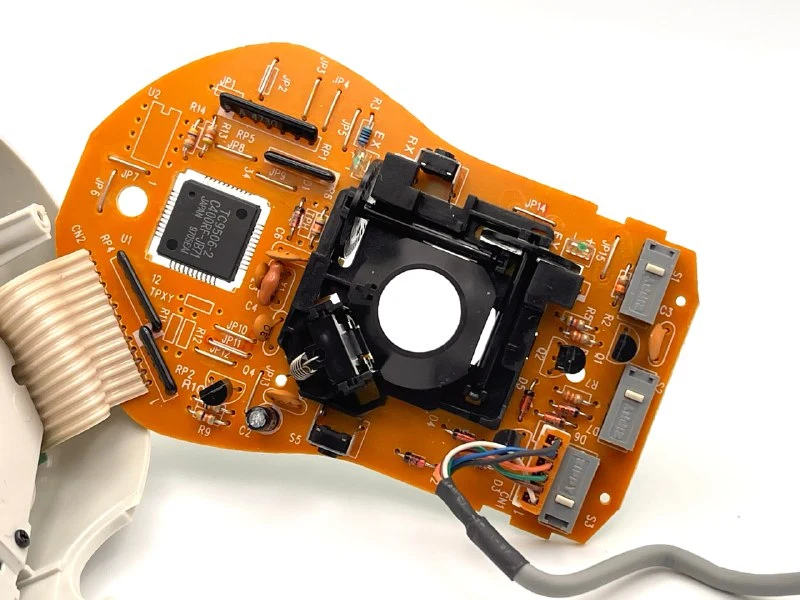

Выше я рассказывал про мышки для маленьких ручек, пришло время показать мышь для больших рук =)

Знакомьтесь, мышь с крышкой.
Под крышкой - полноценный NumPad с 17 кнопками. 
Целевой девайс - ноутбук на базе Windows 3.x/95 без встроенного нампада. Мышка при этом не особо мобильная, весит в два раза больше, чем средняя типовая мышь, да еще и толстая - в обычной ноутбучной сумке будет некомфортно.

Хоть внутри и расположилась клавиатура, мышка подключается к обычному com-порту и видится одновременно и мышей и клавой. 
Для этого внутри стоит микроконтроллер 80C51, он чередует синалы от мыши и клавиатуры, там самым реализует одновременную работу по одному порту. Без дополнительных драйверов, и не требуя второй порт на ноутбуке. [Вот изначальный патент](https://patents.google.com/patent/US5457480A/en?oq=US%E2%80%AF5457480), в котором описана чуть другая механика - переключение управлялось через сигнал от крышки - когда она открыта, мышь блокировалась.

Мышка настолько кучерявая, что в 1996 году попала [в коллекцию  Билла Бакстона](https://www.microsoft.com/buxtoncollection/type.aspx?t=Mouse) (рекомендую, кстати. Мышей там не так много, но креативность инжереной мысли разных девайсов точно не оставит равнодушным)

Производство было свернуло уже в 1997, когда стали появляться ноуты с встроенным тачпадами и легкие оптические мыши, не требующие коврика

