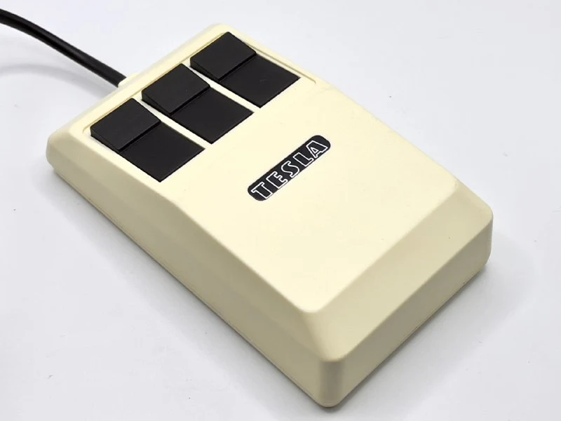
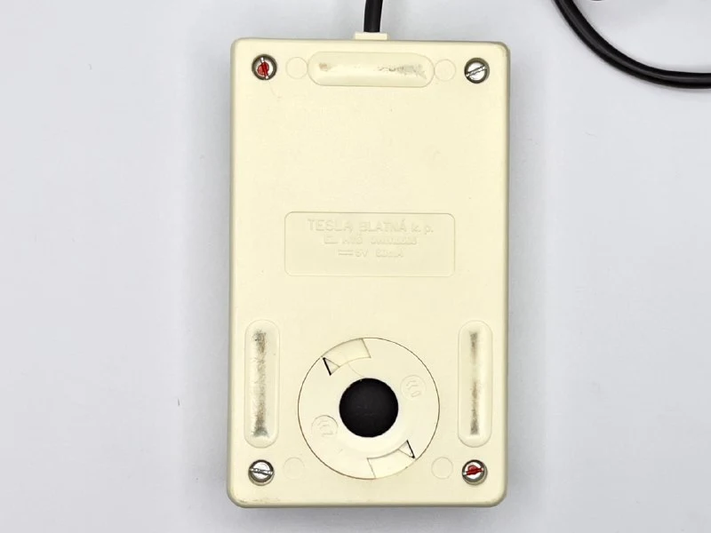
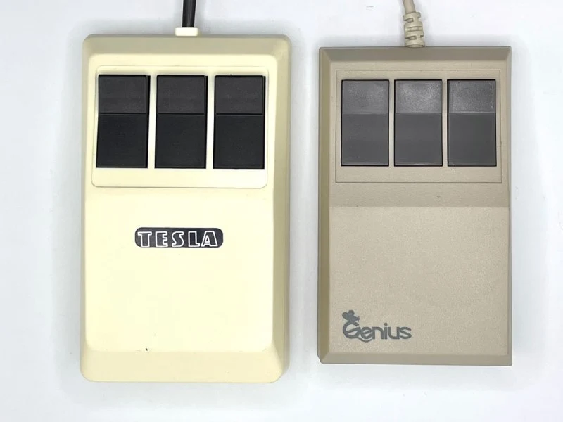
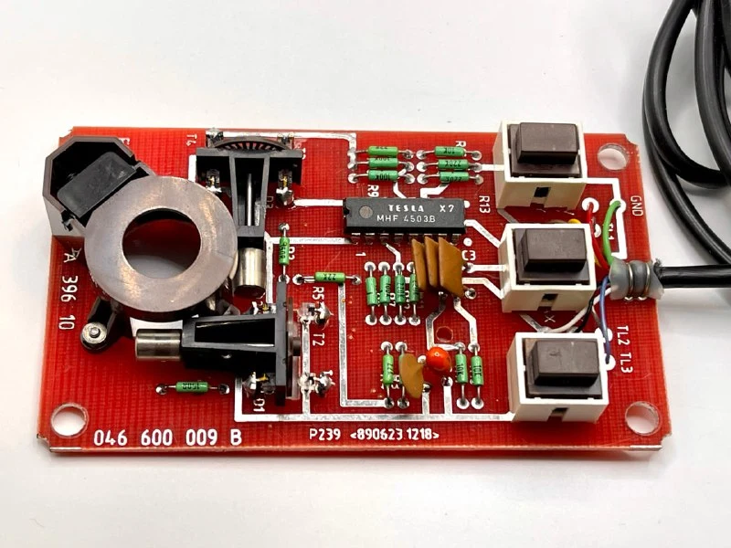
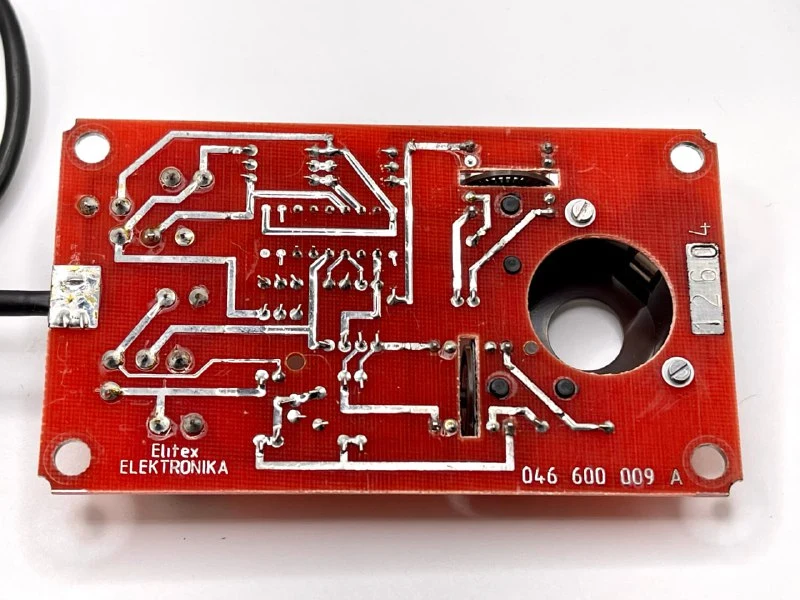

The only mass-produced Czech ball mouse. We found a Slovak mouse too, but that's for later. It was developed in 1988–1989 at TESLA Blatná with engineers from the [JZD Slušovice](https://en.wikipedia.org/wiki/JZD_Slu%C5%A1ovice) agricultural cooperative for the eight-bit TNS HC-08 terminal, and later the sixteen-bit HC-16.

The story of a collective farm building a high-tech operation is interesting in itself.

In the mid-1970s, chairman František Čuba introduced piecework bonuses, strict accountability for resources and the right for workshops to find their own customers. This internal market quadrupled turnover to 3.5 billion Czechoslovak crowns, US$360 million.

The need to automate an organisation of 6,000 employees led it to assemble an engineering team in 1982 and build its own TNS computer. By 1984 other enterprises were queuing up, and a state order followed in 1988. Special foreign-currency status also allowed the cooperative to keep part of its export earnings and buy imported components and equipment directly.

The mouse is simple inside: TTL-level signal shaping with an LM339 comparator, two optocouplers for each X/Y axis and three microswitches. All processing logic lived in the computer. Connectors and pinouts depended on the target machine, in variants 05 and 07. An RS-232 COM version was planned but never released.

The case copies the Genius GM6. Did they get the size wrong because they designed it from photographs?

Most went to classrooms, where HC-08s worked as network terminals. Retail pricing was high: 820 crowns, or US$100, comparable to an engineer's monthly salary.

In 1989 the borders opened, cheap Western equipment flooded the market, TNS computers became uneconomic and the agricultural enterprise soon ceased to exist.

[TESLA Blatná](https://tesla-blatna.eu/history.php) was privatised, survived and is doing well, now making power resistors and automotive electrical products.

An interesting [video of TNS production](https://www.youtube.com/watch?v=ZqBmcNC6WDY), though they didn't show the mice. A must-watch for lovers of Czech!
