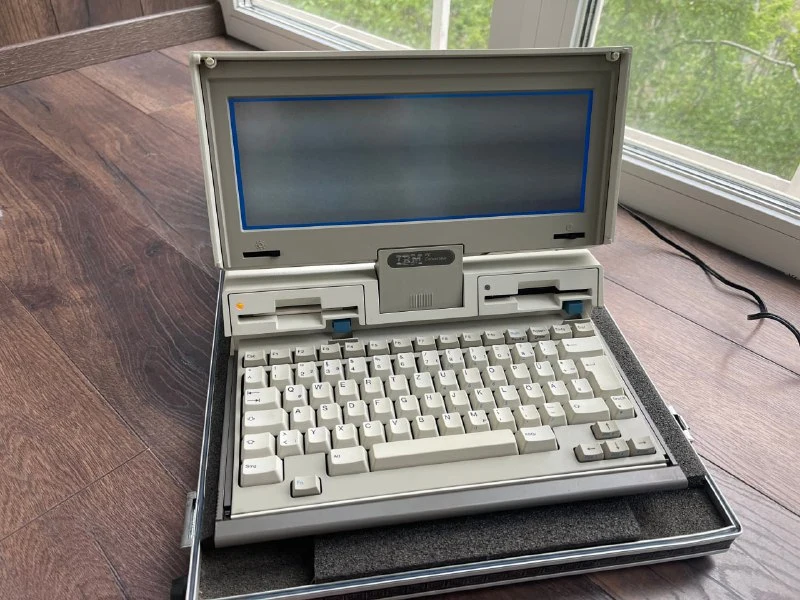
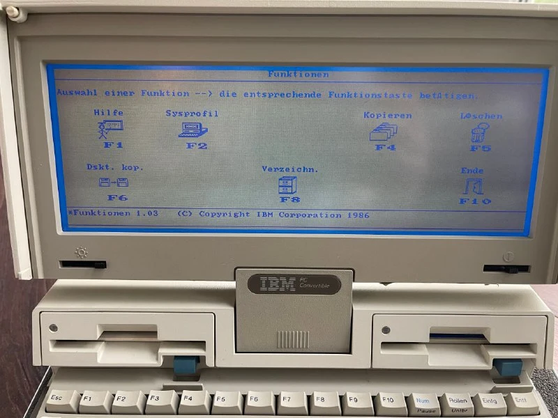
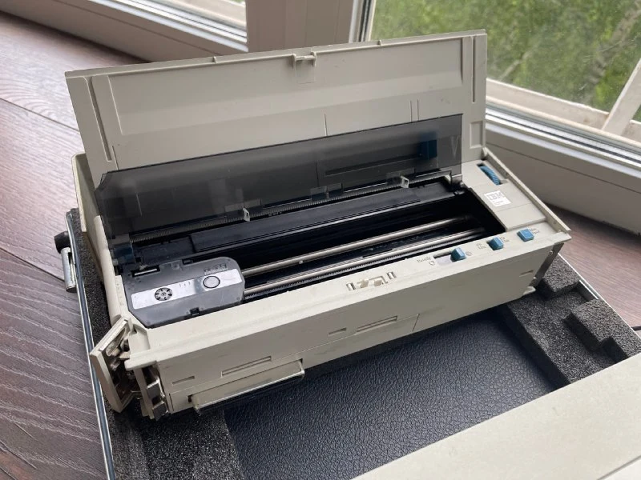
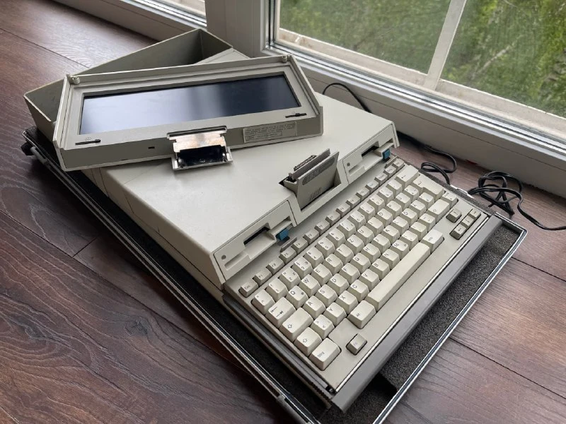
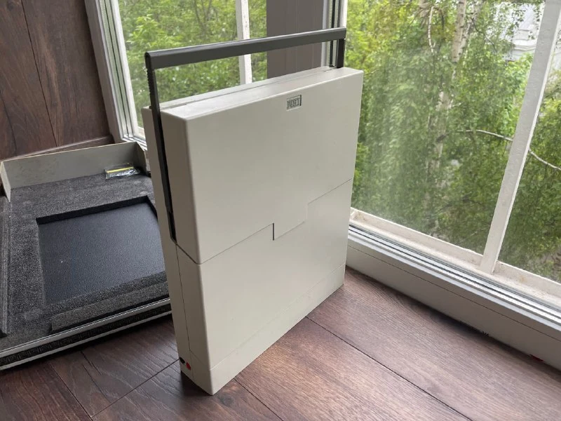

В чемодане лежит первый ноутбук IBM - Convertible 5140.
Представлен 3 апреля 1986 года. 
По сравнению с предыдущим творением IBM, претендующим на мобильность [(IBM portable 5155),](https://habr.com/ru/companies/selectel/articles/561468/) ноут весит смешные 6кг (против 13.5кг), но там были честные 13.5кг, только кабель носи отдельно, а тут добавились модули расширения и чемодан тоже не легкий.

Чемодан настолько неубиваемый, что ноут без проблем доехал обычной почтой из Германии в РФ, правда это было лет 10 назад =) 
Забавно, что я с тех пор не видел ни одной продажи с таким чемоданом, только мягкая сумочка IBM.

Как у любого ноута из 1980х у нашего героя есть ручка. При открытии крышки средняя часть корпуса и клавиатура чуть преподнимаются. Дизайнер делал [Ричард Саппер,](https://richardsapperdesign.com/) который к тому времени уже прославился как лауреат премий Compasso d’Oro за [коферварку](https://richardsapperdesign.com/products/9090-2/) и сотрудничал с IBM. В случае с Convertible Сапперу удалось задать форму, опередившую время: строгий серо-бежевый корпус 5140 предвосхитил эстетику линейки IBM PS/2, появившейся годом спустя.

В ноуте нет ни одного стандартного порта, вместо этого есть набор модулей расширения, которые цепляются сзади друг-другу на общую шину.  Моя версия с принтером. Конструктивно модули цепляются крепко и не отрываются при транспортировке.

Для реализации собственно "конвертируемости" необходим был модуль подключения к внешнему монитору. Вместе они образовывали "док.станцию" - можно было отсоединить дисплей ноутбука и использовать ноут как полноценную машину на столе. Смотрите рекламу того времени (внимательный зритель оценит отсылку к авто).

По железу. 
**Проц**: 16-разрядный Intel 80C88 4,77 МГц. Этот чип построен по технологии CMOS и имеет «статическое» ядро, способное останавливаться без потери данных. Выбор 80C88 обеспечил совместимость с IBM PC/XT, но к 1986 году такой CPU считался устаревшим – конкуренты уже использовали 16-разрядные 80286. Тем не менее CMOS-8088 потреблял меньше энергии и позволил реализовать режимы энергосбережения.

**Память**: 256 Кбайт ОЗУ с возможностью расширения до 640 Кбайт. Используется статическая RAM – дорогая, но зато сохраняющая содержимое при паузе работы. Благодаря этому решению ноутбук мог входить в режим «сна» – при нажатии кнопки питания система не выключалась полностью, а приостанавливалась, сохраняя оперативные данные. Сегодня для нас это привычно, но тогда IBM были первыми, кто такое придумал.

**HDD** нет. Вместо него два 3.5" флопа по 720Кб. Тогда 3.5" только появлялся, и для IBM это был первый компьютер с такими флопами.

Монохромный **LCD-экран** с диагональю ~10″, отображает 80×25 символов или графические режимы 640×200 и 320×200 точек. Матрица очень широкая, из-за чего символы выглядят сплюснутыми по вертикали.

**Работа от батареи** - 8-10 часов! (нет hdd, экономичный проц, дисплей без подсветки)

**Софт**. Ноут поставлялся с фирменной IBM PC DOS 3.2 на дискетах. Впервые для портативного ПК IBM включила графическую оболочку с иконками, облегчающую работу пользователя. Эта оболочка запускалась поверх DOS и представляла собой меню с пиктограммами установленных приложений – прообраз более поздних иконко-ориентированных интерфейсов - позволял выбирать программы без ввода команд, что было дружелюбно для новичков. 
Из программного обеспечения IBM предлагала набор базовых приложений: текстовый редактор, электронные таблицы, блокнот, утилиты управления питанием и портами. В комплект входил «Guide to Operations» – руководства и дискеты с демо-программами.

Итого имеем слабое железо и дисплей не очень хорошего качества. Пишут, что IBM сознательно не стала ставить топ-железо, чтобы не канибилизировать рынок своих компьютеров. 
Поэтому коммерчески проект не очень успешен. Тошиба и Compaq предлагали 286-машины с открытыми портами.

Тем не менее, в истории индустрии IBM PC Convertible занял важное место. Он продемонстрировал, что полноценный PC может быть переносным и работать от батареи, подтвердил жизнеспособность форм-фактора с жк-экраном и встроенной клавиатурой – того вида, который сохраняется до сих пор. А решение IBM внедрить 3,5″ дискету многие считают одним из ключевых в  стандартизации носителей информации.
