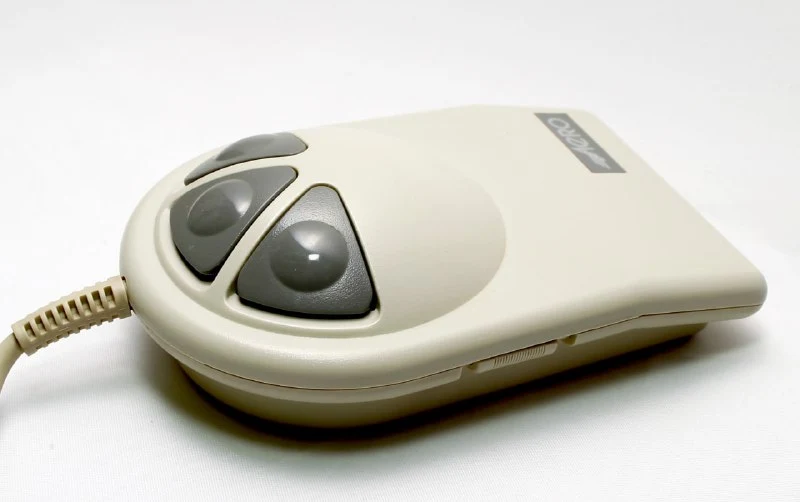
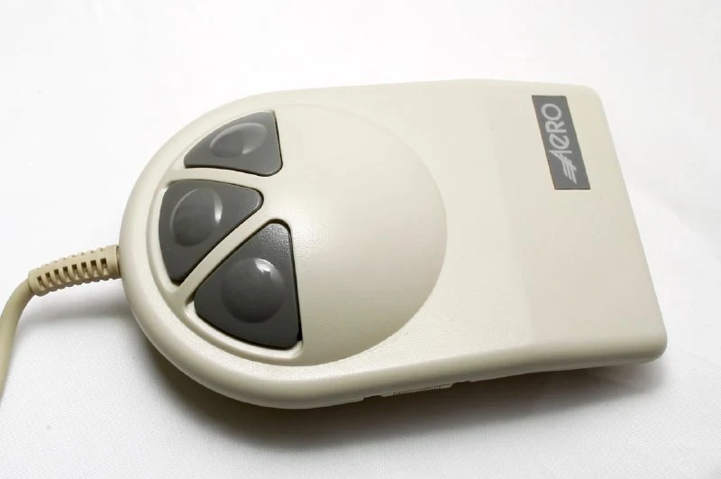
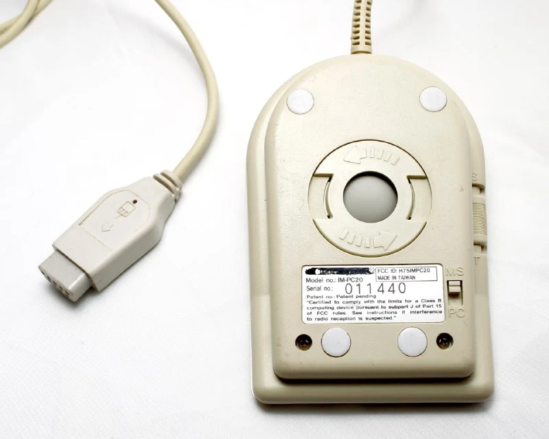
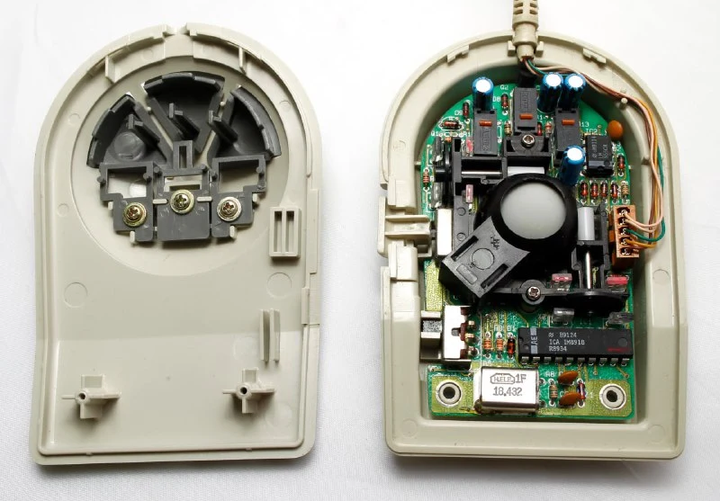
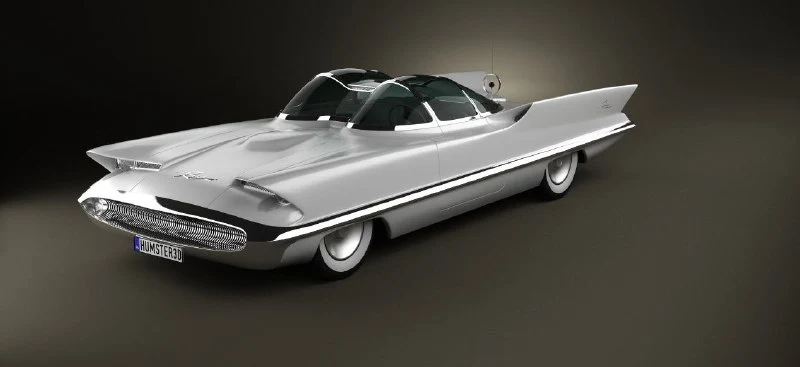

Продолжаем обзор мышей с дизайнерскими премиями. 
1989 год, футуристичный симметричный корпус с тремя кнопками. Чем-то напоминает НЛО.  
Некоторые замечают сходство и отсылки к линиям Lincoln Futura и похожим машинкам. В описании [iF Design Award 1991](https://ifdesign.com/en/winner-ranking/project/aero-mouse/18425) явно указывают "spaceship-like" дизайн.

Не удалось найти электронную версию инструкции, зато нашлась оригинальная в [научно-технической библиотеке](http://www.gpntb.ru/), и, пройдя некоторый квест с получением читательского билета и доставки инструкции в нужное отделение, мне удалось приобщиться к прекрасным 70 (семидесяти) страницам.

Инструкция вообще написана потрясающе подробно - растянуть подключение и управление мышью на 30 страниц - надо постараться, какой-то душнила писал.  
Лучше бы назвали режимы Slow, Normal и Fast, вместо Slow, Normal и Turbo - мы бы тогда не пытались угадать, что значит кнопка T на корпусе. 
Slow (40dpi) используется для рисования (в комплекте была Dr. Halo Plus - что-то типа раннего автокада). 
Turbo (1000dpi) - для больших экранов (помним, что большими считается все, что больше 640*480).

Мышка поддерживает подключение по двум протоколам(второй переключатель): MS (совместимость с microsoft, кто-то даже к win10 подключал), PC (совместимость с Mouse Systems для подключения к sun-технике). 
Прилагается софт, с помощью которого можно настроить кнопки под левую руку, а также задать действия в каком-то наборе популярных(?) программ.  
 
Также из инструкции мы узнаем, что мышь протестирована на дистанции 480 км. Поэтому рекомендуют чистить мышь правильно. Кто хочет освежить в памяти как надо - положу в комменты.

