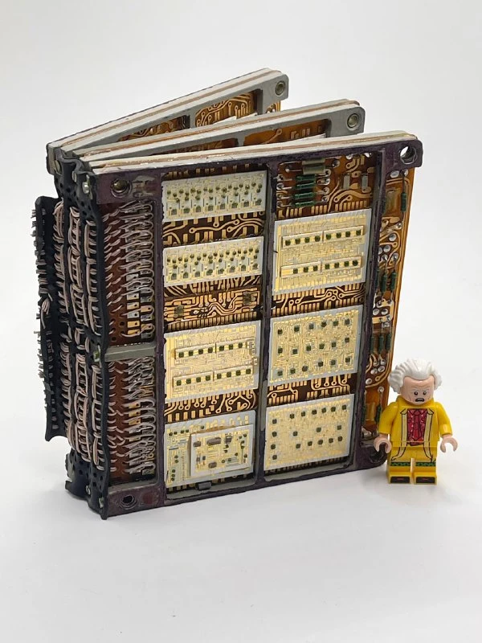
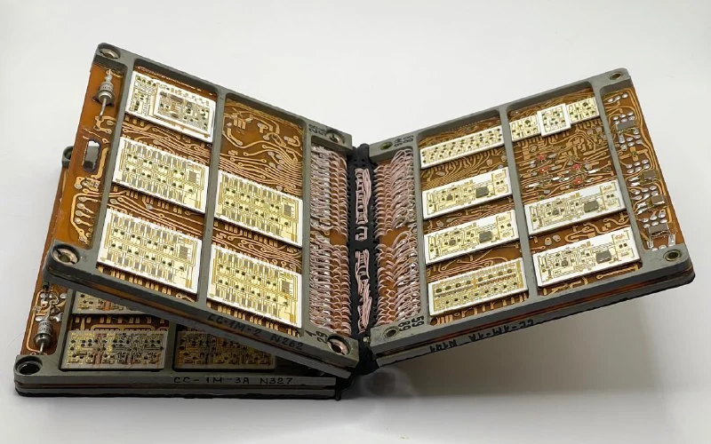
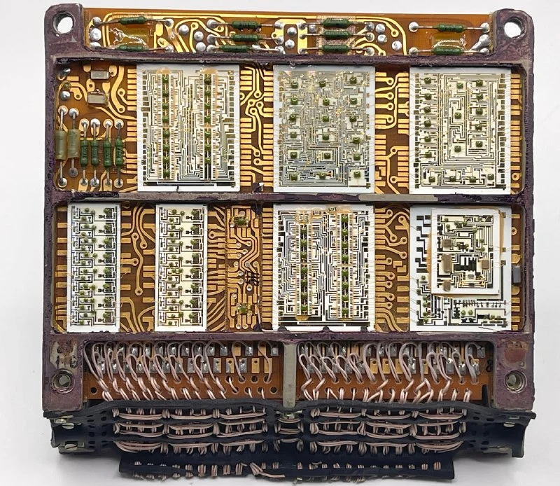
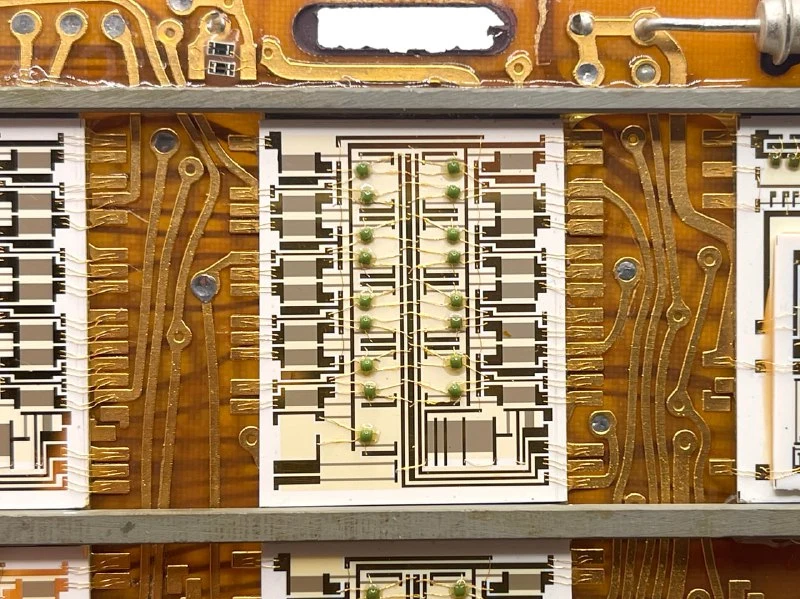

Расшифровывается как «Система синхронизации, модификация 1М». Блок СС-1М был разработан в 1970-х годах как первый микроэлектронный прибор третьего поколения, функционально заменяющий коммутационные устройства (селекторы сигналов) старых телеметрических систем.

Предназначен для коммутации и кодирования сигналов от множества датчиков и выдачи синхронизированных импульсов управления. В частности, он осуществляет сбор аналоговых сигналов датчиков (например, температур, давлений) и их мультиплексирование (поочерёдное подключение к общему каналу) с последующим преобразованием в цифровой код.

Это не вся "книжка", а только несколько "страниц".

Производитель - завод Компонент в Зеленограде, ныне существующий. 
Все микросхемы оформлены в виде кристаллов без корпусов на общей керамической подложке. Обычно каждый зеленый кристаллик-пупырка располагается в отдельной корпусной микросхеме. 
Также на самой подложке могут быть вытравлены какие-то элементы, а какие-то напаяны методом поверхностного монтажа. Формально называется "гибридные интегральные микросборки".

Предположительно использовалась в системах телеметрии типа Сириус, Скут и их модификаций в больших ракетах и наземных радиолокационных станциях.
