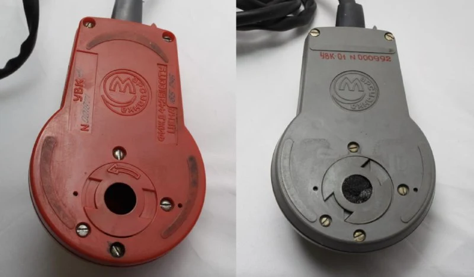

Unexpectedly discovered an engineering sample of the [Martian Mouse](https://collectionerus.ru/search/old-mice/?q=%D0%BC%D0%B0%D1%80%D1%81%D0%B8%D0%B0%D0%BD%D0%BA%D0%B0). First, this dark grey colour isn't documented anywhere; second, the underside tells the story.

I also started digging into prices. It looks very much as though the people at [Mars](https://www.mokb-mars.ru/) initially made a red version and sold it for 185 roubles, then switched to black and white ones at 156. I need more data on colour, serial number and price.

#mouse
