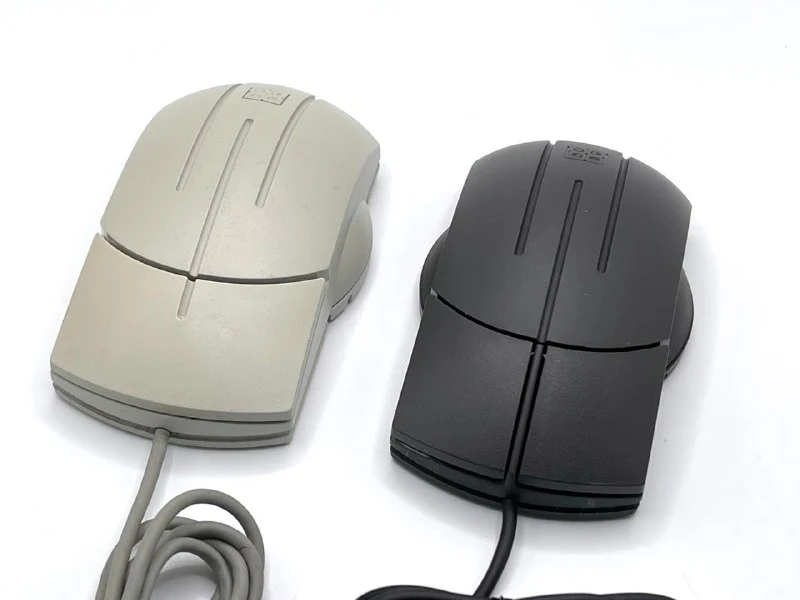
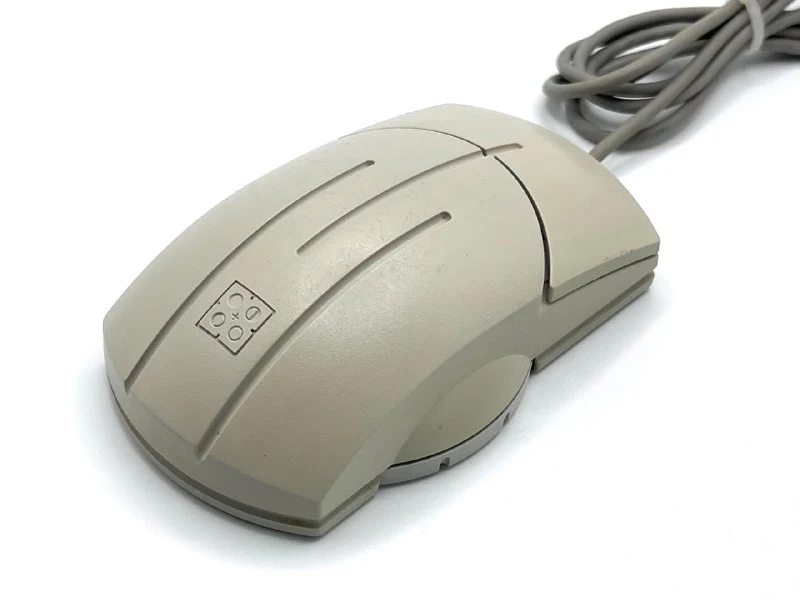
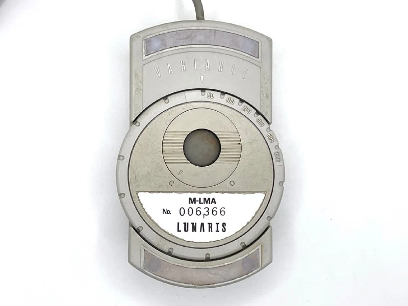
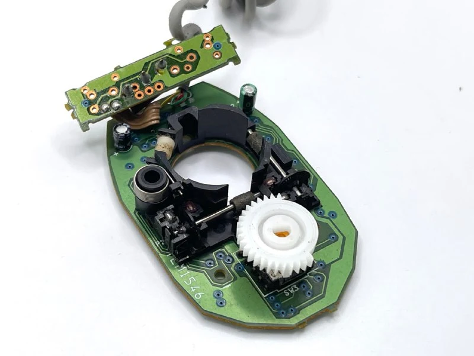
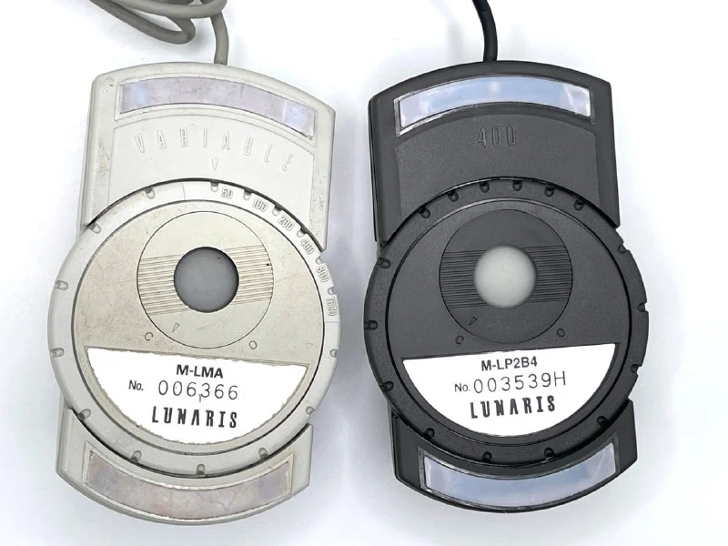

Lunaris — серия культовых механических мышей Elecom 1994 года, разработанная [frog design](https://ru.wikipedia.org/wiki/Frog_Design) специально для японского рынка. Модели отличались футуристичным «расколотым» корпусом, уникальным диском‑регулятором разрешения на днище (50‑1600 cpi) и богатой линейкой интерфейсов — от PC‑98 и PS/2 до ADB для Mac. 
Мышка просуществовала до начала 2000-х, то есть были версии с USB.

Кроме мыши в линейку входил монитор и numpad (кусок клавиатуры с цифрами). 
Мышка и монитор [получили награды](https://www.g-mark.org/en/gallery/winners/9cdee7d5-803d-11ed-862b-0242ac130002?companies=ee32b413-4f2a-4be3-bb19-239a49af3d8e&years=1994) Good Design Award 1994 года. 
Черная версия выпущена специально для mac-ноутов серии PowerBook, чтобы не выбиваться из стиля.

Про переключатель интересно. В спеках и собственно на корпусе заявлено 6 вариантов чувствительности: 50/100/200/400/800/1600 cpi (counts/inch) (штук на дюйм), где "штука" - это один сигнал о смещении, и официально он называется **1 микки**. Иногда удобно переводить чувствительность в более понятную терминологию вида "сколько дюймов/мм по столу должна проехать мышка, чтобы сформировать один импульс смещения". 
Например, для 50 CPI: 1 микии = 0.5мм, то есть на каждые 0.5 мм компьютер получает от мышки импульс.

Так вот, само кольцо имеет шесть положений. Но если посмотреть на сам переключатель, то он имеет 9 положений, то есть технически была возможность расширить левую границу 6.25/12.5/25. Достаточно пытливый пользователь мог сместить начальное положение диска и иметь любой диапазон из 6-ти значений в рамах интервала 6.25 - 1600.

При этом во всей линейке только первая мышь была с регулятором, дальше ребята не заморачивались, 400cpi хватит всем. Но корпус не поменяли, просто [вставили штыречек](https://collectionerus.ru/collections/old-mice/250/), блокирующий поворот диска.

