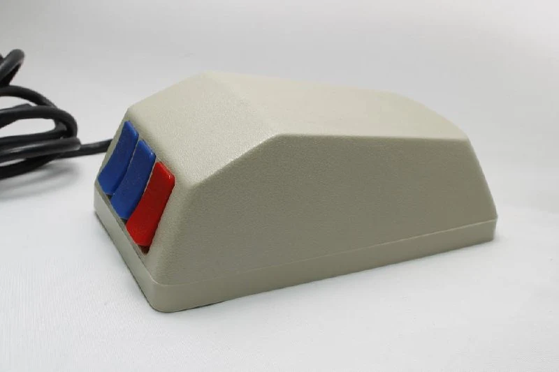
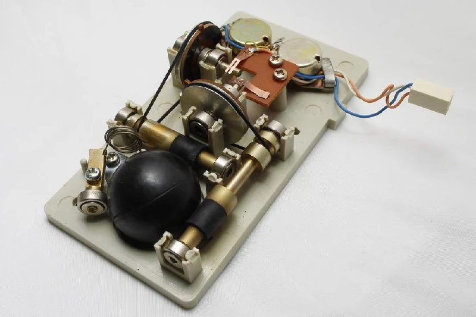
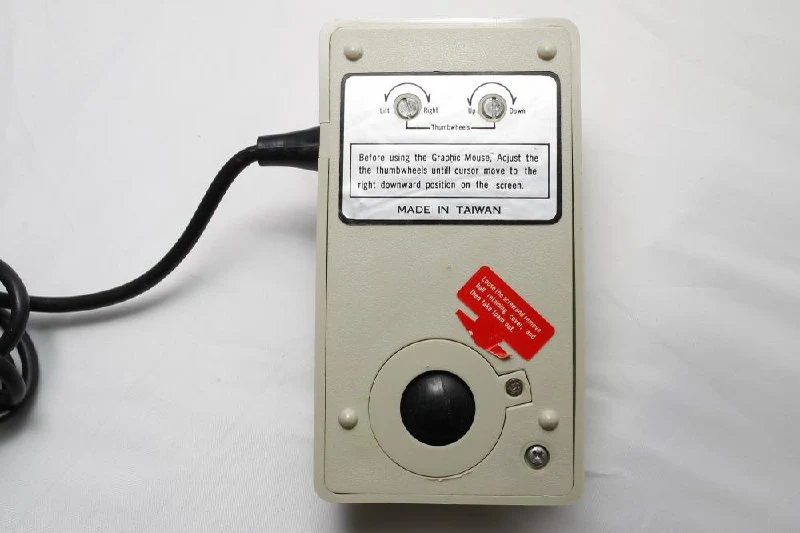
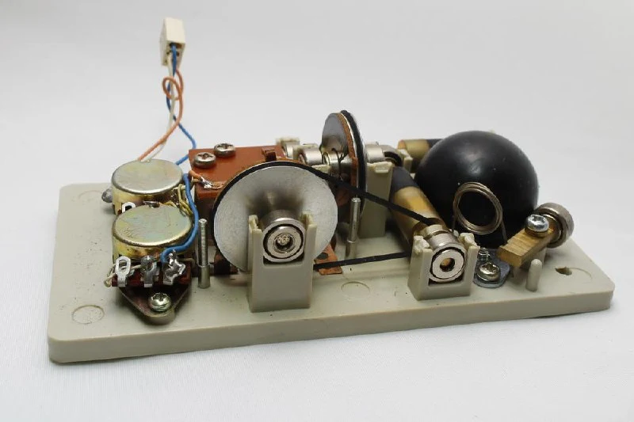

Самая суровая мышь по механике. 
В качестве датчиков - переменные резисторы, которые имеют фиксированные положения min-max, поэтому на пузе есть регулировка, которая позволяет совместить границы экрана и виртуальный рабочий экран мышки.

Пассиковая передача! (пассики, кстати, не высохли за все это время, как обычно бывает на аудио технике).
Ну и зацените прижимную пружинку. 
Мозгов нет никаких, по электронной начинке это больше похоже на "плавный джойстик", чем на классическую мышь.
Выглядит это все как прототип, но мышек было выпущено достаточно много с разными именами и цветными кнопками. Этот вариант для Apple II, но были также и для Commodore.
[#mouse](https://t.me/s/old_mice_and_hw?q=%23mouse)

