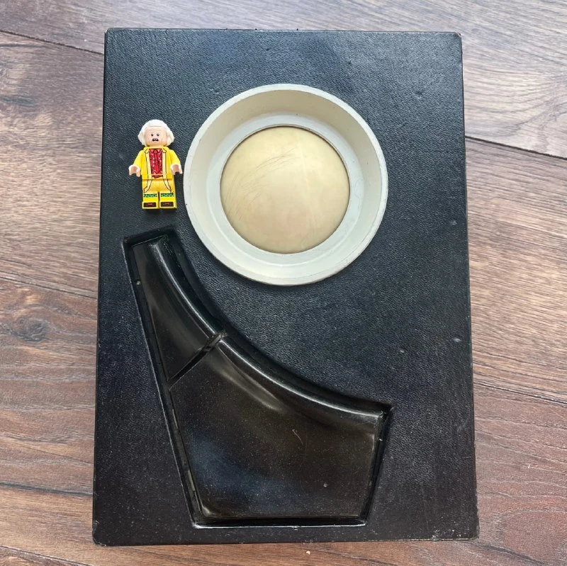
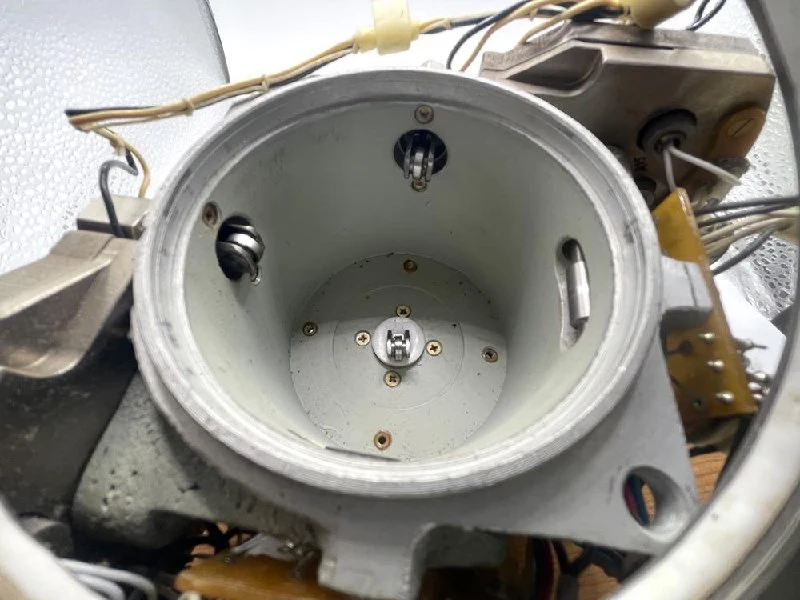
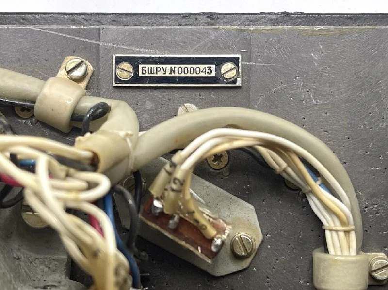
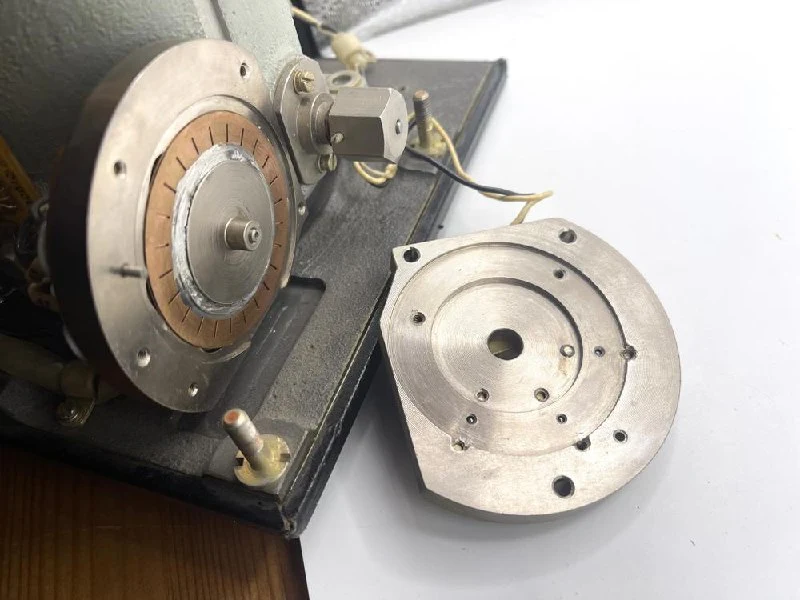
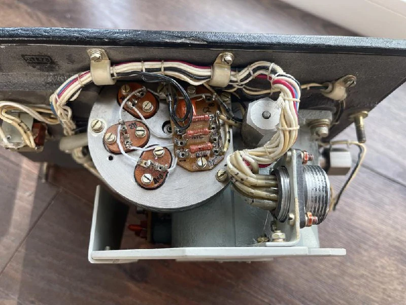

Almost no information survives, and even the name is approximate: a ball-based manual control unit. I'm more confident about the first two Russian words than the last two.

The previous owner described it as being from a submarine, without details. The board is dated 1987.

The button shapes are very unusual. Usually buttons follow some sort of geometry, but here they sit on an arc, vary in size and are pressed in different directions. Update: we worked it out; see the comment. The ergonomics really are good.

Inside are elaborate optomechanics. There are three optical pairs rather than the usual two. Instead of one slotted disc, there are two: one stationary and one rotating. The slots align one at a time in sequence, which should provide good resistance to interference.

Each pair has only an operational amplifier on its output, passing raw signals to the computer. The trackball has no processing electronics of its own.

Opposite each encoder shaft is a spring-loaded bearing on an adjustable axle. Outside the cup is an adjustment nut with a locking screw, allowing the initial pressure to be set and later adjusted for the task or operator.

On another [ball manipulator](https://collectionerus.ru/collections/old-mice/69/), a knob on the case provided continuous pressure adjustment. Here it looks more like a periodic maintenance operation. There is also a theory that the ball wears down over time, requiring the pressure to be corrected.

If you know more, the comments are open.

P.S. Neural networks are fun.
