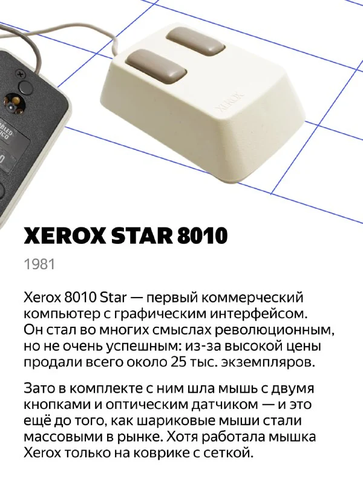
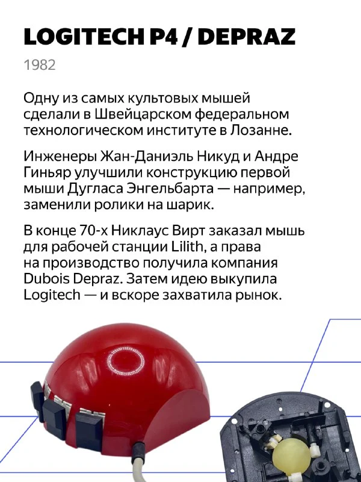
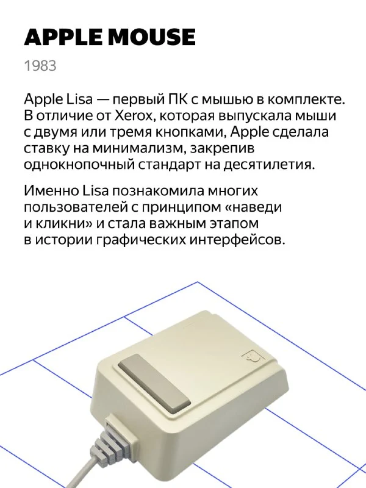
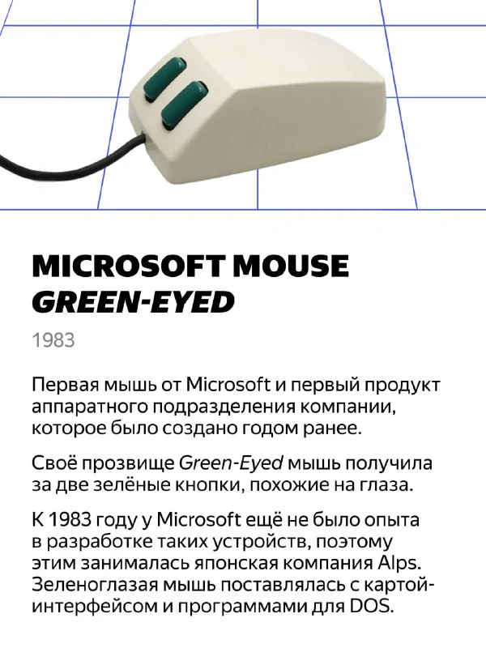
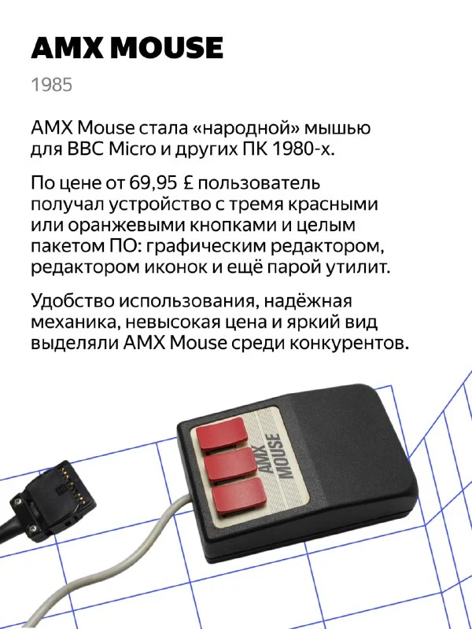
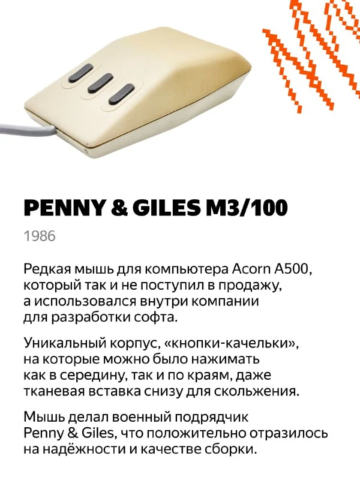
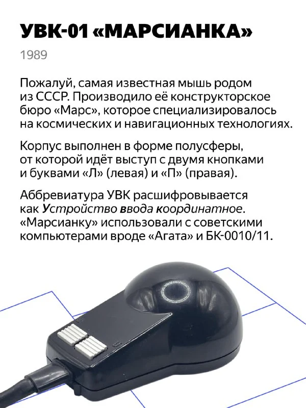
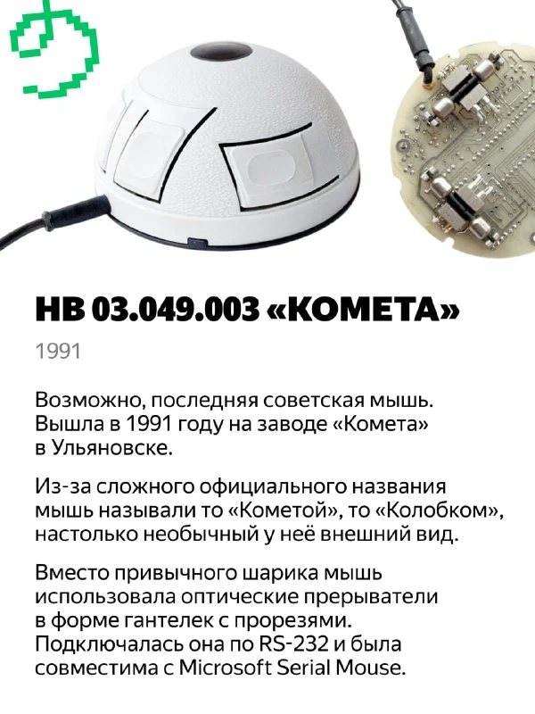

***🖱*** **Эволюция компьютерной мыши: от «зеленоглазой» до «марсианки»**

[Фестиваль Яндекс Музея](https://clck.ru/3PA4ZB) всё ближе, а мы продолжаем представлять его участников ***✨***

Сегодня вместе с коллекционером [Михаилом Павловым](https://t.me/old_mice_and_hw) на примере его экспонатов расскажем, как развивались компьютерные мыши — от первых коммерческих оптических устройств Xerox до советских «марсианок» и «колобков». Узнаем, почему Microsoft делала мышей с «зелёными глазами», зачем Penny & Giles добавляли тканевые вставки, и как швейцарские инженеры покорили весь мир.

Листайте карточки и приходите на Фестиваль Яндекс Музея, чтобы увидеть легендарные мыши вживую — [зарегистрироваться](https://forms.yandex.ru/surveys/13772601.b5d450a34271f463916689b678f18c7d4e3137d2/) можно уже сейчас!

***🗓*** **27–28 сентября**

***🌟*** Москва, [ЦСИ Винзавод](https://yandex.ru/maps/-/CLAOu-Ml)

[#фестиваль_яндекс_музея](https://t.me/s/old_mice_and_hw?q=%23%D1%84%D0%B5%D1%81%D1%82%D0%B8%D0%B2%D0%B0%D0%BB%D1%8C_%D1%8F%D0%BD%D0%B4%D0%B5%D0%BA%D1%81_%D0%BC%D1%83%D0%B7%D0%B5%D1%8F)

