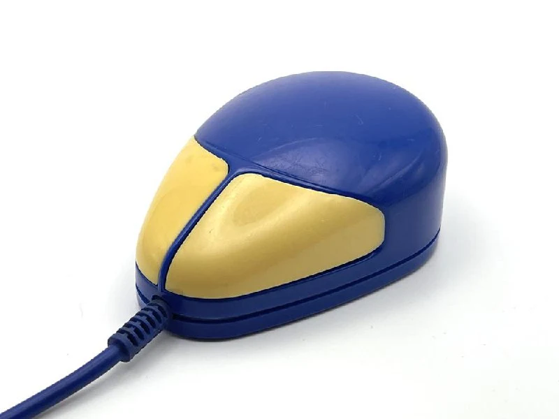
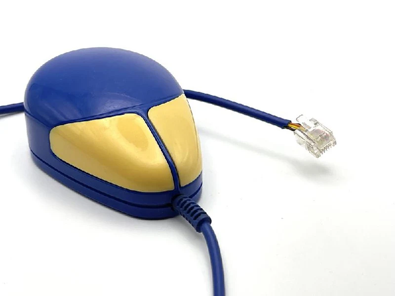
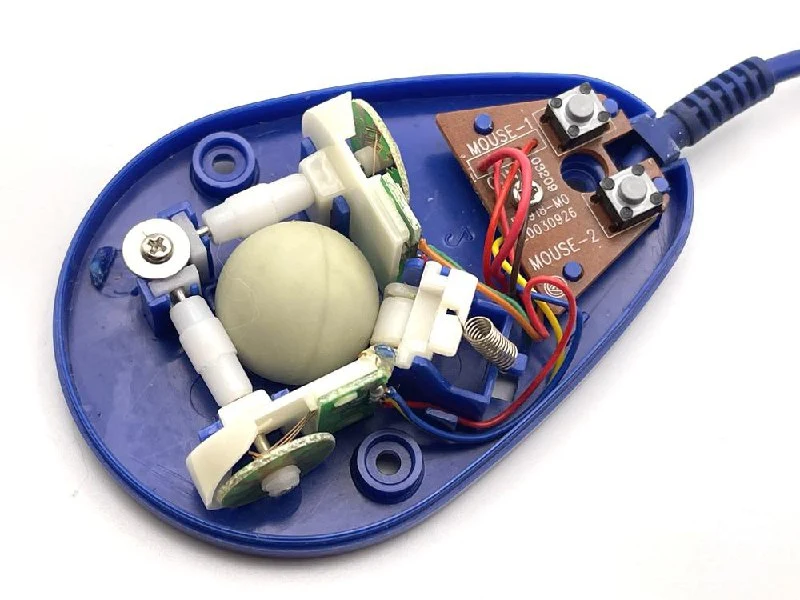
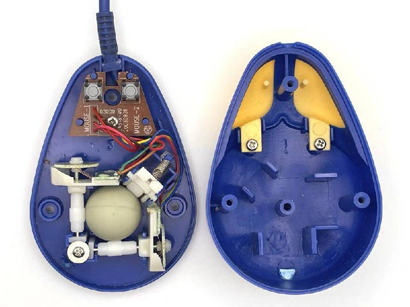
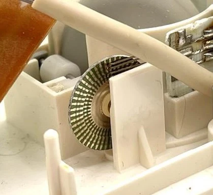
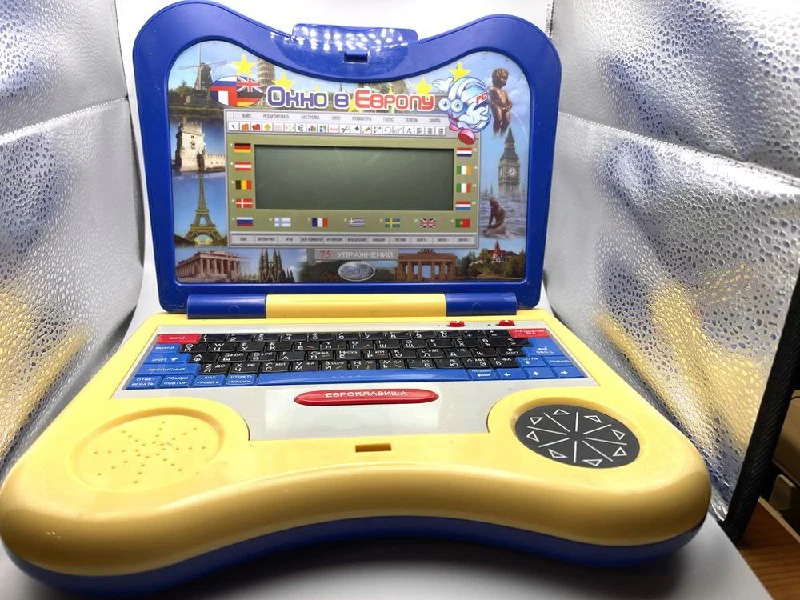

Мышка от детского обучающего компьютера Окно в Европу.
Третья по популярности мышь у детей на Фестивале. (угадайте, какая на втором месте ^_^)

Компьютеров для детей в таком форм-факторе было сделано довольно дофига, и большая их часть с мышками. 
Но почти везде эти мышки бутафорские - только кнопки, вынесенные на проводе.

Здесь же слепили довольно неплохую с точки зрения дизайна мышь, с шариком, но на старой дискретной технологии. Это когда на диске нанесены контактные полоски, а в диск упираются три "усика". Когда полоска проходит под парой усиков, то контакт замыкается и мышка считывает один квант смещения (1 микки, выше [был пост с подробностями](https://t.me/old_mice_and_hw/196)). 
Полоски ближе к краю диска расположены со смещением, таким образом можно понимать, в какую сторону крутится диск, по тому, какая из пар усиков сработала.

В самой мышке нет никакой обработки сигнала -  события от  кнопок и энкодеров передаются по шести проводам в компьютер и обрабатываются уже внутренним ПО.

Самая молодая мышь на дискретных датчиках у меня от 1991 года. А тут сам компьютер промаркирован 2003 годом. В 2003 уже можно было бы что-то более современное и, скорее всего, более дешевое собрать на массовых технологиях (правда еще софт переписать надо). 
Шар тут тоже нестандартный - меньше по диаметру, чем те, которые мы привыкли видеть в массовых китайских мышах.

Сам компьютер забавный. Есть, например кнопка "Евроклавиша". 
Кому надо, могу отдать на опыты, пишите =)

