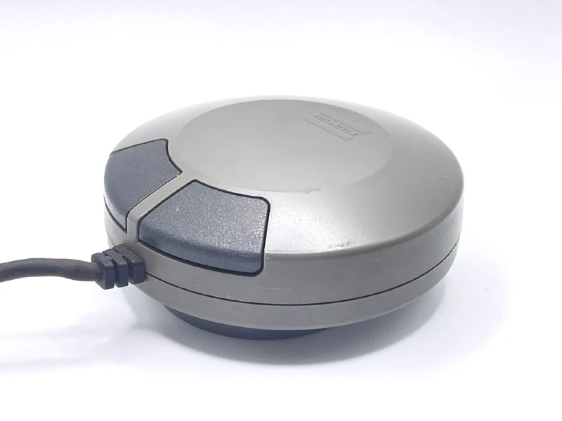
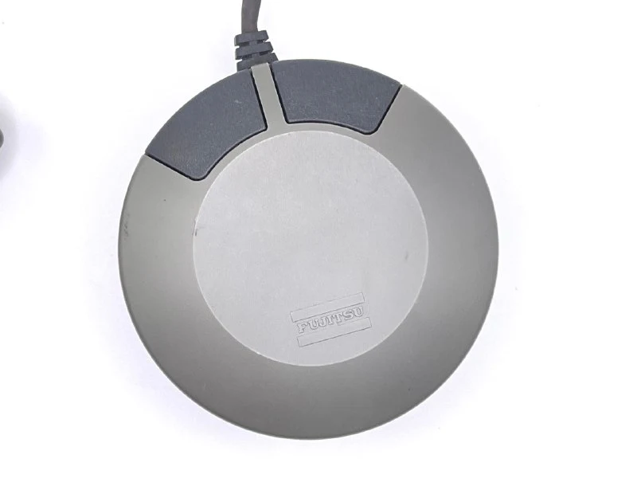
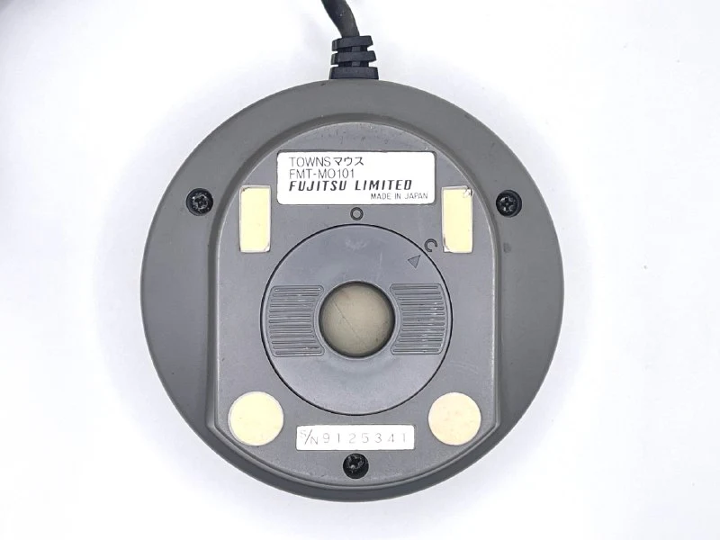
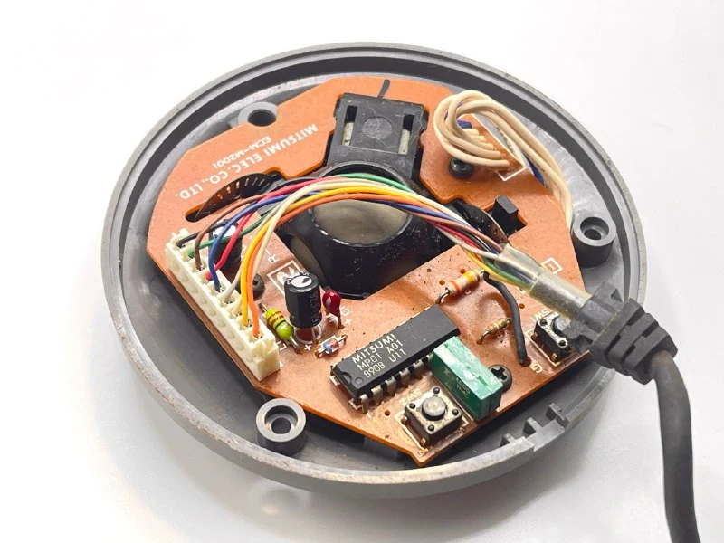
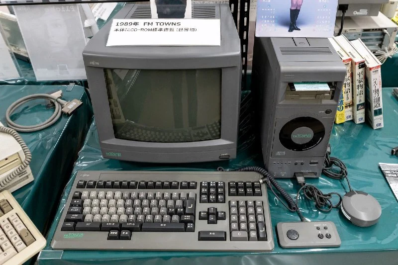

In February 1989, Fujitsu introduced the FM TOWNS personal computer, the first PC with a built-in CD-ROM and a focus on multimedia applications, games and graphics. In a sense, it was the first computer aimed at entertainment rather than business.

Its graphical Towns OS and multimedia interface needed a convenient pointing device, so a mouse was standard equipment with the earliest FM TOWNS models. That distinguished it from most Japanese PCs of the period, for which mice were usually optional.

Fujitsu's strategy was intuitive multimedia use: almost every FM TOWNS operation could be performed with a mouse and minimal keyboard input. Some see it as a response to Apple's Macintosh and its compulsory mouse, but compatible with PC/DOS.

The whole system received a Japanese Good Design Award that year. History shows, though, that elaborate design doesn't always make for comfortable use. The mushroom or tablet shape was awkward for small hands, and the round symmetrical case made orientation easy to lose. Nearly ten years later, Apple would fall into the same trap with the [Hockey Puck](https://collectionerus.ru/collections/old-mice/98/).

Its Atari/MSX connection interface was also used during the 1980s for mice and joysticks on MSX, NEC PC-8801, Atari and Commodore Amiga systems. All encoder processing occurred in the computer, which counted pulses and calculated movement. By comparison, a serial/COM mouse calculates movement internally and sends ready-made coordinate deltas.

Users could connect practically any MSX, PC-88 or Atari mouse to the FM TOWNS and it would work correctly. The reverse worked too.

Fujitsu listened to the ergonomic feedback, and later mice in the range adopted a more conventional shape. We'll look at them another time =)
