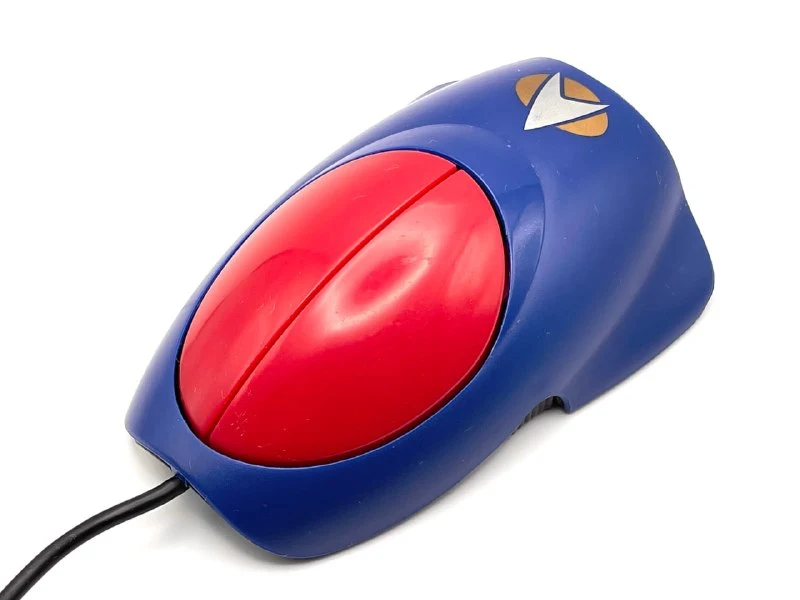
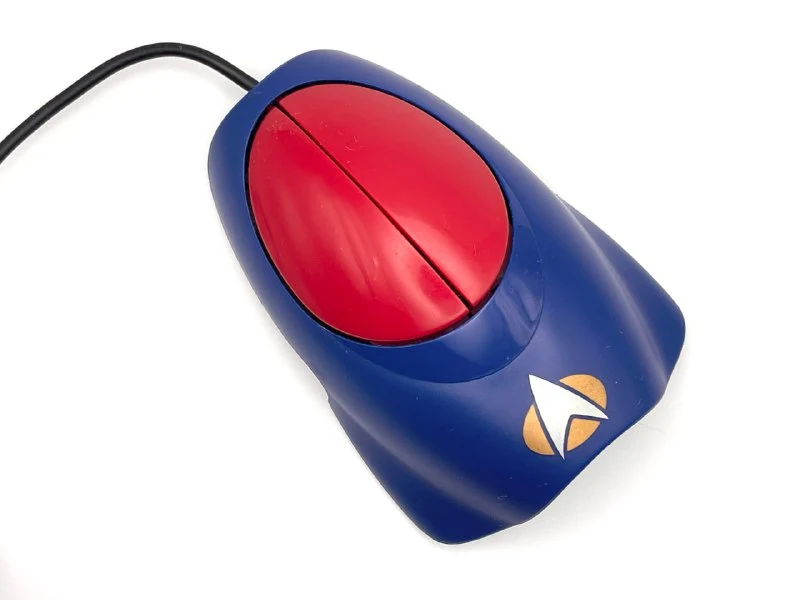
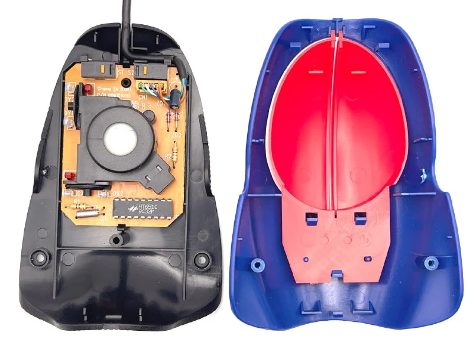
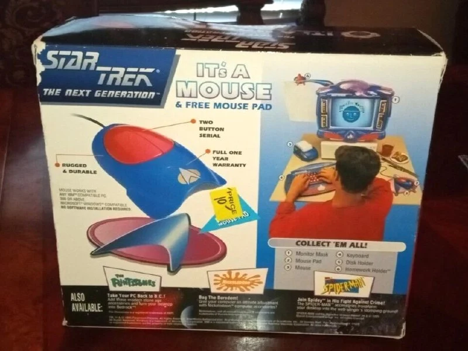
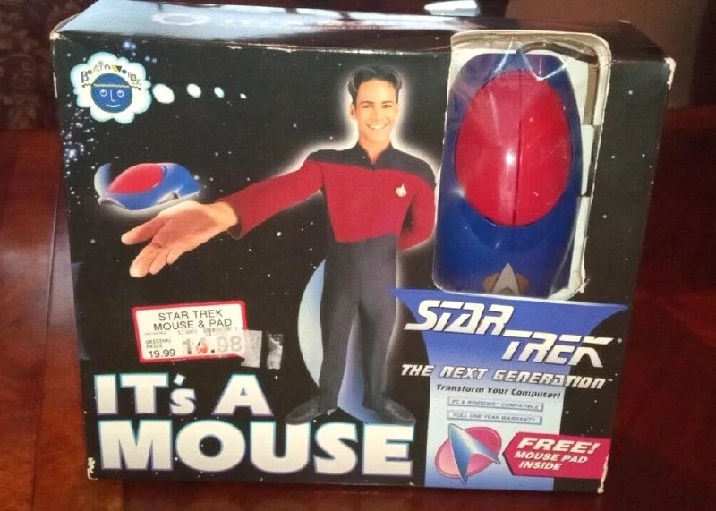
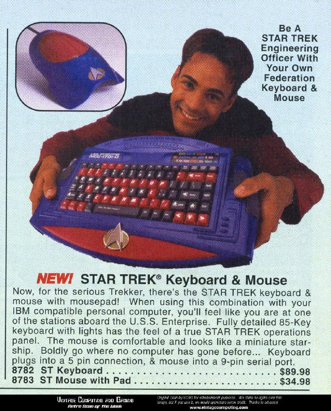

Мышка 1994 года, выпустилась как часть фанатского комплекта: клавиатура, накладка на монитор, мышь+коврик.
Вся линейка объединялась названием "It's A <...>" и превращала компьютер в пульт управления Энтерпрайзом.

Технически ничего интересного, Brainworks использовала oem-начинку тайваньских производителей (там была какая-то история с авторскими правами, но я не копал).
 
Призываю фанатов Стартерка, а особенно TNG, в комменты. 
Это не единственная мышь по теме, позже будет.

