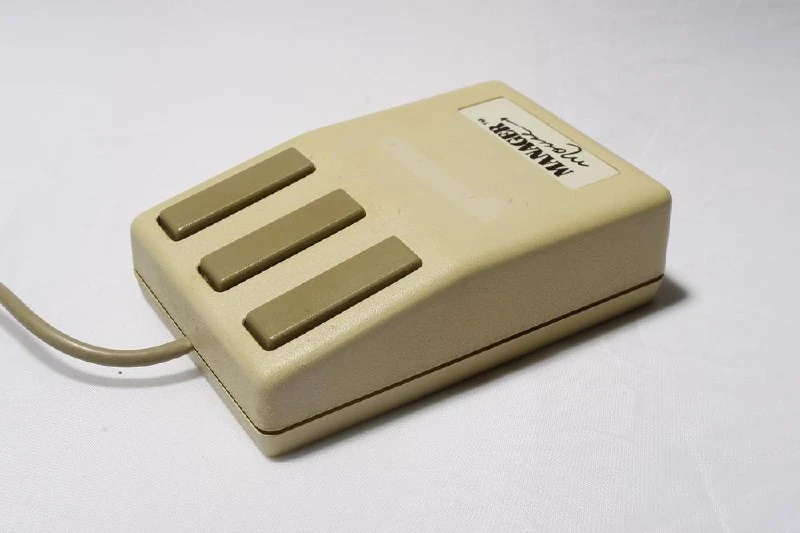
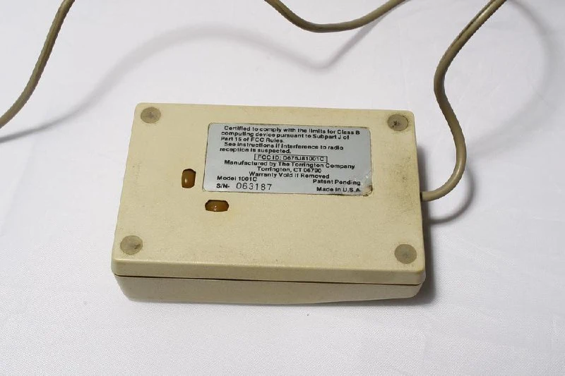
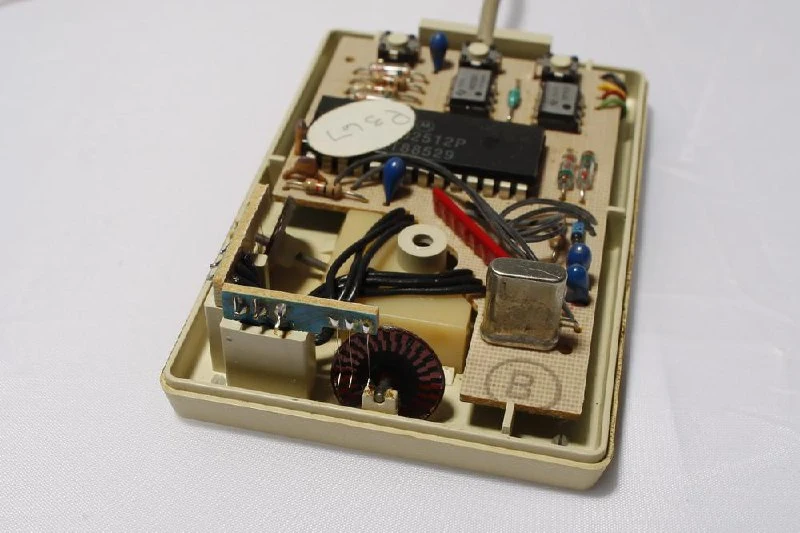

This mouse has an unusual mechanism. No ball: instead, little wheels sit at an angle to the surface.

In a sense, this is an earlier version of the Hawley mechanism; see the [patent](https://web.archive.org/web/20200703234242/http://oldmouse.com/pics/hawley/1986patent4628755_01.jpg). The mouse itself dates to 1985, [according to its FCC ID](https://fccid.io/D676J81001C), while the patent is from 1986.

Instead of optical sensors, it uses contact encoders: contact pads are printed on the disc, and little fingers slide over them. Each closure adds one unit of movement.

Notice that the outer pads are slightly offset from the inner ones. That is how the direction of rotation is detected.

#mouse
