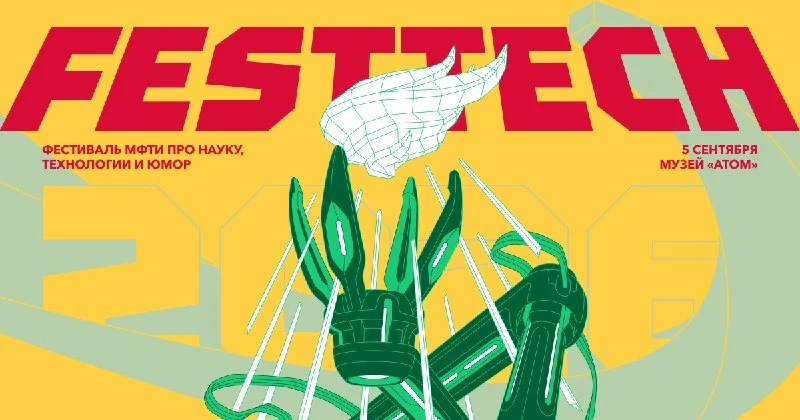

**5 сентября — мышки на FestTech!**

В эту субботу мы с мышками будем на [FestTech](https://festtech.ru/) — фестивале науки и технологий в музее «АТОМ» на ВДНХ.

Привезу с собой небольшую выездную экспозицию: часть мышек будет жить в витрине, а часть, как обычно, можно будет **брать в руки, щёлкать, крутить и рассматривать со всех сторон**.

И важный момент: **это будет другой набор мышей, не тот, который сейчас выставлен в постоянной экспозиции в галерее «Краснохолмская»**. Так что даже если вы уже были там — здесь будет что посмотреть нового :)

Ну и я, конечно, буду рядом — можно приходить знакомиться, задавать вопросы и слушать странные истории о том, зачем люди последние полвека придумывали всё новые и новые способы двигать курсор по экрану.

Участие бесплатное, [зарегистрироваться можно здесь](https://festtechfestival.timepad.ru/event/4094682/).
Приходите щупать мышей ***🐁***
