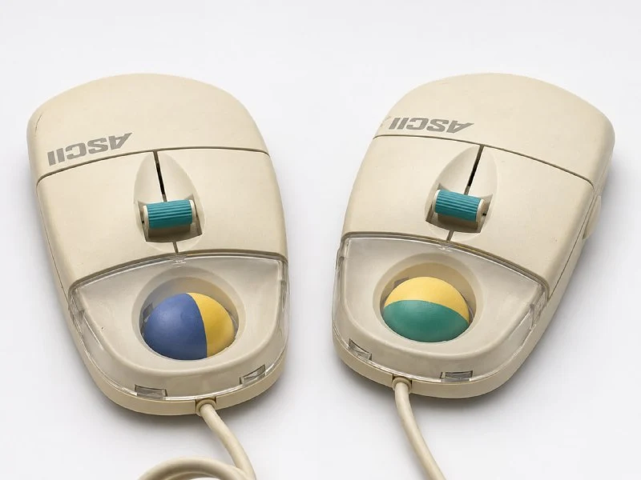
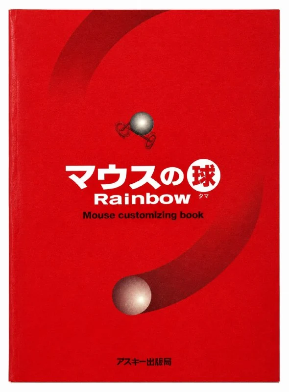
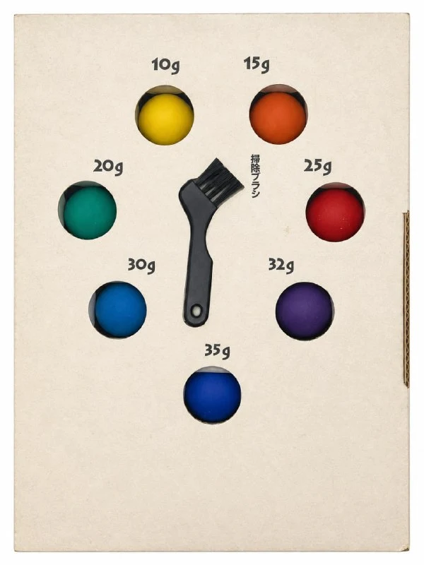
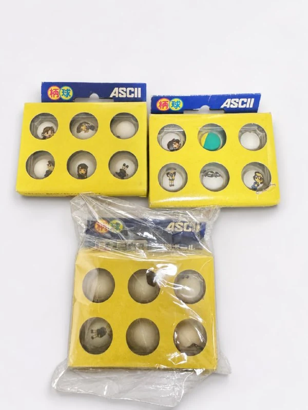

[ASCII MieMouse](https://collectionerus.ru/collections/old-mice/287/) [PM100PS](https://collectionerus.ru/collections/old-mice/287/) 1997

The company began with computer magazines, then moved into software, games, standards and peripherals. Its connection with the history of mice started in the 1980s: ASCII co-founder Kazuhiko Nishi helped arrange the collaboration between Microsoft and Japan's Alps Electric on the first [Microsoft Mouse](https://collectionerus.ru/collections/old-mice/3/) of 1983.

The model was based on a KYE Systems (Genius) technical platform, close to the Genius NetMouse Pro, and received an original case with a visible, replaceable ball.

ASCII itself explained that this shape and the position of the ball had a purpose, or rather three:

**The pleasure of watching the ball move**
Because the ball sits at the front, under a transparent cover, its rotation stays visible even while you work. A classic single-colour ball does not show the spin very clearly, so they made multicoloured ones.

**Smoother control**
The front of the case is bevelled, so the device can be held as naturally as a pen. They claimed this made the wrist less tired.

**Comfortable scrolling**
The company set the "usual wheel", which takes active finger movements, against a more comfortable lever. The third button was moved to the side.

And the most appealing part is being able to customise it.
You could buy extra balls in different colours, with patterns and game characters, as well as different caps for the lever.

Besides the visual customisation, the balls came in different weights. They are 22 mm across and fit many mice, for example an ordinary [Apple Desktop Bus](https://collectionerus.ru/collections/old-mice/36/) mouse.
ASCII released Mouse Customizing Book sets containing several balls (usually seven, from 10 to 35 grams), a cleaning brush, and a booklet on the history of mice by Kazutoshi Otani, a Japanese technology journalist.

Strictly speaking, ASCII had been selling ball sets a year earlier. The first sets were a single colour, black, and when the MieMouse appeared they launched a colour collection called Rainbow.

It is also curious that a special batch of black mice with flag-coloured balls was prepared for COMDEX Fall 97 in the United States. Logistics problems kept it from arriving in time for the show, and what became of that batch is unknown.

I will digitise the booklet soon. There is a lot of interesting material in it.
