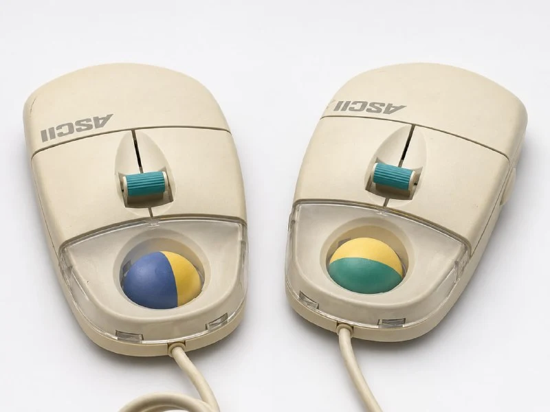
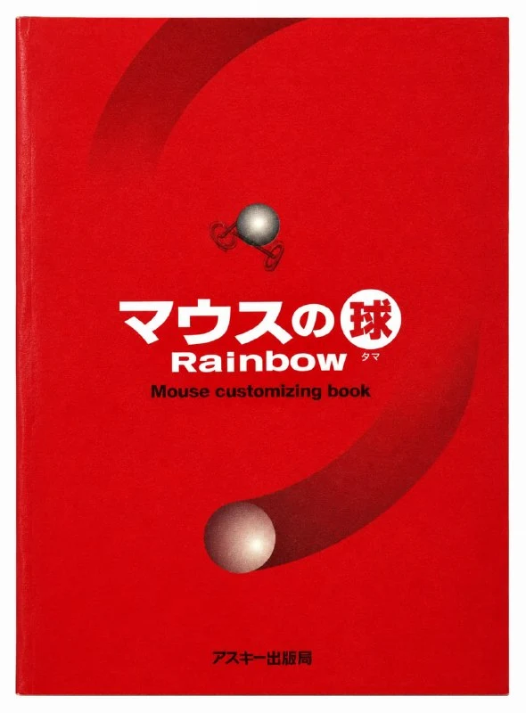
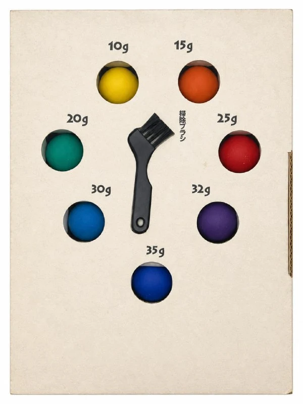
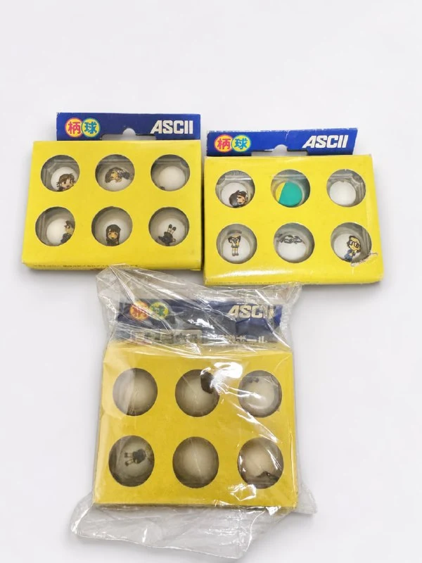

[ASCII MieMouse](https://collectionerus.ru/collections/old-mice/287/) [PM100PS](https://collectionerus.ru/collections/old-mice/287/) 1997 год

Компания начинала с компьютерных журналов, затем занялась софтом, играми, стандартами и периферией. А её связь с историей мышей началась ещё в 1980-х: сооснователь ASCII Кадзухико Ниси помог наладить сотрудничество между Microsoft и японской Alps Electric при разработке первой [Microsoft Mouse](https://collectionerus.ru/collections/old-mice/3/) 1983 года.

Модель опиралась на техническую платформу KYE Systems (Genius), близкую к Genius NetMouse Pro, и получила оригинальный корпус с видимым сменным шариком.

Сама ASCII объясняла, что у такой формы и расположения шарика есть цель, точнее три:

**Удовольствие от наблюдения за движением шарика**
Благодаря тому, что шарик расположен в передней части и прикрыт прозрачной крышкой, его вращение остается заметным даже во время работы. Правда по классическим одноцветным шарам вращения не особо видно, поэтому они придумали разноцветные.

**Более плавное управление**
Передняя часть корпуса имеет скошенную форму, что дает возможность держать устройство так же естественно, как ручку для письма. Утверждалось, что так меньше устает запястье.

**Удобная прокрутка**
Компания явно противопоставляла "привычное колесико", которое требует активных движений пальцами удобному рычажку. А третью кнопку вынесли на бок.

Ну и самое прикольное - это возможность кастомизации под себя. 
Можно было докупить шарики разных цветов, с узорами и персонажами игр, а также купить различные накладки на рычажок.

Кроме визуальной кастомизации можно было использовать шарики разного веса. Они диаметром 22мм и подходят ко многим моделям мышек, например, к обычной [Apple Desktop Bus](https://collectionerus.ru/collections/old-mice/36/).
ASCII выпускала наборы Mouse Customizing Book, в котором было несколько шаров (обычно 7, от 10 до 35 грамм), щеточка для чистки и книжка с историей мышек от Кадзутоси Оотани, японского техножурналиста.

Строго говоря, наборы шариков ASCII продавала и годом раньше - первые наборы были одноцветными - черными, и с появлением MieMouse они запустили цветную коллекцию, назвав ее Rainbow.

Еще забавно, что для выставки COMDEX Fall 97 в США готовилась специальная партия черных мышек с шариками в цветах флага, но до выставки она доехать не успела из-за проблем в логистике, и дальнейшая судьба этой партии не известна.

Книжку скоро оцифрую, там много интересного.
