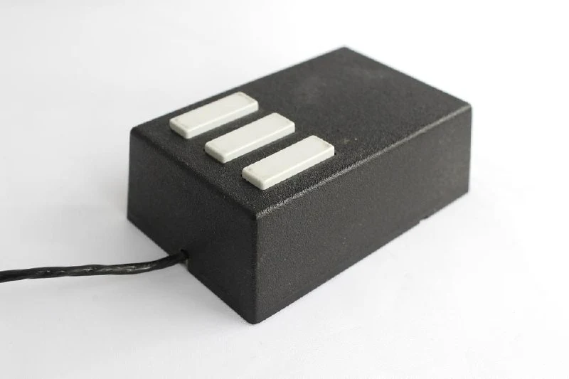
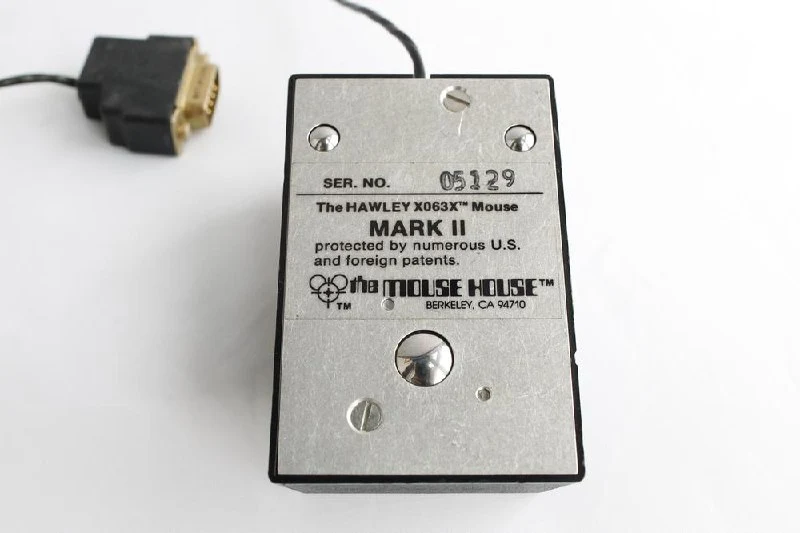
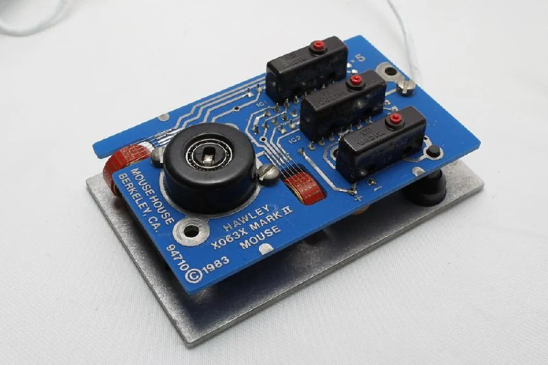
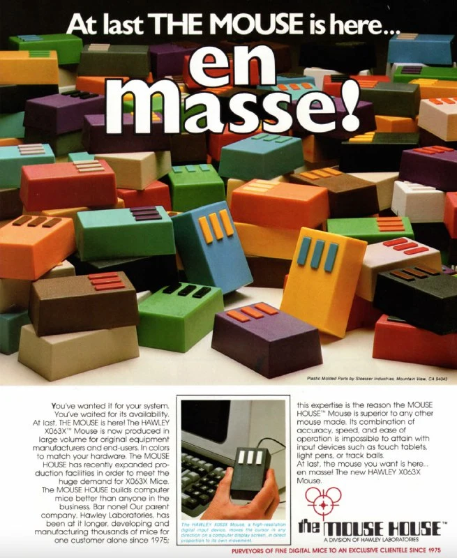

Мышка полностью разработана Джеком Хоули, дизайнером из Xerox и автором нескольких патентов про мышки. 
Механизм позиционирования - раняя версия дискретных энкодеров в виде барабана, которая в следующих моделях будет заменена диском из соображений компактности.

Есть две пары "усиков" - короткая и длинная. Первая быстрее замыкается перемычкой на барабане, когда он движется в одну сторону, вторая - в противоположную. Так мышь узнает, в какую сторону происходит движение.

Чтобы вытащить шарик для чистки, нужно было полностью разобрать мышку, в чем тут была идея - непонятно.

Дизайн с одной стороны был "кирпичным" и ориентирован на инженеров, с другой стороны было много вариаций цветов корпуса и кнопок.
Бонусом [рекламка про распродажу](https://www.microsoft.com/buxtoncollection/a/pdf/Mouse%20House%20MK%20II%20Flyer.pdf) =)

[#mouse](https://t.me/s/old_mice_and_hw?q=%23mouse)
