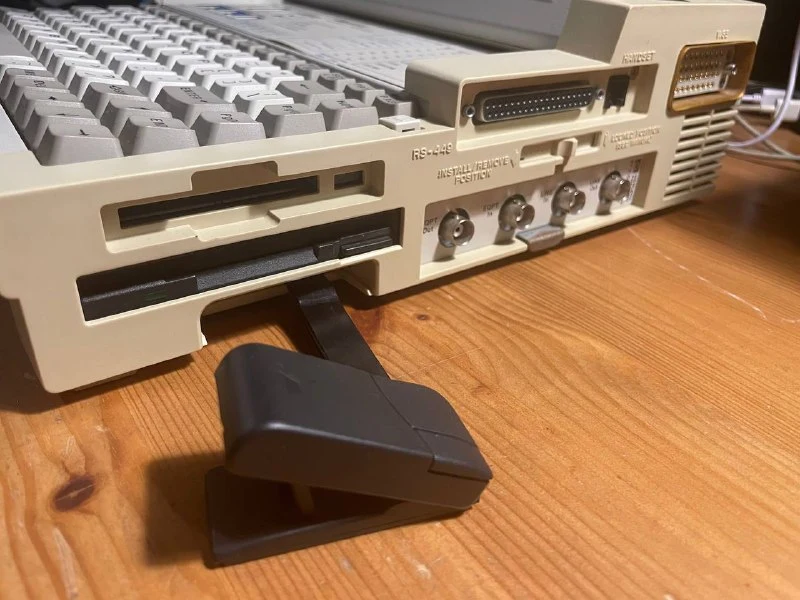
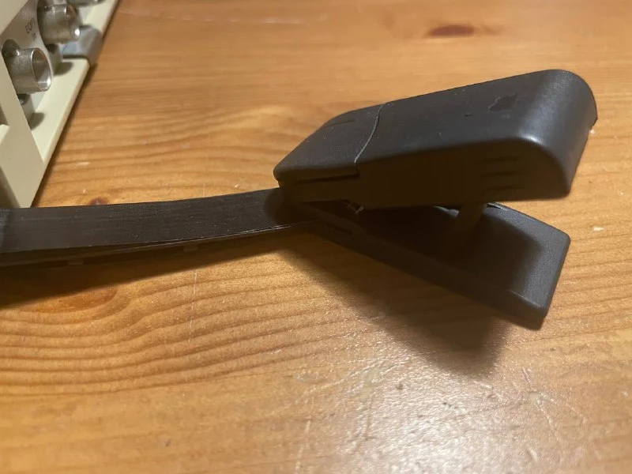
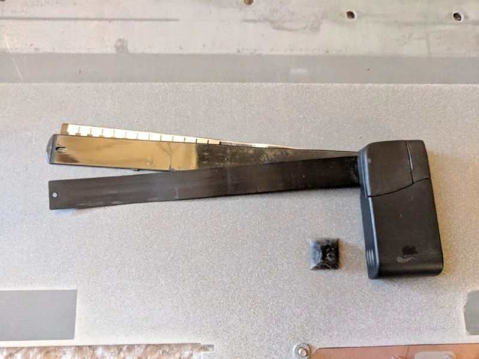
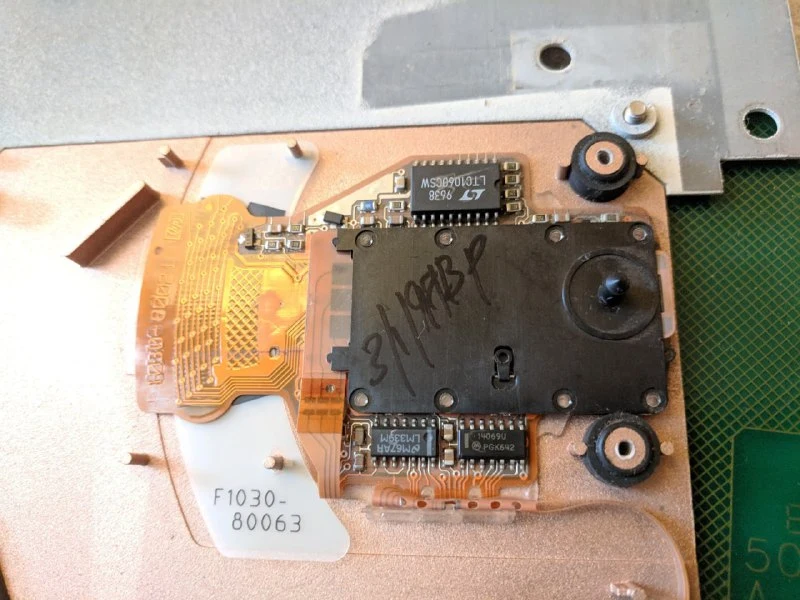
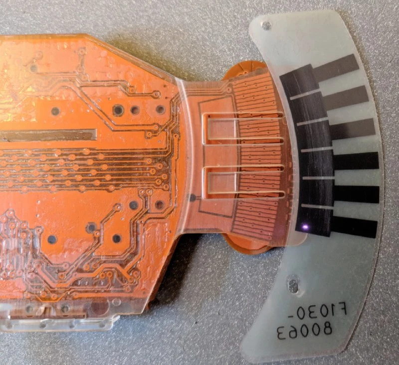
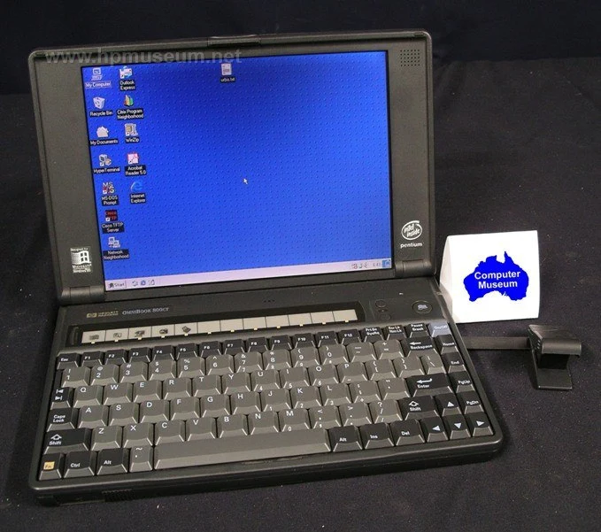

This mouse appeared in 1996 as a built-in part of OmniBook and InternetAdvisor laptops. It popped out when you pressed a dedicated button with an actual mouse drawn on it.

The mouse is connected to the case by a thick plastic strip. There are no electronics, sensors or ball in the mouse itself. One layer of the strip contains three traces for transmitting button presses, but the traces aren't connected to anything: the mouse has no electrical connection to the laptop at all!

Movement and button presses are detected by a board inside the laptop, which reads the movement of the plastic strip. Another layer carries a patterned grid. Decoding works rather like capacitive sensing: the board produces a high-frequency electric field whose characteristics change with the pattern's position.

You can use the mouse freely on any surface, or even in mid-air.

#mouse

