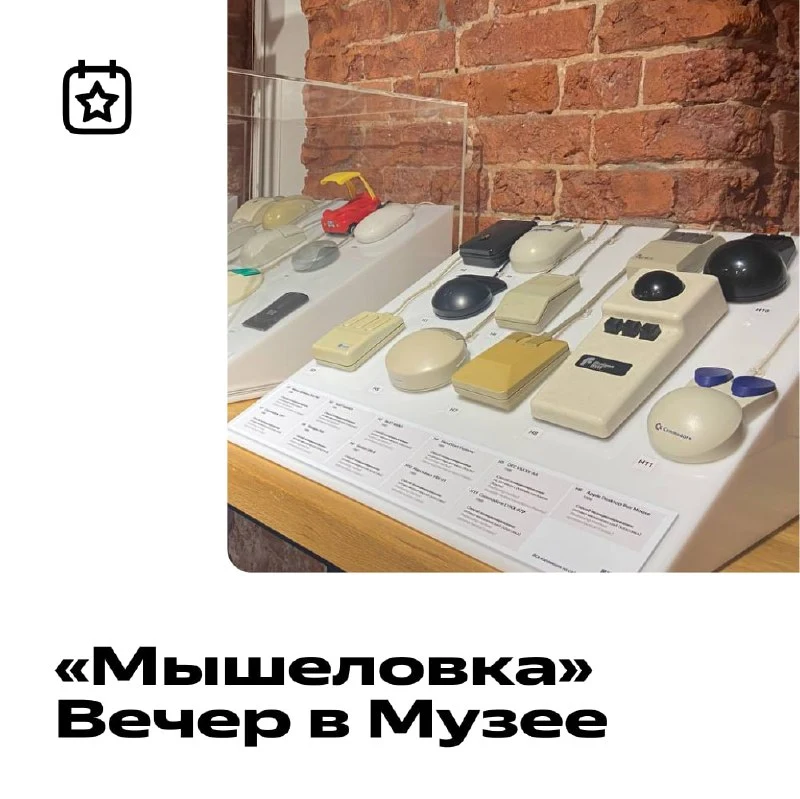

**Вечер в Музее «Мышеловка»: выставка компьютерных мышей и трекболов продолжается!**
Одновременно с выставкой «Мышеловка» 24 июня проведём тематический Вечер в Музее. Наш коллега — коллекционер компьютерных мышек и трекболов Михаил Павлов — расскажет, почему ему интересны именно эти устройства и как он охотится за новыми экземплярами. Начнём в 19:00, [регистрируйтесь и приходите](https://forms.yandex.ru/surveys/13473772.b571e25d117459ff8514c524a4d59d0a94a3fb24/?utm_source=tg&utm_medium=yandexmuseum&utm_campaign=20june&utm_content=post)!

Сама выставка продлится до 12 июля. За десять лет Михаил собрал более 150 мышек и трекболов. Увидеть большинство из них вживую можно в Яндекс Музее на Павелецкой, а познакомиться со всей коллекцией — на [сайте выставки](https://yandex.ru/museum/mouses?utm_source=tg&utm_medium=yandexmuseum&utm_campaign=20june&utm_content=post).

***▫️***Москва, БЦ «Аврора», ул. Садовническая, 82с2
