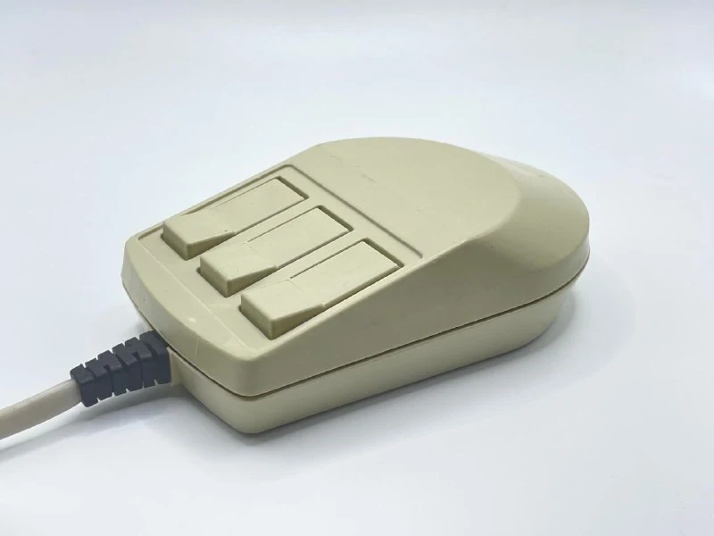
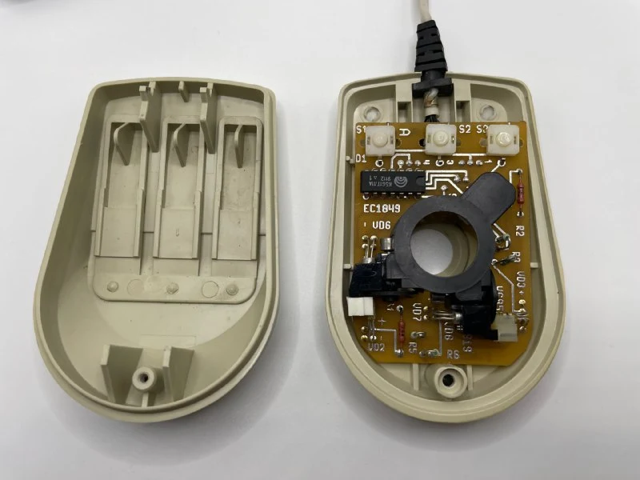
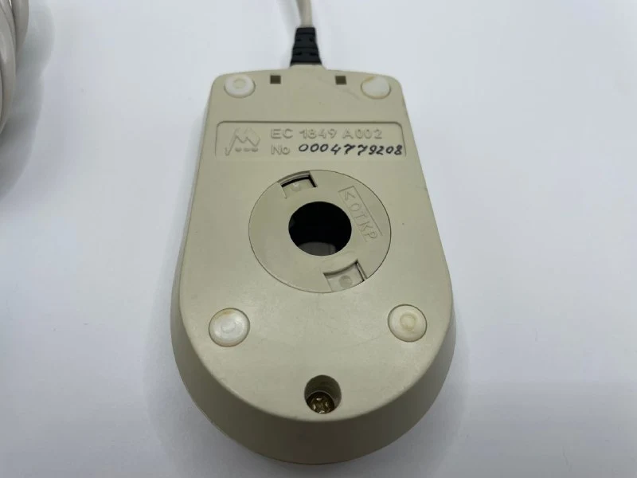
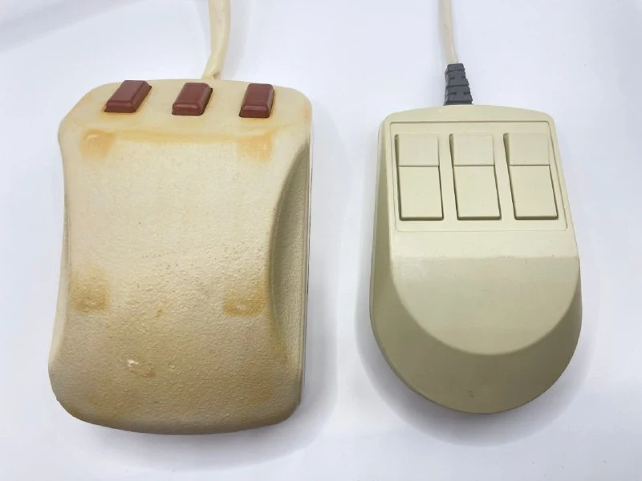

Довольно редкая мышь Минского завода ЭВМ. Не нашел в сети никаких упоминаний того, что к 1849 были какие-то варианты манипуляторов.

Схемотехника аналогична [ЕС 1841](https://collectionerus.ru/collections/old-mice/8/).
По корпусу - прогресс, конечно, но на ощупь и внутри очень хрупкая, все дребежжит, ничего не закреплено.

[#mouse](https://t.me/s/old_mice_and_hw?q=%23mouse)

