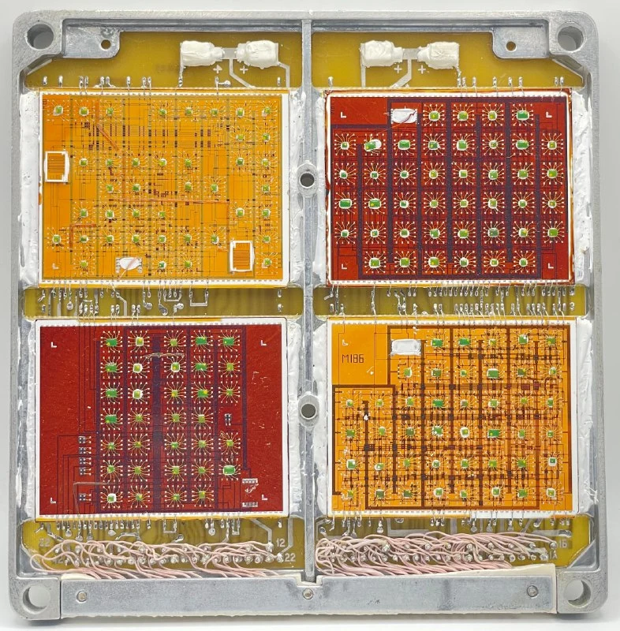
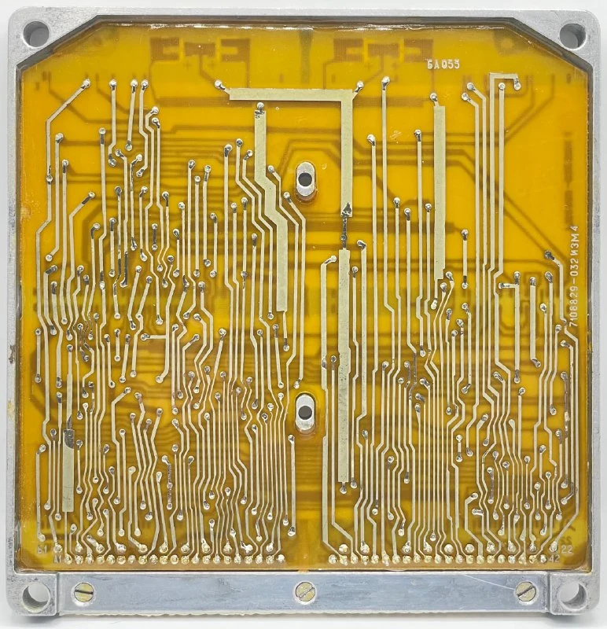
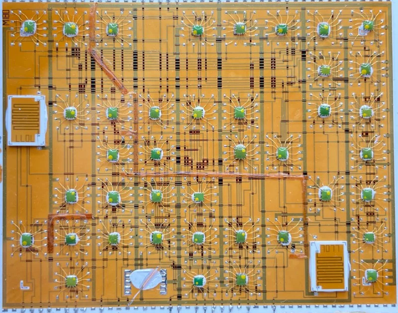

Плата/модуль от бортовой цифровой вычислительной машины (БЦВМ) предположительно от серии Салют-2М или более старших версий. Примерно 70-е годы.

Элементы - большие бескорпусные микросхемы.

[#hw](https://t.me/s/old_mice_and_hw?q=%23hw)

