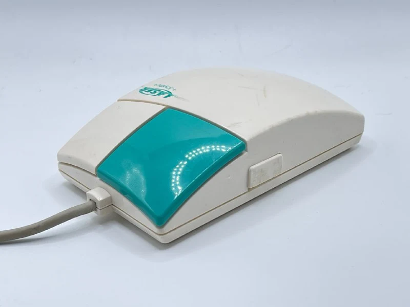
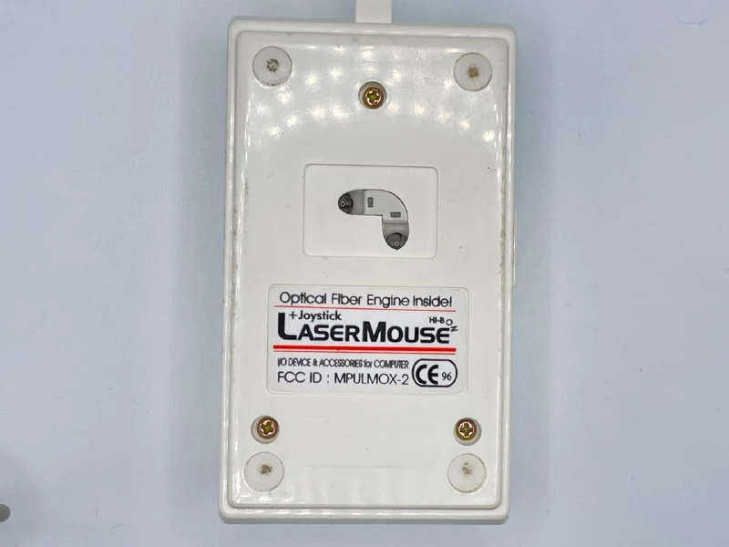
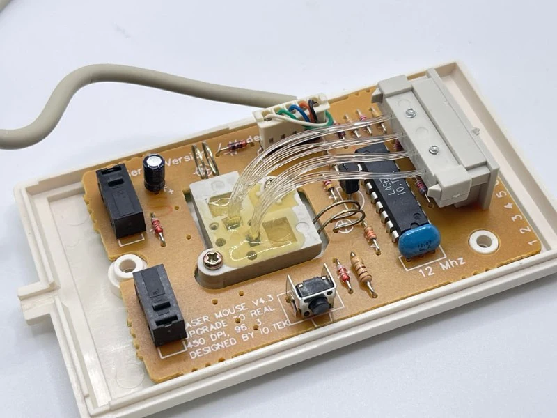
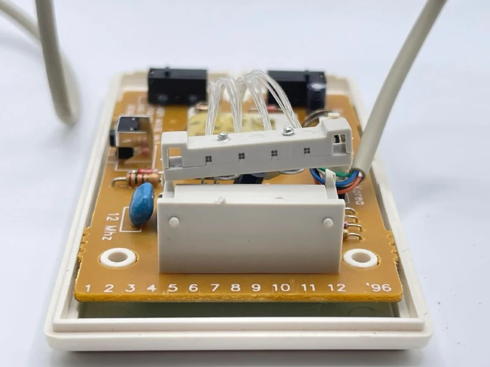

This mouse uses infrared light carried to and from the surface by light guides. Eight guides per axis provided a then-revolutionary 450 dpi.

It needs a special pad with dark dots that reflect less light.

The mouse had three operating modes:

- Standard mouse mode.
- Pressing the side and left buttons enabled joystick mode: a small movement in one direction made the cursor keep moving that way.
- Pressing the side and right buttons enabled artist mode: particularly precise positioning for drawing pixel by pixel.

Its own RISC processor handles these modes without drivers or special software.

Because of the sensor layout and pad pattern, the pad had to be aligned horizontally or vertically. Turn it 45 degrees and the mouse practically stopped working.

P.S. The same year, LEGO released its legendary [Space Shuttle](https://www.bricklink.com/v2/catalog/catalogitem.page?S=8480-1#T=S&O=%7B%22iconly%22:0%7D), with lighting based on light guides.

#mouse
