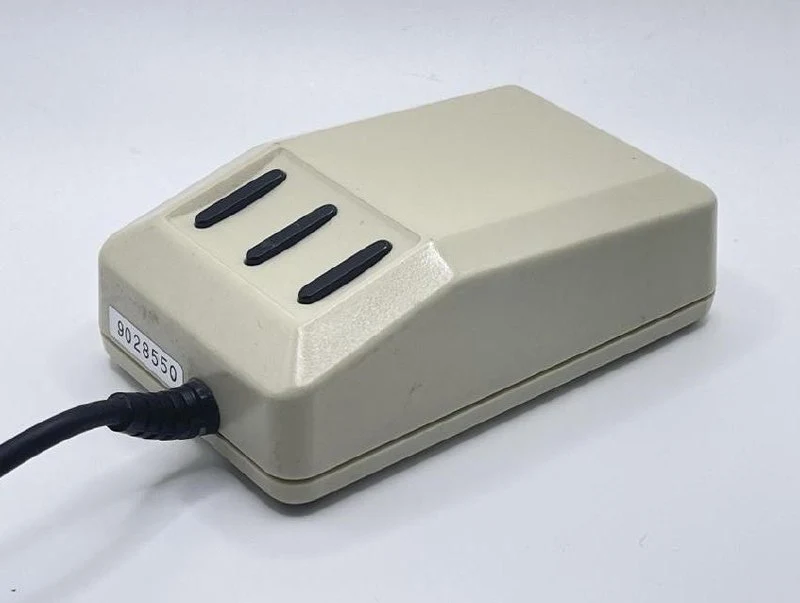
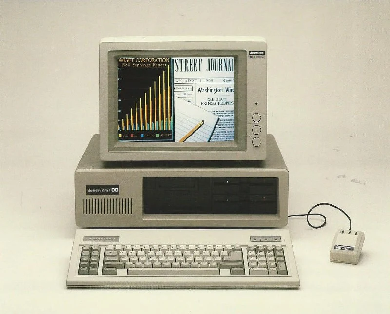
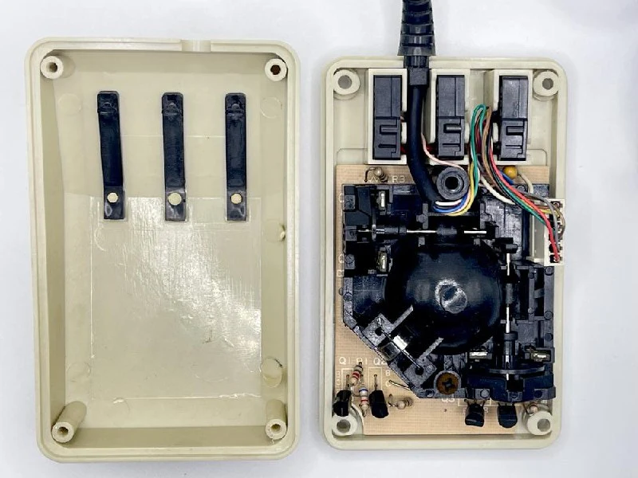
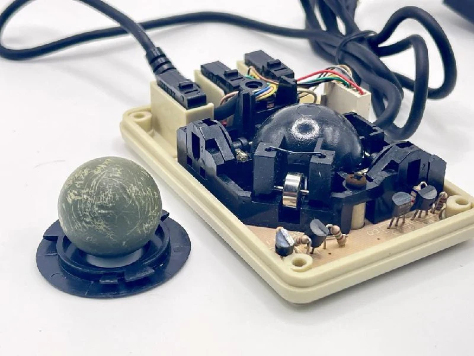

Ехала ко мне больше года по маршруту Египет-Германия-Казахстан-РФ.

В 1980-х годах компания American Computer & Peripheral, выпускала клоны IBM XT и IBM PC c разнообразными твиками и расширениями. В частности на все компьютеры предустанавливалась программа Compu-Brush, которая представляла упрощенный графический редактор для подготовки изображений главным образом для презентаций.

Для этого требовалась мышь и компания разработала свою версию с необычными узкими кнопками (есть гипотеза, куда они смотрели, но об этом в следующих сериях).

Внутри все примерно обычное, только шарик из чего-то непонятного не очень хорошего качества - выглядит довольно убитым. 
Ну и из-за огромных кнопок не получилось пустить провод по центру корпуса.

Компания просуществовала всего 5 лет, а такой дизайн кнопок не получил развития. 
[#mouse](https://t.me/s/old_mice_and_hw?q=%23mouse)
