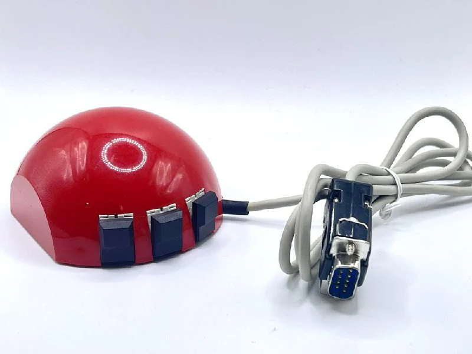
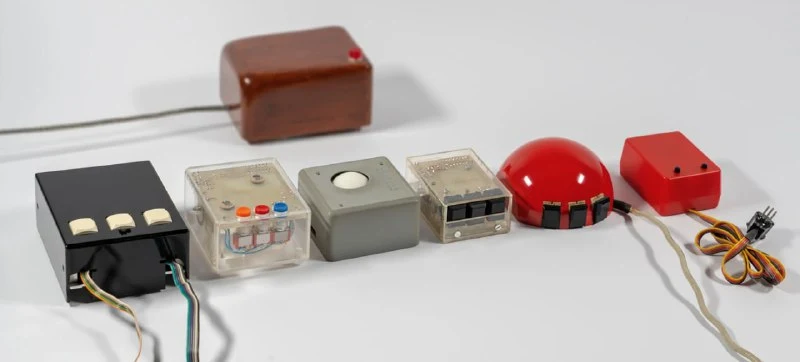
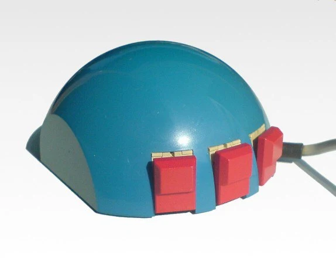
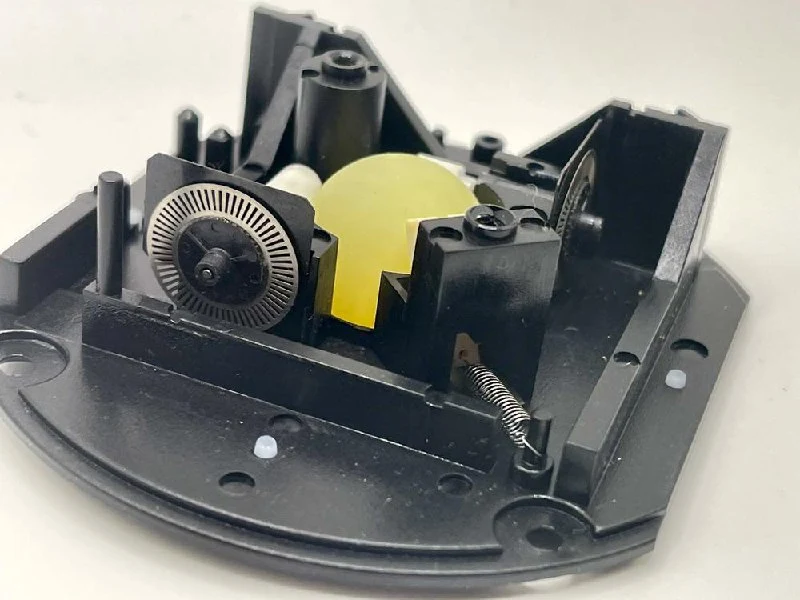
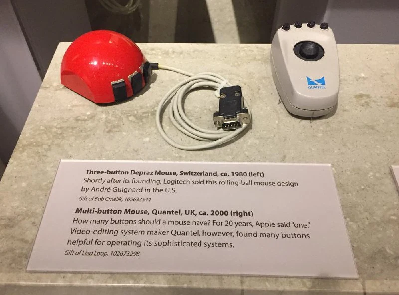

Probably one of the best-known and most iconic truly old mice.

Its greatest interest, though, is that the story of its creation traces the transition from Douglas Engelbart's wooden model to the mass-produced mouse mechanisms we came to know.

Our two protagonists:

[Jean-Daniel Nicoud](https://en.wikipedia.org/wiki/Jean-Daniel_Nicoud), a computer engineer and head of the Microcomputing Laboratory at the Institute of Technology in Lausanne.

[André Guignard](https://en.wikipedia.org/wiki/Andr%C3%A9_Guignard), a Swiss engineer with a watchmaking background, worked in the same laboratory. Judging by his inventions, we would probably call him a robotics engineer today.

After Engelbart demonstrated his prototype in 1968 ([the story of how the mouse appeared](https://habr.com/ru/companies/yandex/articles/746754/)), Nicoud obtained the drawings and became enthusiastic about improving it.

A prototype with optomechanical encoders appeared in 1973, greatly improving the original potentiometer-based mechanism proposed by Engelbart. You no longer had to lift the mouse and bring it back when a potentiometer reached its limit.

The laboratory team later worked on replacing the wheels with a ball. Over several years they built a number of mechanical prototypes, but with students and postgraduate researchers doing the work, industrial manufacturing quality was out of the question. See photo 2.

In 1977, [Niklaus Wirth](https://en.wikipedia.org/wiki/Niklaus_Wirth) — yes, that one — visited Nicoud and asked him to make a proper mouse for Xerox.

Guignard entered the picture and designed, for money, the internal mechanism we would see for many years, along with the domed case.

Manufacturing rights went to Dubois Depraz SA, a company established in 1901 making watches and related mechanisms, apparently on Guignard's recommendation. The details are unknown, but it seems Depraz undertook manufacturing and sales while the laboratory received a percentage.

(Continued in the comments.)
