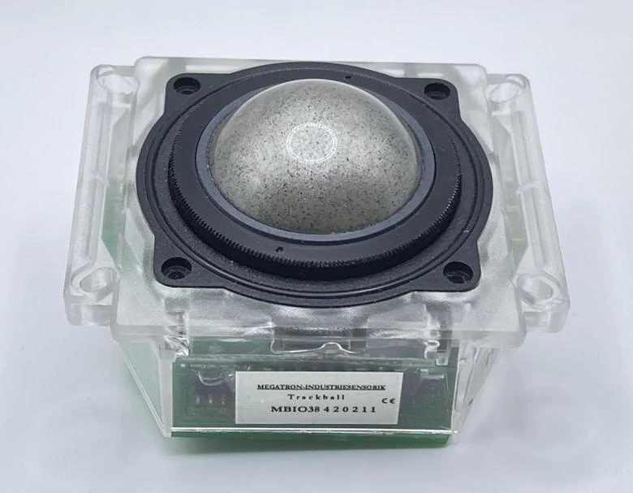
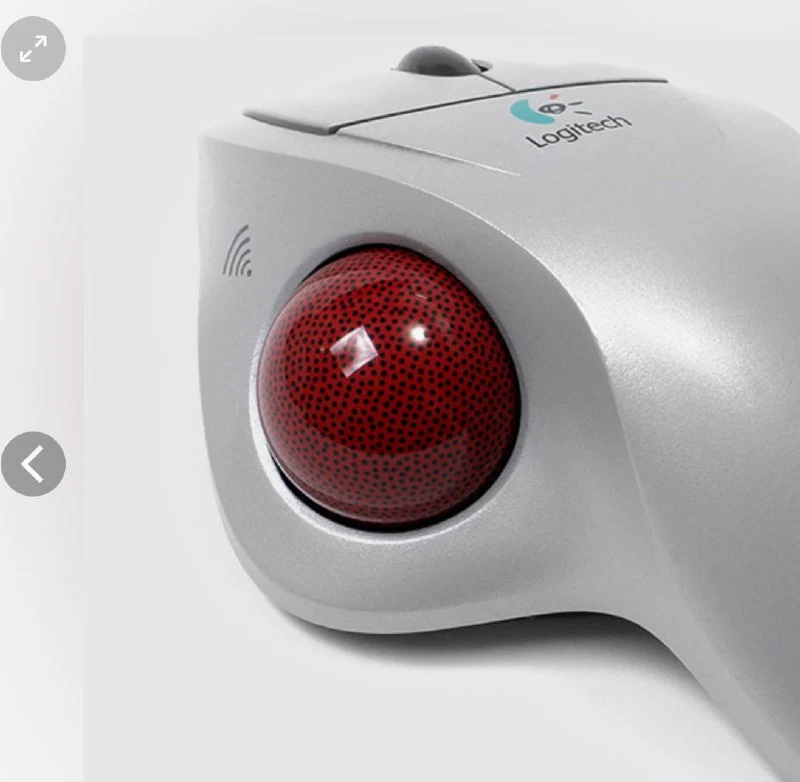

Современные трекболы тоже используют оптические датчики. Но если датчики мышек смотрят на фото поверхности, по которой ездят, то у трекболов такой поверхности нет. 
Поверхностью служит сам шарик, поэтому в ранних моделях шарик делали с "рисунком". Особенно хорошо видно на красных шарах старых Logitech.

У меня есть встраиваемый [трекбол компании Megatron](https://collectionerus.ru/collections/old-mice/160/), в котором рисунок шарика такой, что непосвященный человек воспримет как "собрали что-то из мусора". При этом сам шарик еще покрыт прозрачным пластиком.

[#trackball](https://t.me/s/old_mice_and_hw?q=%23trackball)
