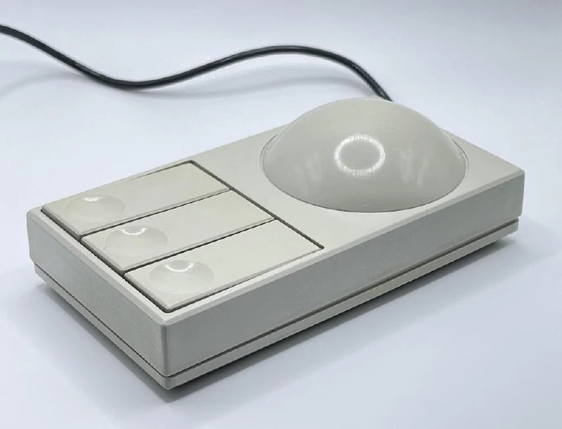
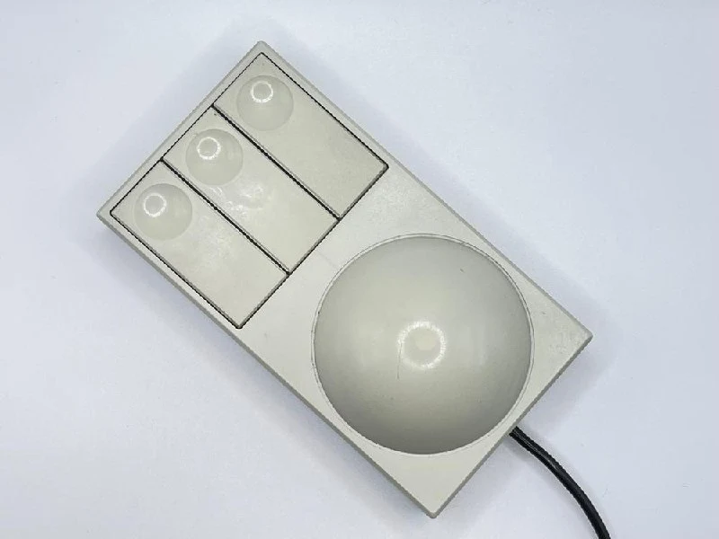
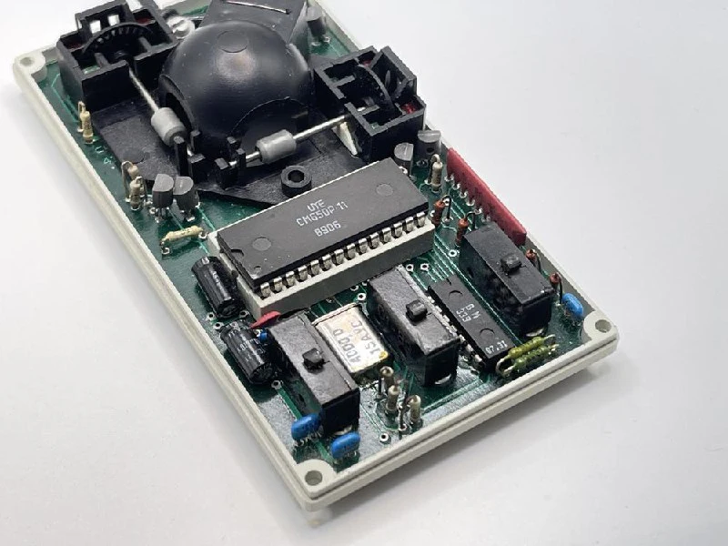
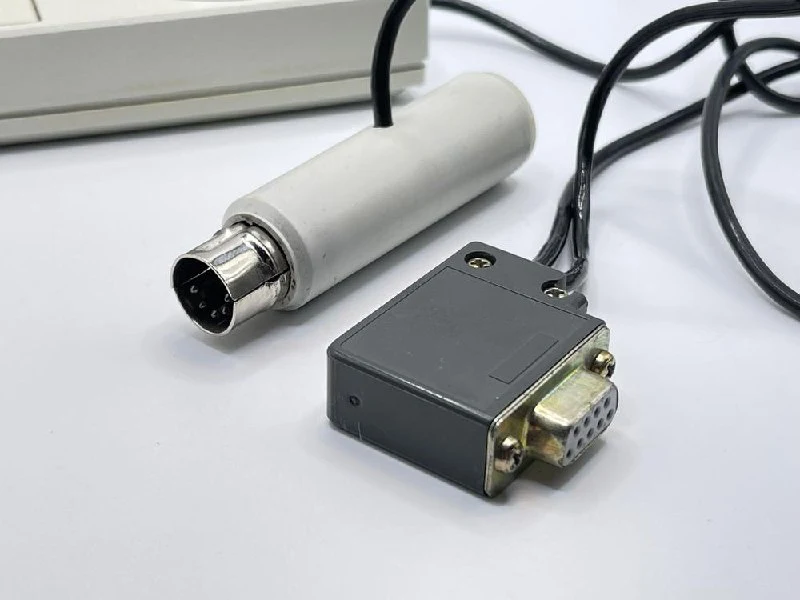
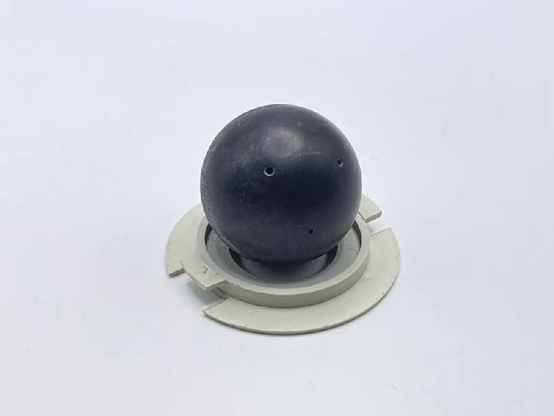
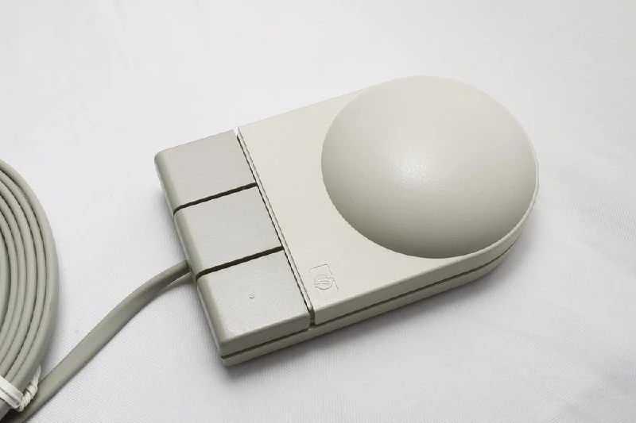

The MAN-88 graphics input device.

The first, and probably only, Bulgarian mouse. Information is hard to find, partly because the Bulgarian word for a mouse is “mishka”. It was made in 1988 at the Control Panels and Keyboards factory in Gabrovo, part of the Mechatronika group.

It looks very much as though they were inspired by [HP mice](https://collectionerus.ru/collections/old-mice/12/), although the result was rather square.

The mouse could operate in two modes, impersonating either a Mouse Systems mouse or a Microsoft mouse. To switch modes, you held the middle button for a few seconds while powering it up.

It needed a separate power supply, taken from the keyboard through an inline connector.

The ball is rather poor quality, with mysterious manufacturing holes, but at least it is no longer bare metal.

The box even highlights a key specification: maximum speed, 20 cm/s. Have you ever measured how fast you move your mouse? =)
