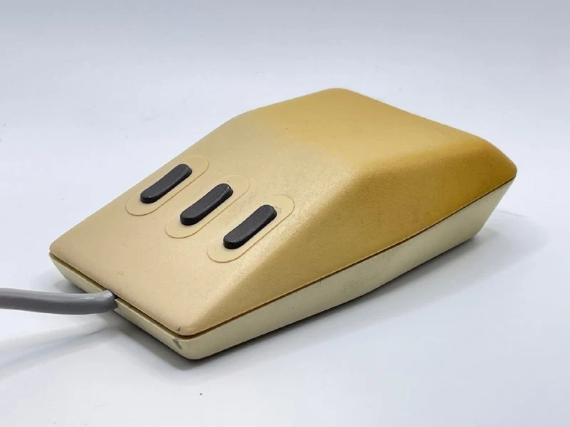
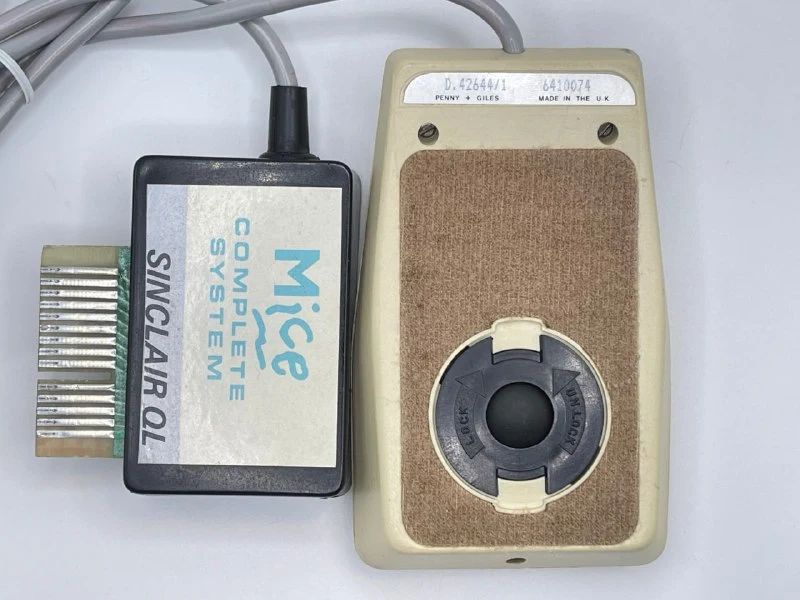
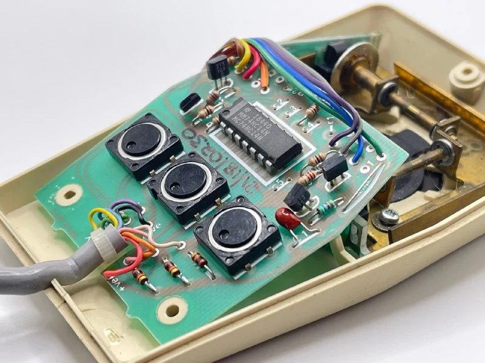
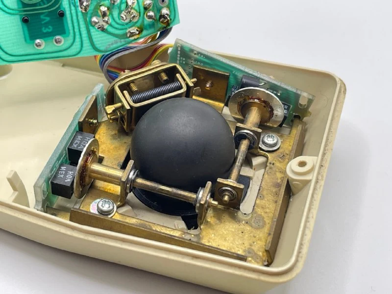
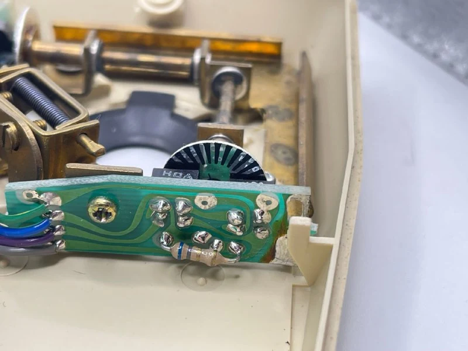

P&G в основном специализировалась на оборудовании для военки и OEM. 
При этом в отличие от тех же Logitech/Depraz/Mouse Systems они никаких следов про себя ни внутри, ни снаружи не оставляют. 
Поэтому понять, например, что вот [этот трекбол](https://collectionerus.ru/collections/old-mice/143/) для Apricot сделали они же, без раскопок истории довольно сложно.

В этой мышке можно выделить примерно все. 
**Форма**, не похожая ни на что. 
**Кнопки** в форме качельки для удобства пальцев. Нажать можно как в середину, так и на любой из краев, кнопка сработает. 
Что-то вроде тканевой вставки для удобства скольжения. Представляю, как сложно ее было чистить.

**Механика** брутальная: каркас из толстого листа латуни, местами согнутого для креплений плат и роликов. 
Особая консутрукция энкодеров: свет проходит не сковозь диск, как обычно, а отражается от зеркального диска и попадает на фотоприемник. За счет нанесенных краской черных полосок обеспечивается прерывание.

Единственное известное применение - вместе с [компьютером Acorn 500](https://chrisacorns.computinghistory.org.uk/Computers/A500.html?cfch-archive=orig), который никогда не продавался, а использовался только внутри компании для разработки софта, и формально не вышел из стадии прототипа. 
Из этих же данных и появилось название модели **M3/100**, хотя нигде на мышке этих данных нет. На корпусе есть что-то страшное D.42644/1, не очень подходящее под коммерческое название

При этом моя версия имеет переделанный интерфейс для компьютера [Sinclair QL](https://ru.wikipedia.org/wiki/Sinclair_QL). Похоже это сделано уже после компанией Mice Complete System, которая разрабатывала и продавала коннекторы/переходники на Sinclair (при этом мышь вставлялся непосредственно в расширитель памяти, писал прямо в мозг). 
Сделано весьма добротно.

