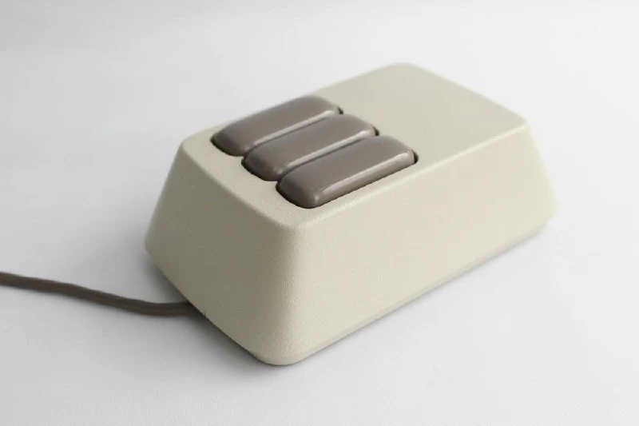
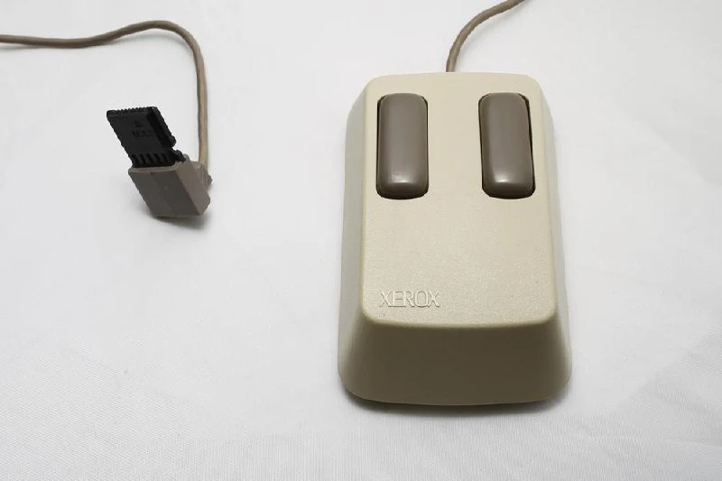
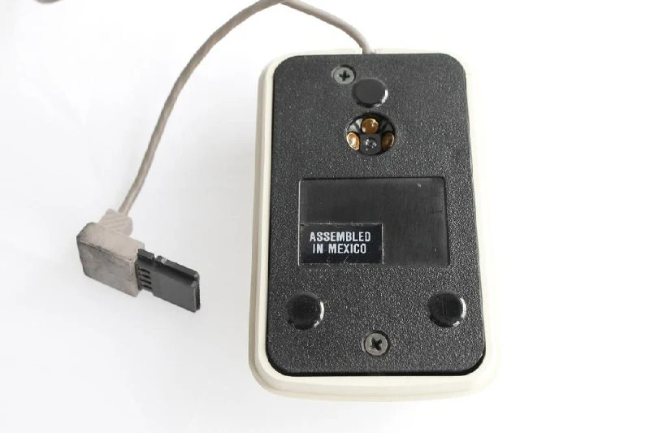

The first mouse sold with a commercial computer: 1981, and optical, by the way. There are [two-button](https://collectionerus.ru/collections/old-mice/1/) and [three-button](https://collectionerus.ru/collections/old-mice/102/) versions. More about the computer [in English](https://www.howtogeek.com/769913/the-computer-folder-is-40-how-the-xerox-star-created-the-desktop/) and [in Russian](https://habr.com/ru/companies/ua-hosting/articles/678694/).

#mouse

