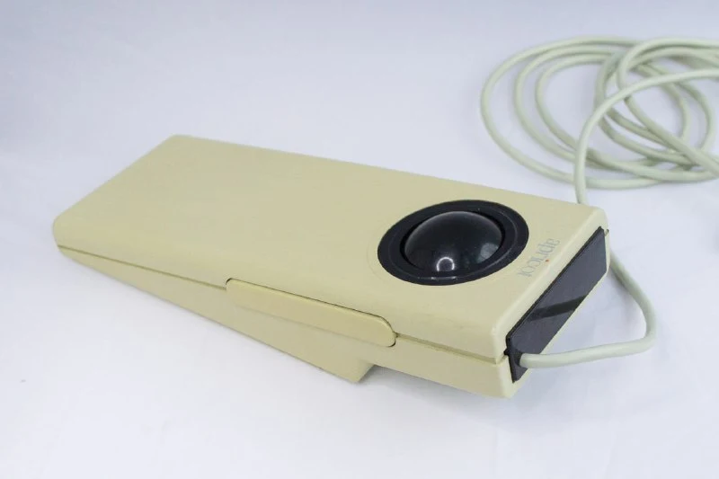
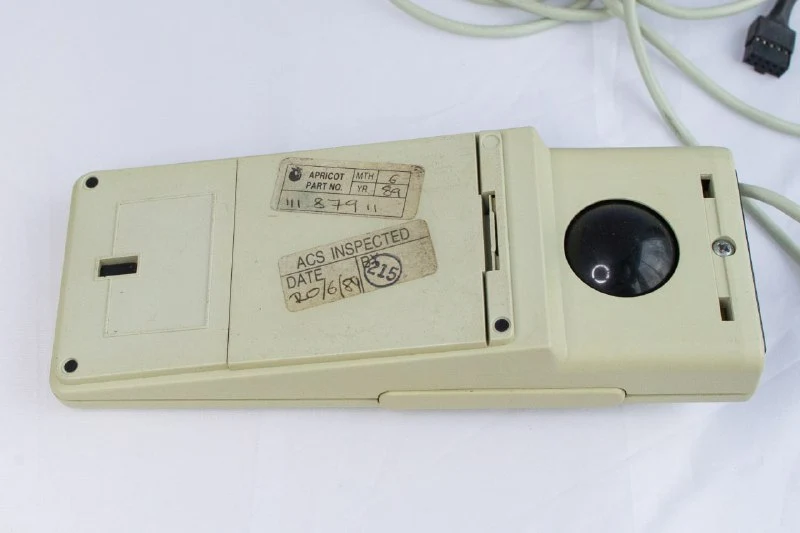
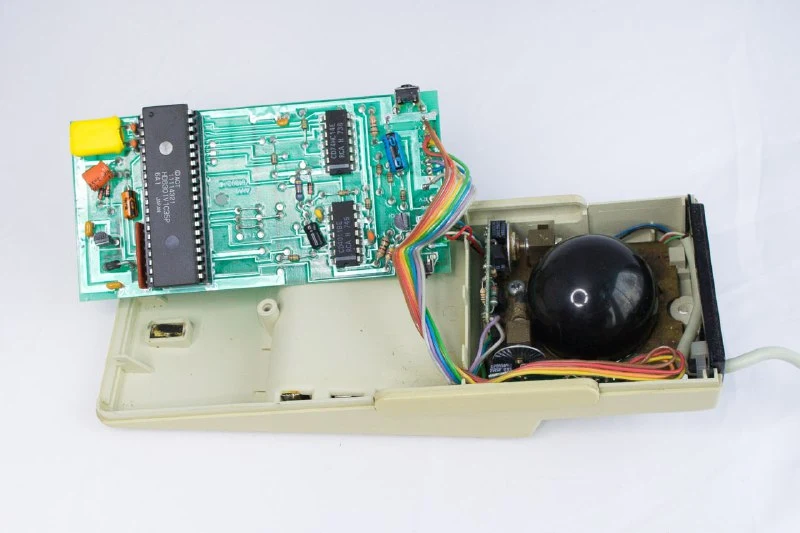
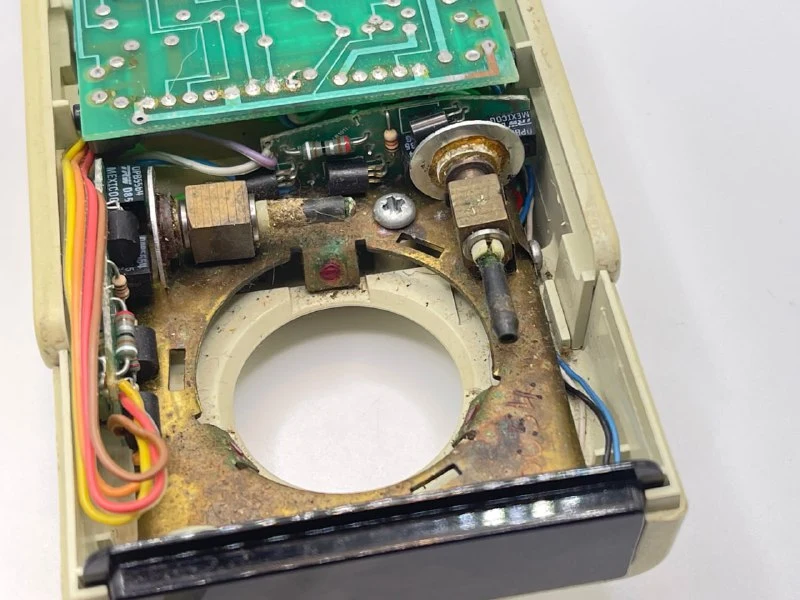
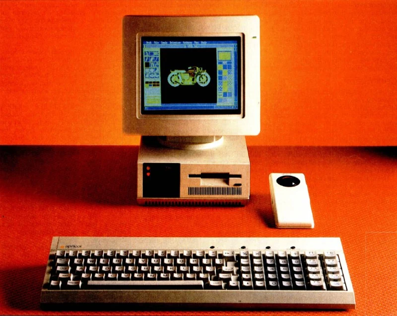

Продолжаем раскапывать P&G. 1984 год. 
- первый беспроводной трекбол
- первый комбо трекбол-мышь
- первый трекбол специально для портативных устройств - для [Apricot Portable](https://www.computinghistory.org.uk/det/2143/Apricot-Portable/)

Выпускали варианта с разными интефейсами, вплоть до PS/2, и модификациями передней панели в виде калькулятора или дополнительной клавиатуры.
У меня не самая старая и не самая навороченная версия.

Организация механики и сенсоров очень похожа на другие P&G-мыши (см. пост выше) 
Длинные кнопки сбоку позволяют использовать трекбол как мышь, двигая всю конструкцию по столу. Кроме того, был еще третий способ: вращать шарик двумя пальцами - один сверху, другой снизу для очень точного позиционирования. 
Несмотря на задумку, в публикациях его продавали в основном как трекбол.

Беспроводная версия уже тогда предусматривала специальный режим совместимости для "двух трекболов в комнате", чем даже сейчас не могут похвастаться некоторые телевизоры.

ЗЫ. Как думаете, картинка реальная или сгенерированная?

