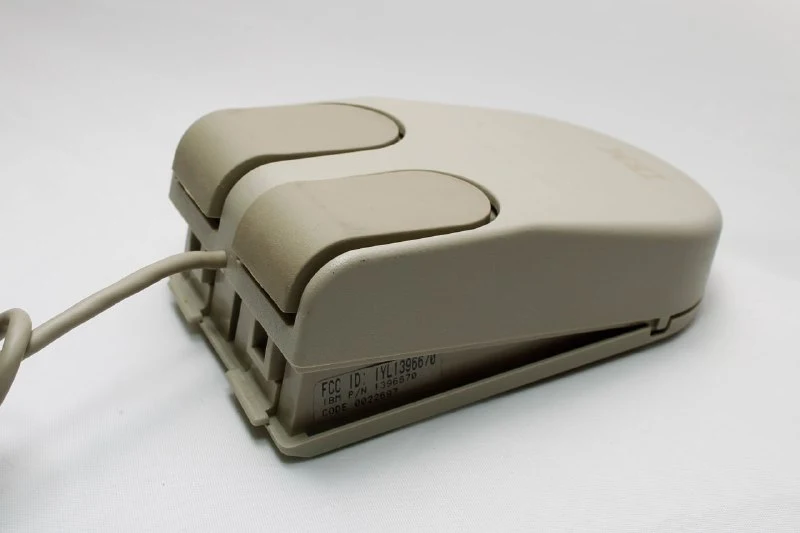
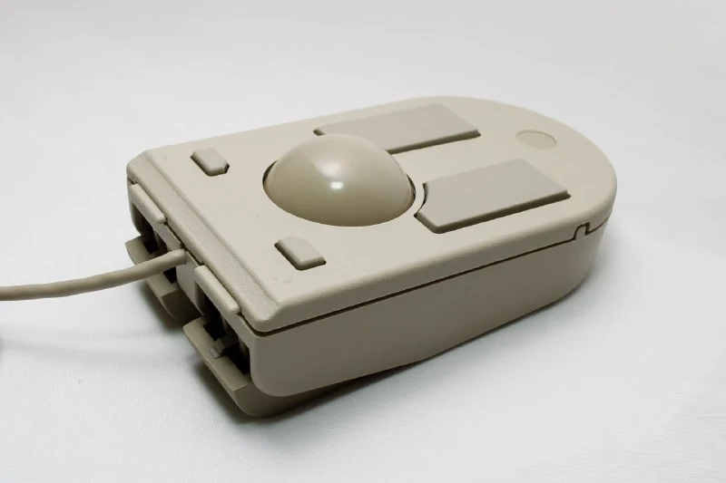
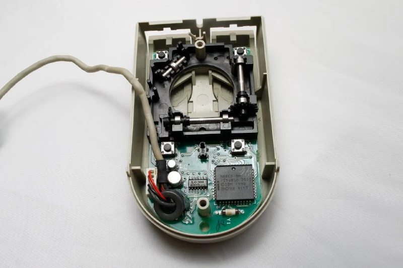
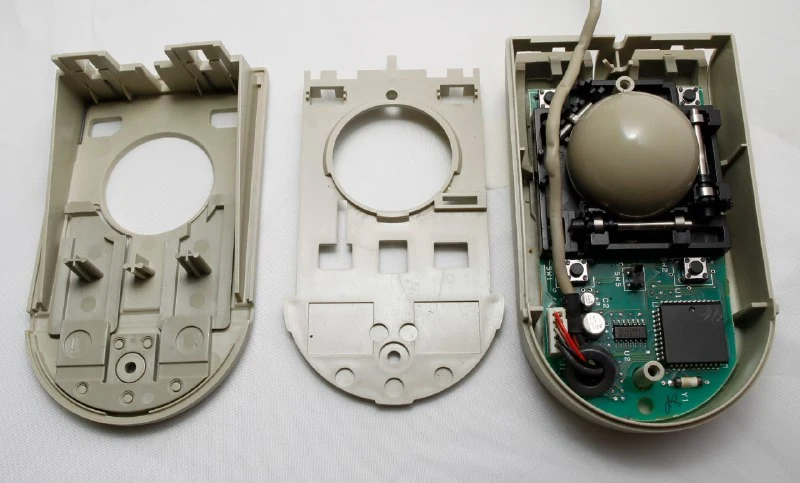

Еще один комбо-девайс, но более продуманный и компактный. 
Анонсирован в 1991 году вместе с ноутбуком IBM [PS/2 L40 SX](https://en.wikipedia.org/wiki/IBM_PS/2_Model_L40_SX) (и [на Хабре был).](https://habr.com/ru/articles/135617/) Идея та же: на столе используем как мышку, если стола нет - трекбол. Часто встречаюсь с тем, что в рекламе того времени "стола нет" именно в самолете. С другой стороны, попробуй сейчас без внешней мышки и встроенного трекпада что-то на ноуте поделать - быстро надоест =)
При этом в самом L40 был трекпоинт (пипка посередине клавиатуры), сам по себе довольно удобный.

Конструкция построена на защелках и гибкости пластика в некоторых тонких местах -  часто переключать режимы довольно стремно. Тут я пытался описать словами как это работают, но понял, что нужен видос. 
Кнопки мыши покрыты резиной и в состоянии трекбола они не дают скользить.

Внутри классическая опто-механика и микроконтроллер Intel N80C51BH. Переключатель посередине платы указывает на используемый режим, и он же определяет какую из пар кнопок сейчас используют для управления.

Через софт можно было настраивать чувствительность вертикального и горизонтального энкодера независимо. Никогда не думал, что такое кому-то нужно. Для узких экранов, возможно.

Несмотря на то, что девайс называется "Trackpoint", лого IBM расположено на "мышином" режиме. На обеих сторонах смотрелось бы логично.
