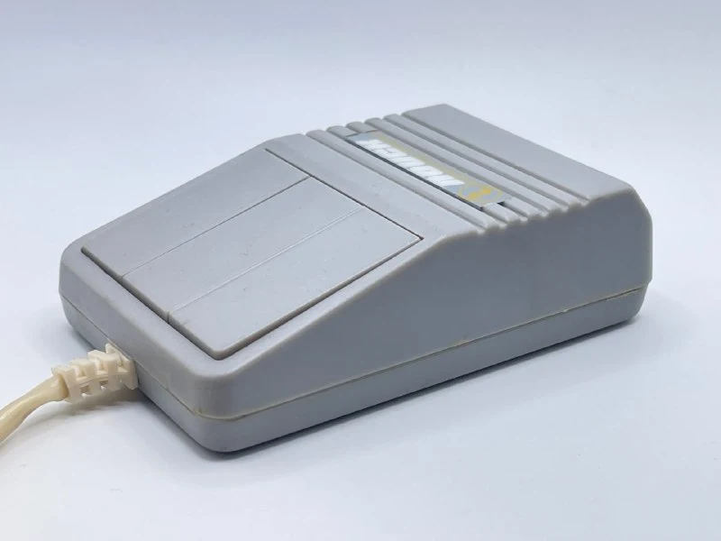
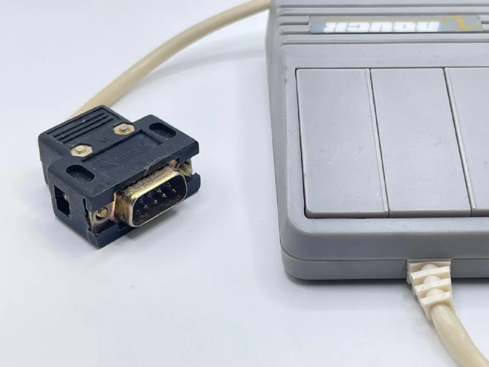
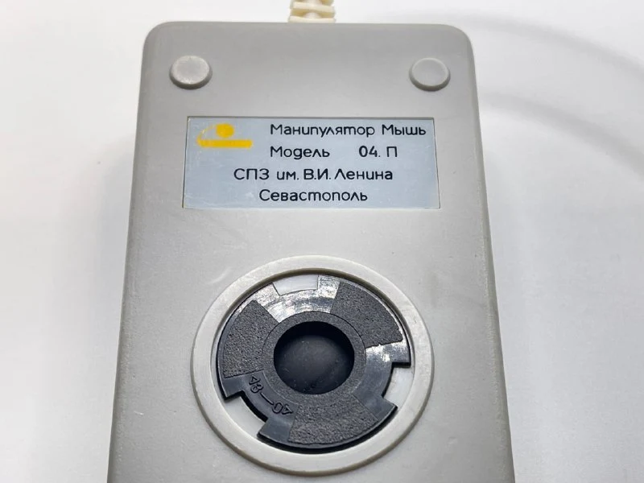
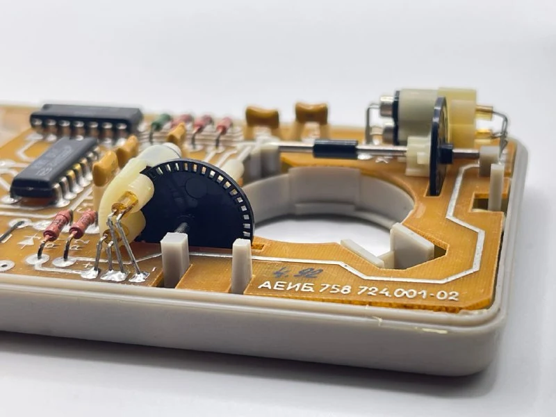
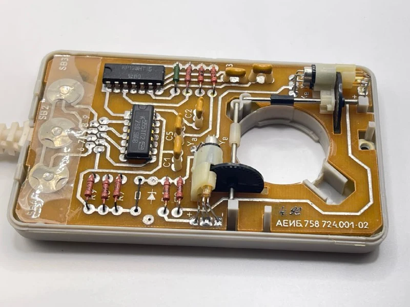

An extremely rare mouse. Even among fans of the [Poisk computer](https://ru.wikipedia.org/wiki/%D0%9F%D0%BE%D0%B8%D1%81%D0%BA_(%D0%BA%D0%BE%D0%BC%D0%BF%D1%8C%D1%8E%D1%82%D0%B5%D1%80)), few know a branded mouse existed for it.

It was made by the now-defunct Parus instrument-making plant in Sevastopol. Its 1990s range was typical for such enterprises: computers for military satellites, submarine control software, sewing machines, clockwork toys and ZX Spectrum clones. In this case, the [Parus home gaming computer](https://habr.com/ru/articles/767388/).

The computer's documentation didn't provide for a mouse, so there was presumably some collaboration with Kyiv's [Elektronmash](https://ru.wikipedia.org/wiki/%D0%AD%D0%BB%D0%B5%D0%BA%D1%82%D1%80%D0%BE%D0%BD%D0%BC%D0%B0%D1%88).

Inside, everything uses the cheapest possible components, especially the buttons. They are even worse than those in the [ES 1849 mouse](https://collectionerus.ru/collections/old-mice/158/). Although this example came from storage, its right button is almost dead.

