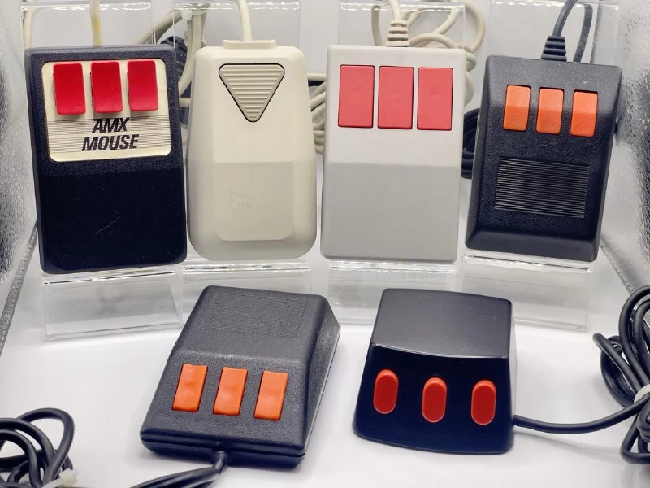
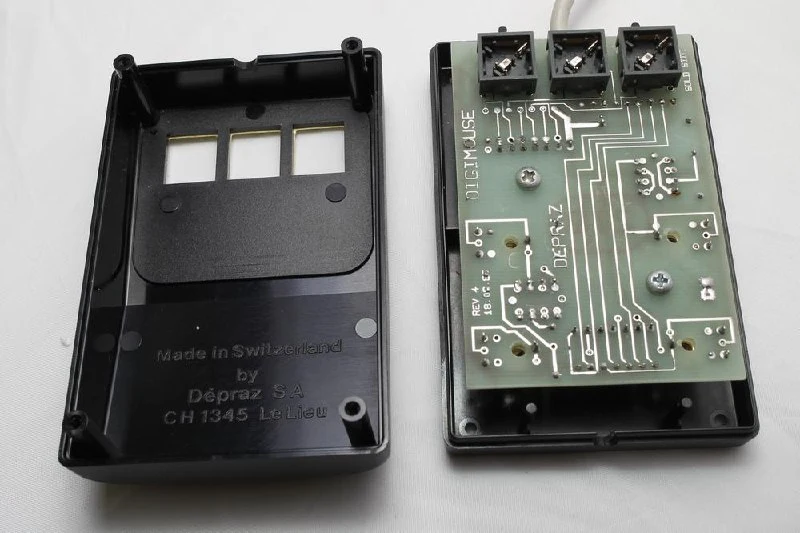
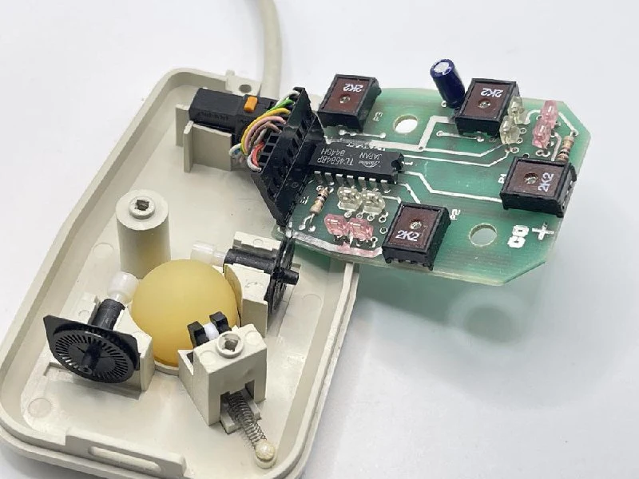
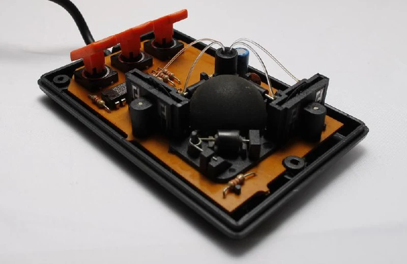
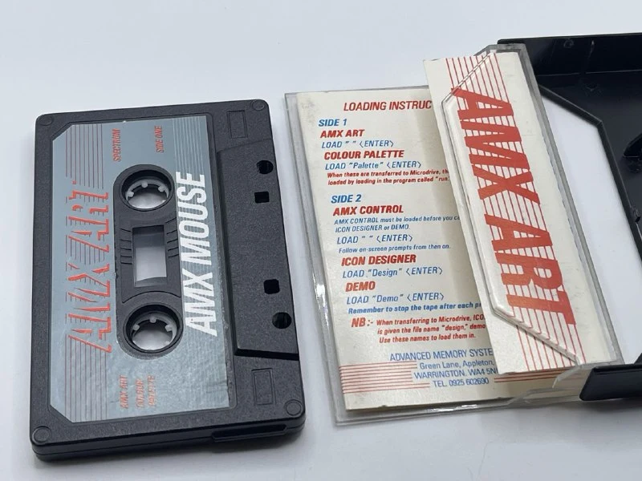
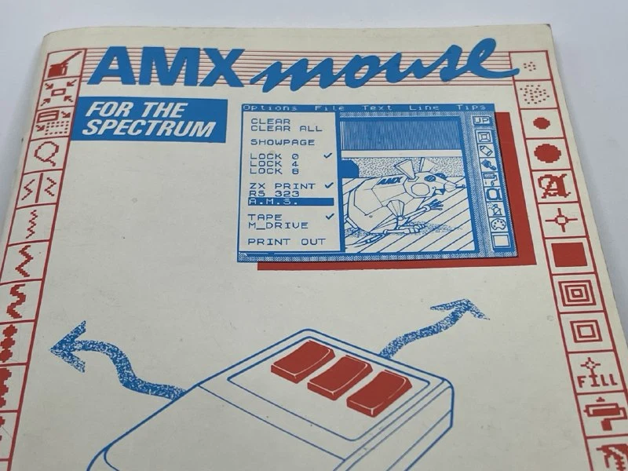
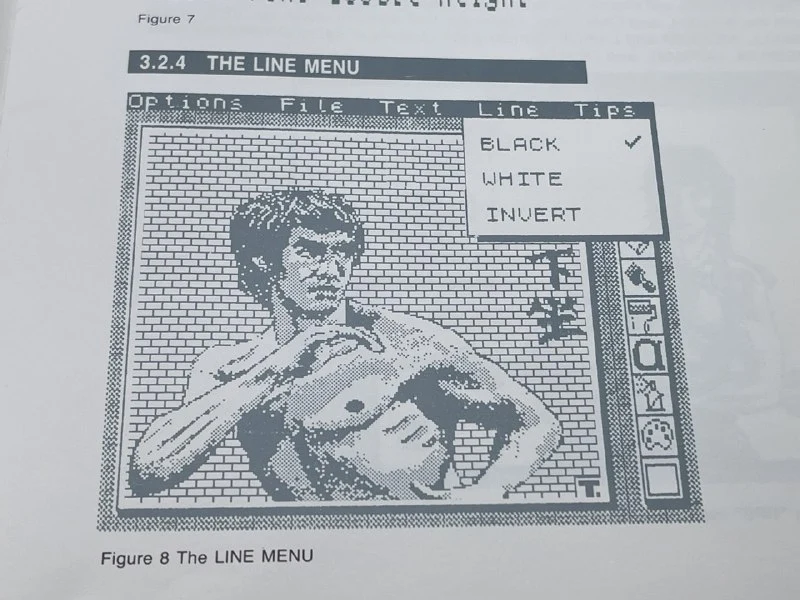

В начале 1980-х годов в Великобритании компания Acorn Computers совместно с BBC представила учебный компьютер BBC Micro, который стал ключевым элементом государственной программы по компьютерной грамотности. BBC Micro был хорошо и быстро занял центральное место в британских школах, попутно став популярным и среди домашних пользователей. Однако развитие интерфейсов оставалось вызовом: клавиатура, хоть и привычная, далеко не всегда подходила для работы с графикой и приложениями нового поколения.

К 1984 году на рынок начали поступать устройства, ориентированные на более интуитивное взаимодействие, среди которых особое место заняла мышь AMX, выпущенная британской компанией Advanced Memory Systems (AMS). В отличие от дорогих моделей, вроде мышей Logitech или Microsoft, AMX Mouse позиционировалась как доступное решение для массового сегмента. Она предлагалась за £69.95 — сумма, хоть и значительная для того времени, но всё же более приемлемая для домашнего пользователя. При этом устройство поставлялось в комплекте с программным обеспечением, включающим графический редактор AMX Art(первый photoshop), утилиту AMX Control для программирования мыши(что-то вроде SDK), а также инструменты для работы с цветом и создания интерфейсов.

AMX Mouse выделялась своим дизайном. Простая и функциональная форма с тремя оранжевыми кнопками обеспечивала удобство использования. Эти кнопки предлагали больше возможностей для управления, чем стандартные двухкнопочные аналоги. Мышь продавалась в яркой коробке с инструкцией, кассетой с ПО и преобразователем портов.

Часть моделей произвела швейцарская [Depraz](https://t.me/old_mice_and_hw/54), на платах некоторых мышей даже копирайт есть, а также используется узнаваемый легкий каучуковый шарик и характерная конструкция, когда механика располагается на днище, а плата с энкодерами надевается сверху.

Есть и экзотические конструкции, например в одной из моделей свет от светодиодов идет по четырем световодам ([почти как в Laser](https://t.me/old_mice_and_hw/45)) и попадает в непонятный элемент всего с двумя выводами, типа фоторезистора. Как это работает я пока не разобрался.

Мышки AMX - пример хорошего позиционирования и упаковки продукта через ценность для пользователя

